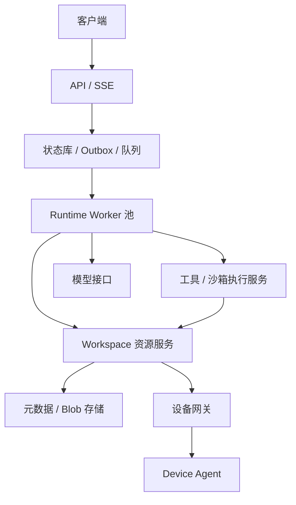

# 云端目标架构代码拆分计划

日期：2026-11-18。分析基线：v0.5.0；实施进展：v0.5.1 第一阶段拆分。第 2 节保留拆分前问题，第 10 节列出实际完成项；其余目标服务不代表已经实现。

## 1. 分析结论

当前项目不是所有代码都在一个文件或 Python 模块中：已有 api、application、tasks、runtime、scheduling、workspace、tools、model_provider、storage、domain 等目录。准确说法是：**一个 Python 分发包、一个部署进程、共享 SQLite Store 的模块化单体，模块边界尚未真正独立。**

目标采用原云端设计中的“Device Agent + 云端 API + Runtime Worker 池 + 工具/沙箱执行资源 + Workspace 服务”。不立即拆成多个 Git 仓库，也不要求每个类都变成服务。先完成依赖反转与独立入口，再按隔离、扩容和资源需求建立进程与网络边界。

关键顺序：**抽取契约与用例 → 存储和事务解耦 → API/Worker 分进程 → 持久等待 → Workspace/Device/Sandbox 远程化 → 多租户生产部署**。文件并发保护、事件协议和鉴权贯穿其中。

参考与优先级：

- [cloud_runtime_architecture.md](cloud_runtime_architecture.md)：云端最终拓扑，部分“第一版”描述已过时。
- [task_design.md](task_design.md)：当前 Task 与 Step 行为及需求演进；当前已经有任务拆分。
- [workspace_design.md](workspace_design.md)：v0.5 空间绑定与备份语义。
- runtime_worker_design.md：本轮讨论形成的独立 Worker 方案；关键决策在本文重述，项目内未假设该文件已经存在。

冲突处理：早期云端设计的 WorkItem 对应本计划 Job；Attempt 统一落在 JobAttempt，并携带 Run/Step 引用，避免无必要同时维护 JobAttempt 和 RunAttempt 两套权威状态。原设计“同 Session 串行”作为迁移初期策略；未来独立 Task 并发须显式放开，不能在增加 Worker 时悄悄改变语义。

## 2. 源码现状与拆分阻碍

以下路径相对于项目根目录；分析依据为源码，而非仅根据目录命名。

|当前文件/对象|已承担职责|实际耦合或缺口|目标归属|
|---|---|---|---|
|src/artorias_assistant/bootstrap.py:create_app|创建 Store、TaskRuntime、Scheduler、HTTP App|一个组合入口同时组装 API 与执行器|独立组合入口 apps/local、apps/api、apps/worker|
|api/app.py:create_http_app|REST、SSE、鉴权、文件查询、空间注册|lifespan 启动 Scheduler；路由直接 SQL 查询与撤销授权；实例化 Workspace 服务|HTTP 适配器调用应用用例与查询接口|
|application/service.py:AssistantService|提交消息、审批、取消|取消直接调用当前进程 scheduler.cancel|持久命令用例，取消不依赖持有执行协程的进程|
|storage/sqlite.py:Store|建表、消息、Run、Job、事件、审批、恢复|通用 Store 混合多个领域；submit 反向创建 WorkspaceCatalog；query 也通过 BEGIN IMMEDIATE 事务|按领域 Repository + UnitOfWork + 版本化迁移|
|scheduling/service.py:Scheduler|领取、执行、状态推进、取消|单 Worker；active 字典只在本进程；启动 recover 会处理所有 running Run|WorkerPool、JobConsumer、LeaseManager、RecoveryCoordinator|
|tasks/service.py|Schema、规划、候选召回、SQL、上下文、Step 执行|多个变化原因集中；直接依赖 Store、模型工厂和 WorkspaceCatalog|TaskPlanner、TaskService、TaskRepository、ContextAssembler、TaskExecutor|
|runtime/service.py:DeepAgentRuntime|创建模型、上下文、工具、checkpointer、事件转换|硬编码 AsyncSqliteSaver、本地 data 路径；直接查询历史和构造 WorkspaceService|AgentEnginePort 的 DeepAgents 适配器|
|tools/registry.py:build_tools|文件工具、授权中断、Docker 执行|工具 Schema 与业务操作、进程管理混杂；observed_versions 是闭包内存|框架工具适配器 + FileToolService + SandboxClient|
|workspace/catalog.py|空间注册、绑定、权限、迁移兼容|初始化建表；设备身份与本地目录依赖；SQL 与规则混合|WorkspaceCatalogService、BindingService、PolicyService 及 Repository|
|workspace/routing.py:WorkspaceService|路径解析、授权、Connector 选择、回滚|直接引入 langgraph interrupt；绝对路径默认解释为当前安装设备|框架无关 ResourceRouter；审批由执行适配层发起|
|workspace/connectors/__init__.py|Connector Protocol、注册、本地与云端实现|open 要求传 Store；ManagedCloudConnector 实际仍用本机文件目录；接口同步|独立 Connector 契约、Local/RemoteDevice/ObjectStorage 适配器|
|workspace/service.py:LocalWorkspace|文件校验、SHA-256、备份、日志、锁、恢复、撤销|文件 I/O 与数据库提交、事件等集中；锁依赖本地文件系统|LocalFileBackend、ChangeService、OperationJournal|
|workspace/blobs.py|BlobStore Protocol、FilesystemBlobStore|已有良好扩展点，尚无云对象存储适配器|保留接口，补对象存储与位置策略|
|model_provider/*|模型配置与构造|主要为进程环境配置，没有租户级凭证与预算|ModelGateway 接口及 SDK 适配器，初期无需独立 HTTP 服务|
|domain/ports.py|Runtime/EventRepository/Workspace 三个 Protocol|契约较薄，Workspace 未覆盖版本、资源位置、权限和变更语义|按职责扩展端口及稳定 DTO|

### 2.1 不能直接复制当前进程扩容的原因

- Scheduler.loop 创建执行 task 后立即 await，当前仅串行推进；直接启动 10 个 loop 会改变现有隐式隔离。
- Store.claim 没有分布式租约、Attempt 或 fencing token；同 Session 的 waiting 阻塞有检查，但并没有完备的多 Worker Session 互斥。
- Store.recover 在启动时把全部 running 标记 interrupted。多 Pod 下不能让新 Pod 把其他健康 Pod 的执行判为崩溃。
- Store.decide 当前将原 jobs 行重新设为 queued；与“每次唤醒创建恢复 Job”的目标不同。
- Store.finish 按 run 更新所有 jobs。引入多 Job 后必须按 job_id/attempt_id 精确更新。
- checkpoint 在本地 checkpoints.sqlite；Pod 更换后不保证可见。
- HTTP token 在 App 创建时随机生成，bootstrap 直接提供给本地 UI；这是本地部署机制，不是多租户认证。多 API 副本之间也不能依赖这种实例内 token。
- 所有云空间仍落本机目录；多个 Worker 所见磁盘不一定相同。

### 2.2 当前已有的文件保护不能在拆分时丢失

project_read 会计算内容版本并放入 observed_versions；project_write 使用该版本；LocalWorkspace 在本地锁内检查 expected，记录操作日志并备份后原子替换。当前文件上限为 1 MB。project_edit 使用操作时重新读取的内容和唯一文本匹配，delete 也以操作时读取建立基线，语义不等于对模型最初读取版本的保护。

observed_versions 每次 build_tools 都重新创建，并不是持久 checkpoint 状态。恢复时可能丢失原读取令牌，必须重新读取，或显式持久化编辑基线；不能以恢复时的当前版本偷偷替换原基线。

本地 RLock/flock 协调参与同一锁机制的操作，不能保证任意外部编辑器并发修改时的严格 CAS；云端不能照搬本地锁当作分布式文件版本服务。

## 3. 目标模块边界与依赖规则

### 3.1 代码层次

保留一个仓库，初期保留一个 Python 分发包。建议将包内部整理为以下结构；这是目标目录清单，不是本次已创建的实现。

|目标路径（src/artorias_assistant/ 下）|职责|
|---|---|
|apps/local.py、api.py、worker.py|本地一体启动、纯 API 启动、纯 Worker 启动|
|apps/dispatcher.py、reconciler.py|Outbox 投递和对账/定时扫描入口|
|contracts/|命令、事件、资源、工具结果的跨进程 DTO 与 schema_version|
|domain/|Task/Run/Execution 状态规则、值对象；不依赖 FastAPI、数据库、LangGraph|
|application/sessions/、tasks/、execution/|提交、规划、执行、等待、审批、取消等用例|
|application/workspaces/、permissions/|空间绑定、资源访问、版本提交、授权规则|
|ports/|Repository、UoW、Queue、Checkpoint、Engine、Model、Connector、Sandbox 等端口|
|adapters/http/|FastAPI 路由、认证映射、SSE；不直写 SQL|
|adapters/persistence/sqlite/、postgres/|具体 Repository 与事务实现|
|adapters/queue/、events/|持久队列、Outbox、事件查询和通知|
|adapters/agent/deepagents/|模型/工具绑定、interrupt/resume、框架事件和 checkpoint 适配|
|adapters/models/|已有模型 SDK 工厂、凭证与预算适配|
|adapters/resources/local/、object_storage/、remote_device/|不同位置的资源访问|
|adapters/blobs/、sandbox/|本地/对象 Blob、LocalDocker/RemoteSandbox|
|device/|设备注册、出站连接、命令去重、端侧授权与执行|
|migrations/|集中、版本化数据库变更|

仅跨进程契约放 contracts；不要把所有领域逻辑都塞进“公共库”。需要独立发布 Device Agent 时再抽出最小 contracts 包，云端内部包不必全部成为独立 wheel。

依赖规则：入口负责装配；HTTP/框架/数据库适配器依赖应用端口；应用用例依赖领域和端口；领域不导入任何基础设施。Repository 不反向调用 WorkspaceService；跨领域事务由用例编排。

### 3.2 部署边界

|部署单元|首期边界|后续扩容依据|
|---|---|---|
|API + SSE|独立于执行进程；只调用用例、读取事件|连接数、请求吞吐；必要时再分 SSE 服务|
|Runtime Worker|一 Pod 一进程、可配置协程槽位，暂定 10|ready 积压、模型/工具配额、内存|
|Dispatcher / Reconciler|独立入口，可共用运维部署，需防重复领取|投递延迟、等待扫描量|
|Workspace 服务|代码先抽接口，远程适配完成后独立服务|文件吞吐、存储策略、权限边界|
|Sandbox / 重工具服务|与主 Runtime 分离权限和资源|CPU、内存、浏览器会话、隔离需求|
|Device Gateway + Device Agent|网关在云端，Agent 在用户设备|设备连接量；设备所有者与端侧授权|
|ModelGateway|初期为进程内客户端模块|需统一租户配额、凭证和跨团队复用时再服务化|

不是每个图中节点第一天都单独部署。消息队列只选择一套；数据库 JobQueue 可作为过渡，不能同时维护两套不一致的任务事实。

## 3.3 Workspace 与 Tool 的本地／云端双场景细化

### 三个位置必须独立表达

Runtime 的部署位置、Workspace 资源位置、Tool 执行位置是三个维度。云端 Runtime 可以操作本地文件，本地 Runtime 可以使用云端模型或工具。不能以“当前进程在云端”推导文件也应写云端。

|Runtime 所在端|资源所在端|Workspace 访问路径|Tool 执行路径|
|---|---|---|---|
|本地|本地|本地资源服务 → LocalFilesystemConnector|LocalToolExecutor / 本地沙箱|
|本地|云端|WorkspaceClient → 云端资源服务 / 对象存储|RemoteToolClient → 云工具，或授权下载后本地执行|
|云端|云端|WorkspaceClient → 云端资源服务 / 对象存储|云工具服务 / 云沙箱|
|云端|用户设备|RemoteDeviceWorkspace → 设备网关 → Device Agent|RemoteDeviceToolExecutor；或授权传输输入后云端执行|

同端也可以通过 RPC 调用，部署形式不改变资源归属。无可用 Connector 时应报错或等待设备，不自动切换空间、设备或执行位置。

### Workspace 分层与职责

1. **契约层**：ResourceRef、ReadResult、VersionToken、WriteRequest、ChangeResult，以及 list/read/write/delete/revert。Runtime/Tool 都使用同一套资源语义。
2. **绑定与路由层**：消费 Session/Task/Run 绑定，解析位置意图，按 backend + location_id/device_id 选择适配器；路径、权限、版本与备份策略由程序检查。
3. **本地适配器**：LocalFilesystemConnector 和 FilesystemBlobStore，实际访问当前授权设备的目录。
4. **云端适配器**：ObjectStorageWorkspaceConnector，维护逻辑目录、对象版本、元数据提交与云 Blob；不是把 Worker Pod 目录称作云空间。
5. **跨端适配器**：RemoteDeviceWorkspaceClient 经网关调用端侧资源服务；RemoteCloudWorkspaceClient 支持本地 Runtime 调用云端资源服务。

WorkspaceClient 是调用端接口，资源服务是权威执行端；RPC 中不传 SQLite Store、Python 对象或数据库连接。云端访问授权与端侧授权分别检查。用户本地备份不因 Runtime 在云端而默认上传。

### Tool 分层与职责

1. **契约层**：ToolRequest、ToolResult、operation_id、查询/取消、pending 协议；注册元数据声明可执行位置与所需能力。
2. **路由与策略层**：结合工具能力、所需设备/登录会话、资源可达性、授权与配置选择执行器；不能只依据 Workspace.kind 机械选择。
3. **本地执行层**：进程内普通工具、本地子进程、LocalDockerExecutor；不可信代码必须进入沙箱。
4. **云端执行层**：RemoteToolClient、RemoteSandboxExecutor；服务端执行器负责配额、隔离与结果持久化。
5. **远程设备执行层**：通过 Device Gateway 调用本地应用、浏览器或设备专属能力，保留命令去重和端侧授权。

MCP 是工具接入方式，不代表必然在云端；执行位置来自已注册连接和端点身份。

文件工具调用 FileToolService，再使用 WorkspacePort，不能直接绕过版本、备份和权限。任意代码/浏览器工具若可直接写文件，则应限制为隔离工作副本，通过结果提交 ChangeSet；否则不能宣称所有写入都受 Workspace 保护。

### 跨端文件传输与结果提交

例：云端工具处理本机文件。先解析资源及设备 → 核验读取和上传授权 → 建立带源版本的输入清单 → 传输到受限暂存区 → 云工具执行 → 输出形成产物/ChangeSet → 按目标 Workspace 和基线版本提交 → 清理暂存资源。

本机绝对路径不能直接发给云端进程使用；RPC 传 ResourceRef、内容引用或有时限授权的传输句柄。原始位置、输入版本、目标位置和 operation_id 持久保存，以支持等待后的恢复。输入上传与输出写回是独立授权动作。

### 渐进式代码安排

本次先实现可注入 Workspace 工厂、文件工具服务和 SandboxExecutor。资源接口暂保留现有同步调用语义，避免在本轮同时改变全部 API；生产远端资源适配前，需要将资源端口和调用链迁移为异步，或通过明确的受控线程桥接，不能在事件循环里直接阻塞网络调用。

后续目录增量：adapters/resources/object_storage、remote_device、remote_cloud；adapters/tools/local、remote_cloud、remote_device；独立 transfer 服务负责输入暂存和输出提交。当前不创建返回假成功的远程占位实现。

验收矩阵覆盖上述四种组合，且每个组合验证授权拒绝、连接中断、重复请求、版本冲突和恢复后资源位置不变。第一阶段替身测试只能证明接口可替换，不能证明真实远程服务已完成。

## 4. 必须先定义的契约

|契约|最小字段/行为|
|---|---|
|ExecutionContext|principal/tenant、session_id、run_id、task_id?、step_key?、attempt_id、fencing_token、workspace_binding、预算与版本|
|ExecutionResult|completed / waiting / yielded / failed；结果引用、checkpoint_ref、wait_spec；与增量事件分开|
|JobCommand|command_id、kind(start/resume)、run_id、step_key?、wait_id?、generation、available_at|
|JobRepository|原子 claim、renew、complete_attempt、release；必须校验 owner/version|
|WaitSpec|reason、依赖 ID、all/any、deadline、恢复输入类型、checkpoint_ref|
|ToolRequest/Result|tool_call_id、参数或引用、权限上下文、幂等键；completed/pending/failed/unknown；operation_id|
|ResourceRef|backend、location_id/device_id、workspace_id?、逻辑路径；不能仅用一个跨设备歧义的绝对路径|
|ReadResult/WriteRequest|内容/引用 + version_token；写入携带 expected_version 或 create_only|
|EventEnvelope|event_id、schema_version、归属、Run/Step/Tool 引用、producer_event_id、cursor、payload|
|CheckpointPort|以执行身份定位、保存确认、恢复引用及引擎版本；不暴露 SQLite 文件路径|

接口优先异步，以便远端调用；本地阻塞 I/O 使用受控适配，不在事件循环中执行大量同步 SQL/文件工作。对少量纯计算规则保持普通同步函数即可。

取消必须成为持久 cancel_requested，持有租约的 Worker 执行取消并确认；HTTP 接到请求不等于外部操作已经停止。审批应绑定具体工具调用/参数摘要、归属和有效期，不仅是 run → approve/reject 的字符串。

## 5. 数据归属与事务边界

初期云端可以共享一个 PostgreSQL 实例，但业务表只有指定模块能写；不因同库就让 API、Worker 和工具任意跨表修改。

|数据|逻辑写入所有者|
|---|---|
|Session、Message、Run、输入幂等记录|Session/Run 应用用例|
|Task、Plan、Step、ContextSnapshot|Task 应用用例|
|Job、Attempt、Lease、Wait、Outbox/Inbox|执行协调与调度用例|
|Approval、权限记录|审批/授权用例|
|Workspace 目录、绑定、文件版本、ChangeSet|Workspace 用例|
|Blob 内容|BlobStore，按位置和策略选择存储|
|框架 checkpoint|Agent 引擎适配器所使用的 checkpointer|
|Event 日志|EventRepository，鉴权并幂等写入|

必须保留的事务：

1. 接收输入：幂等校验、消息、Run、提交时 Workspace 绑定快照、初始 Job/Outbox 一起提交。
2. 规划安装：计划校验、新 Task、Step、Task 空间绑定一起提交，避免只有部分任务落库。
3. 唤醒：完成事件去重、等待条件满足、Step ready、新恢复 Job/Outbox 一起提交。
4. 交付：Step 结果、Task 进度、事件按确定边界提交；Run 最终消息只生成一次。

跨 checkpoint 与业务库、对象存储与元数据库不假设原子：使用稳定 operation/suspension ID、提交阶段与对账。模型调用和网络工具调用不能放在长数据库事务里。

数据库迁移集中管理；禁止构造服务时到处 CREATE TABLE。已有 SQLite 数据先备份，再迁移用户归属、ID、时间、状态、绑定及变更记录。现有 updated 是计数，不能直接转成更新时间；新增 updated_at 与 execution_count。

## 6. 分阶段拆分与完成标准

### P0：固定现状与术语（小规模准备阶段）

动作：补充模块依赖检查、关键行为测试，建立状态机和契约；统一 Execution/Step、Job/Attempt；修正旧架构文档“尚未拆 Task”等过时说明。保留现有 CLI/API 行为。

产物：contracts、接口草案、数据库迁移清单、部署配置矩阵。验收：明确哪些行为保持、哪些后续变更；不出现把旧文档目标当已实现的描述。

### P1：同进程内完成依赖拆分（优先实施）

动作：

- 将 tasks/service.py 拆成 planner.py、repository port、context.py、executor.py；先保持现有规划和摘要语义。
- 将 runtime/service.py 变成框架适配器，注入 ModelGateway、ToolFactory、CheckpointProvider；历史选择移交 ContextAssembler。
- 将 tools/registry.py 的 Docker 执行抽为 SandboxPort；文件工具只调用 FileToolService。
- Workspace 授权不再 import LangGraph；返回权限需求，由框架工具适配器执行 interrupt。
- Store 拆为明确 Repository；SQL 留在 SQLite adapter，uid 移到基础值对象/ID 工具，不再从 storage.sqlite 导入。
- API 所有直连 SQL 改用查询或用例接口；bootstrap 成为唯一实现选择位置。

验收：现有测试通过；领域/应用模块不导入 FastAPI、DeepAgents、SQLite；可以注入 fake engine/queue/workspace 跑用例。本阶段不引入 MQ，也不改变审批 Job 语义以外的无关产品需求。

### P2：独立入口与持久调度（安全分进程的前置门槛）

动作：增加 api、worker、local 三个入口；API lifespan 不再默认启动 Worker。提供共享 PostgreSQL Repository 和 checkpointer；新增 JobAttempt、租约、fencing、cancel_requested、Outbox。Store 的按 Run 批量改 Job 行逻辑改为按 Job/Attempt 精确操作；启动 recover 改为仅回收过期租约。

先保持每 Session 一个活跃 Run，保护已有上下文语义；多用户/不同 Session 可并行。Session waiting 是否阻止新请求明确配置，待 Task 关联和冲突规则完成后再放开。

验收：两个 API、两个 Worker 进程共享持久状态；随机终止一个 Worker，不影响其他健康 Run；重复 Job 不重复产生最终消息；API 重启不取消 Run；SSE 重连可补读。通过后才启用每进程 10 槽位和横向扩容。

### P3：通用等待与恢复

动作：增加 WaitRecord、ExternalOperation、依赖事件 Inbox、回调/轮询器和 Reconciler；审批统一成一种等待类型。等待时原 Job 已处理，唤醒新建恢复 Job，原 Run/Step 不变；重试记录在 Attempt。完成事件可早于等待登记。

Agent 适配器实现真正可恢复边界，不能只把 pending JSON 当普通工具结果丢给模型。checkpoint 提交确认、等待状态与恢复 Job 通过关联 ID 和对账协调。恢复回填原 tool_call_id；持久化必要编辑基线或要求显式重读。

验收：审批、外部异步操作、超时三类等待释放槽位；跨 Pod 恢复不重新规划；重复/乱序回调不重复提交工具；取消后不会复活；checkpoint 与业务提交之间故障可恢复。

### P4：Workspace 与设备访问远程化

动作：把 Connector.open(workspace, store, ...) 改为返回资源端口，远端请求只传资源和执行上下文，不传 Store。ManagedCloudConnector 替换为真实对象存储/元数据实现，使用条件写入和版本引用；保留 LocalFilesystemConnector 作为本地适配器。

路径解析分离设备语义：用户本机绝对路径必须带来源 device_id 或可解析的用户设备绑定，不能解释成 Worker Pod 的绝对路径。建立 DeviceGateway/DeviceAgent 的命令、结果、心跳、端侧授权与幂等协议。断线形成等待，不自动改存其他空间。

Blob 位置遵循 Workspace 策略；本地备份不默认上传云端。先对象持久化再提交元数据指针，悬挂对象通过回收策略处理。新增/覆盖/删除/回滚统一版本前置条件与变更来源。

验收：同一 Task 换 Pod 后访问同一云空间；本地文件始终在指定设备执行；离线可恢复；租户越权被拒绝；并发覆盖返回冲突；原本地版本和撤销能力无回归。

### P5：工具与沙箱执行服务分离

动作：Docker 命令从 Runtime 镜像移到 Sandbox 服务；Runtime 无 Docker socket 权限。传递授权资源清单，不默认导出整个 Workspace；产物通过 ChangeSet 提交，而不是依赖临时容器存活。浏览器上下文和可变 Shell 状态按执行隔离。

普通短 I/O 工具可继续进程内异步调用；CPU/浏览器/长工具按需要进入服务。模型网关先是模块，确有统一配额需求再独立部署。

验收：用户代码无法接触 Worker 凭证或宿主目录；外部操作有稳定幂等键；长工具挂起后 Runtime 槽位释放；沙箱销毁后产物仍可访问。

### P6：多租户与运维闭环（正式上线门槛）

动作：替换本地 bootstrap token 为用户身份和服务身份；所有 Session/Task/Workspace/审批带归属验证；设备身份和凭证可撤销。SSE 保留持久游标和断线重放，鉴权同 REST。新增用户/模型/工具配额、指标、追踪、死信与人工核查入口。

先 DB 持久事件再通知；当前全局 seq 可以作为带 Session 过滤的游标继续兼容，若切换 session_seq 必须设计游标迁移，不要求仅为拆分就强改序号。并发分配必须原子，不能使用 SELECT MAX + 1。

验收：租户隔离、丢通知补读、慢客户端不拖垮执行、滚动发布与版本不兼容保护、最小权限通过测试。鉴权设计从 P1 开始，P6 是完整验收，不允许此前直接暴露公网给多租户使用。

## 7. 具体迁移映射与首批提交建议

|提交组|主要变更|明确不混入的工作|
|---|---|---|
|PR-1 契约与 ID 工具|增加 DTO/ports，替换 storage.uid 依赖|不改部署和数据语义|
|PR-2 Task 拆类|planner/context/executor/repository 分离|不顺便实现需求 patch 或语义召回|
|PR-3 引擎与工具注入|DeepAgents adapter、CheckpointProvider、SandboxPort|不立即远程运行 Docker|
|PR-4 应用用例与 SQL 归位|API 去 SQL，UoW、SQLite adapter、迁移入口|不先拆数据库|
|PR-5 多入口与云存储基础|local/api/worker 启动、PostgreSQL 与共享 checkpoint|未具备租约前不开放多 Worker|
|PR-6 调度一致性|Job/Attempt、租约、Outbox、持久取消、恢复 Job|不放开同 Task 并行执行|
|PR-7 通用等待|回调/轮询、等待状态、恢复适配与对账|不承诺任意 await 自动挂起|
|PR-8 资源和设备|远程 Connector、云存储、Device Agent/Gateway|不将本地文件默认迁往云端|
|PR-9 沙箱与运维|独立沙箱、配额、鉴权闭环、部署与告警|不按目录数机械拆服务|

PR-5/6 可在隔离测试环境增量合并，但完成 PR-6 的一致性门槛前保持单 Worker。PR-8 的设备端和云存储可分开交付；协议先冻结再实施。

## 8. 配置、依赖与打包

新增显式运行配置：deployment_mode、database_url、checkpoint backend、queue backend、worker concurrency、lease/heartbeat、blob backend、device gateway、sandbox endpoint、model credential provider。配置不能由业务代码临时读取任意环境变量来改变资源含义。

本地 profile 保持 SQLite、FilesystemBlob、LocalDocker 和一体入口；云端 profile 使用共享数据库/checkpoint、远端资源和服务身份。两者共享用例和领域规则，区别在组合入口与 adapter。

pyproject 可先按 api/worker/device/dev 拆依赖 extras；生产分别构建 API、Worker、Sandbox、Device 镜像/包。API 镜像不必安装模型框架与 Docker 工具；Device 不携带云端模型密钥。直到确需独立版本周期，再拆 wheel 或仓库。

框架 checkpoint 依赖升级、图结构变化与应用版本关联；旧执行可通过旧 Worker 完成，或显式迁移。不能仅换 Python 包版本后假设全部旧 checkpoint 都可继续。

## 9. 测试与迁移风险

沿用 tests/test_core.py、test_runtime.py、test_tasks.py、test_workspace_disk.py、test_workspace_routing.py、test_providers.py 的行为覆盖，再增加：

- SQLite/PostgreSQL Repository 契约测试，证明同一幂等键、事务回滚和归属校验一致。
- API-only 启动不加载模型或执行任务；Worker-only 不启动 HTTP UI。
- 多进程抢占、租约失效、旧 Worker 迟到提交和重复投递测试。
- 挂起前后各持久化边界故障注入，特别是外部提交成功但未确认的情形。
- 文件版本令牌跨恢复、跨 Connector 的一致性；新建不覆盖、冲突不静默丢成果。
- 真实多租户/设备授权、回调伪造和过期审批拒绝测试。
- SSE 断线、游标恢复、最终消息去重；checkpoint 版本不兼容时明确拒绝或迁移。

迁移不采用不受控双写。数据库切换先备份、停止新领取、等待或挂起活跃执行，迁移并核验计数/关系，再切入口。SQLite checkpoint 到云端 checkpointer 的导入需单独验证框架支持；若不支持，旧执行在旧部署完成，新执行进入新部署。

回退以入口和 adapter 配置为单位；已经发生的外部副作用与云端文件提交不可用“回退代码”抹除。禁止新旧执行器同时处理同一执行而无所有权控制。

## 10. v0.5.1 第一阶段实施进展

本次已开始 P1，尚未完成整个 P1，也没有进入分布式部署阶段。

|已实施|文件/边界|
|---|---|
|Task 职责分离|tasks/models.py、planner.py、matching.py、repository.py、context.py、executor.py；service.py 保留兼容导出|
|基础 ID 去存储依赖|domain/ids.py；旧 storage.sqlite.uid 导入仍兼容|
|文件工具业务分离|tools/files.py:FileToolService；registry.py 只负责框架工具封装及审批|
|Docker 执行抽取|tools/sandbox.py:LocalDockerExecutor，实现 SandboxExecutor 契约|
|Workspace 适配器分文件|connectors/base.py、local.py、managed.py、registry.py，旧包导入保持兼容|
|Runtime 实现注入|workspace_factory、model_factory、checkpoint_provider、tool_factory 可替换；bootstrap 显式组装本地实现|
|本地 checkpoint 适配器|runtime/checkpoints.py:SQLiteCheckpointProvider；Runtime 不再直接打开 SQLite saver|
|Workspace 移除框架中断|权限批准由 tools/registry.py 的框架适配层处理，Workspace 的 grant_access 仅接受可信调用方已批准的操作|

保留的行为：单进程单 Worker、SQLite、审批复用原 Job、本地空间与单机托管空间、文件版本检查、Docker 限制和工具名称。FileToolService 的读取版本仍是执行实例内存状态；重新构造后必须重读，不声称已解决跨恢复的编辑基线持久化。

验证：36 项自动测试通过，包括原有 34 项，以及真实 DeepAgents 循环中注入非文件系统 Workspace、替代 Sandbox 和自定义 checkpoint provider 后的审批恢复；另一测试验证版本冲突与工具服务重建后的禁止盲写。

未实施：Repository/UoW 完整抽象、上下文去 SQL、API/Worker 分进程、真实远程 Connector、对象存储、设备网关、多租户和通用长等待。TaskRepository 仍是 SQLite 实现；当前 managed Connector 仍为单机模拟。兼容构造器仍提供本地默认实现，因此并非已完成所有依赖反转。

下一批优先完成 Repository/UoW 和查询接口，再清理 Runtime 的历史查询及 API 直连 Store；远程资源接口异步化与实际 RPC 在后续阶段交付。

> 2026-11-19 v0.7 更新：代码已拆为 shared/device/server/web/local_app 五个包。当前模块路径、依赖方向、数据兼容和云端扩展边界见 [模块拆分说明](module_split_v0.7.md)。本文原版本路径作为历史记录保留。
