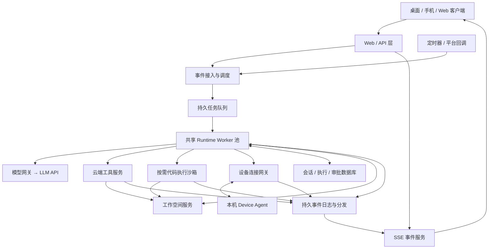
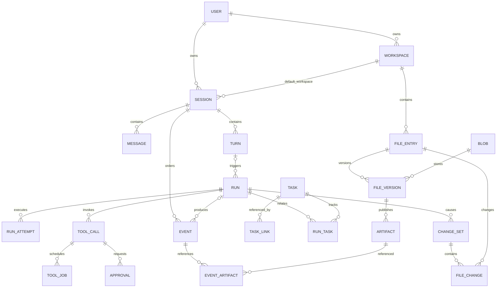

> v0.5 更新：Workspace 的绑定、路由、备份以 [workspace_design.md](workspace_design.md) 为准；本文保留原有架构背景。

# 个人助理 Agent：云端 Runtime 架构设计

版本：1.0 · 日期：2026-11-11 · 状态：建议实现方案

配套文档：[本地 Deep Agents 实现设计](local_deepagents_architecture.md)。本文定义目标架构与统一领域契约；配套文档定义第一阶段落地方式。除末尾框架资料引用外，架构、状态和表结构均为本项目的设计建议，不代表某个产品的内部实现。

## 1. 设计结论与范围

采用「本机 Device Agent + 云端 Runtime Worker 池 + 工具执行资源池 + 用户逻辑工作空间」。主 Runtime 指承担决策与执行编排的逻辑角色，由多个共享 Worker 实例承载，不额外引入一个全局单例主 Agent。

持久状态与执行资源分离：用户拥有数据、工作空间和权限，不拥有常驻 Runtime 进程或云电脑。Worker 领取可恢复的 Run；沙箱仅在需要执行代码时创建。普通问答可完全不分配文件工作目录或沙箱。

第一版不实现自动多意图拆分：普通输入创建 Message、Turn、Run；Task 是可选的跨轮业务目标。之后可以加入任务拆分，不改变底层执行和事件协议。

## 2. 总体架构



图中的箭头表示逻辑调用或事件流，不要求各框独立部署。工具和沙箱通过带身份验证的事件入口写入，不能任意伪造其他 Run 的事件。设备通过出站长连接连接网关，避免要求客户端开放入站公网端口。

## 3. 模块职责与领域对象

| 模块 | 职责与输入输出 | 主要对象 | 执行边界 |
|---|---|---|---|
| 客户端 | 提交消息、显示增量、提交审批、浏览文件版本 | Message、Turn、Event、Approval、Artifact | 不持有模型密钥；不作为权限判定权威 |
| Web/API | 身份验证、租户授权、请求幂等、REST、下载授权、SSE 路由 | User、Session、Message、Trigger | 不在 HTTP 请求函数中承担完整 Agent 生命周期 |
| 定时器/回调 | 产生定时触发或外部通知，验证回调签名 | Schedule、Trigger | 以外部事件 ID 或计划执行时间去重 |
| 接入与调度 | 保存输入、生成 Run、处理取消/恢复、并发限制、投递执行命令 | Turn、Task、Run、Outbox、WorkItem | 不依赖 LLM 才能可靠接收请求 |
| 持久队列 | 执行命令的投递、重试、死信 | WorkItem | 允许至少一次投递；不充当会话 transcript |
| Runtime Worker | 构建上下文、调用模型、安排工具、检查完成条件、保存恢复点 | Run、RunAttempt、CheckpointRef、ToolCall、ContextSnapshot | 网络等待使用异步；不执行无隔离的用户代码 |
| 模型网关 | 模型路由、凭证、配额、超时、用量和请求追踪 | ModelInvocation、CredentialRef | 模型输出只是建议，不直接授予执行权限 |
| 云端工具服务 | 搜索、fetch、邮件等工具；统一参数、权限与结果格式 | ToolCall、ToolJob、ToolResult、ExternalConnection | 简短 I/O 可直接异步调用；CPU/浏览器任务进入专用池 |
| 沙箱服务 | 分配隔离执行环境、执行程序、产生变更与产物、释放资源 | SandboxLease、ImageSpec、ToolJob、ChangeSet | 镜像与持久文件分离；限制网络、CPU、内存与运行时间 |
| 设备网关/Device Agent | 设备在线状态、本地文件和应用操作、端侧授权、结果上传 | Device、DeviceCommand、PermissionGrant | 云端授权不能绕过端侧目录和操作权限 |
| 状态数据库 | 业务状态、关系、幂等键、审批与调度事务 | 全局领域对象、Outbox、Inbox | PostgreSQL 为建议；工作进程本地磁盘不作权威存储 |
| 工作空间服务 | 文件命名空间、版本、挂载清单、ChangeSet、产物生命周期 | Workspace、WorkspaceMount、FileEntry、FileVersion、Blob、Artifact | 文件内容在对象存储；元数据在数据库 |
| 持久事件日志 | 接收并去重事件、分配会话内序号、支持按游标读取 | Event、EventArtifact、EventTask | 必须先持久化，再通知订阅端 |
| SSE 服务 | 鉴权、历史补发、实时推送、心跳和断线恢复 | EventCursor、Session | 不持有 Run 执行权；断开连接不取消执行 |

工具池是共享执行代码和资源的部署方式，不必等价于每次启动 Lambda。可以是常驻异步服务、队列消费者、容器 Job 或函数服务。独立工具通常无需模型；确需模型的分析工具或子 Agent 可通过模型网关调用，仍计入父 Run 的预算和追踪。

## 4. 术语与统一生命周期

| 对象 | 本文的固定含义 | 关系与约束 |
|---|---|---|
| Session | 一个用户可见的会话与事件流 | 有多个 Message、Turn 和 Run；可涉及多个 Task |
| Message | 用户或助手的一条语义消息 | 消息可关联多个任务；输入原文不可被意图提取结果覆盖 |
| Turn | 一次输入引起的用户可见响应单元 | 用户输入对应一个 Turn；后台触发可无 Turn；审批恢复不另建普通 Turn |
| Task | 可跨多轮维护的业务目标 | 可选；包含目标、约束、验收条件和进度；不能用它代替队列任务 |
| Run | 一次逻辑 Agent 执行，包括中断和恢复 | 一个 Turn 可产生多个 Run；第一版固定一个；Run 可无 Task |
| RunAttempt | Worker 对某个 Run 的一次实际承接 | 重启、失租或恢复可产生新 Attempt；含租约与 fencing token |
| WorkItem | 队列中的调度命令 | 指向 Run，类型为 start/resume/cancel；不是业务 Task |
| ToolCall | Agent 发起的一次工具调用意图 | 有稳定调用 ID、参数散列和权限上下文 |
| ToolJob | 工具调用在执行资源中的实际作业 | 可异步；重复提交由幂等键返回原作业 |
| Event | 已发生事实或输出片段 | 关联 Session、Run 等；Task ID 可空；不能每个事件都强制绑 Task |
| Checkpoint | 框架执行恢复状态 | 不是 transcript，也不是用户文件备份 |

Run 状态：QUEUED → RUNNING → SUCCEEDED / FAILED / CANCELLED；等待时进入 WAITING_TOOL / WAITING_APPROVAL / WAITING_USER / WAITING_DEVICE，条件满足后回到 QUEUED。取消先进入 CANCEL_REQUESTED，实际停止后才进入 CANCELLED。副作用执行结果不明时保留 reconciliation_required 标志，不能误报取消成功。

Task 状态：OPEN、IN_PROGRESS、BLOCKED、COMPLETED、FAILED、CANCELLED。Task 完成依据目标的验收条件与结果证据，不依据用户是否继续提及。没有明确可验证条件时可记录「已交付、待反馈」，不要伪称用户已验收。后续修改既可创建关联 Task，也可显式重新打开旧 Task，必须保留变更原因。

## 5. 主要执行流程

### 5.1 普通输入、执行与流式响应

1. 客户端提交 POST /sessions/{id}/messages，带客户端生成的幂等键。
2. API 验证身份、Session 所属关系、附件引用。一个数据库事务保存 Message、Turn、Run、输入 Event 及 Outbox；提交成功即返回 message_id、turn_id、run_id。
3. Outbox dispatcher 将 WorkItem 投递持久队列。提交成功后崩溃可能导致重投，因此消费端仍需去重。
4. Worker 原子领取 Run 租约并创建 Attempt；同一 Session 的共享上下文第一版串行推进。租约过期重领后，旧 Worker 的写入由 fencing token 拒绝。
5. Context Builder 装配系统规则、当前输入、最近语义历史、相关任务摘要与按需检索结果。运行配置记录模型、prompt 版本、工具版本、预算和来源引用。
6. Deep Agents 或其他 Agent 引擎产生模型输出和工具调用；应用适配层将其转换为稳定业务 Event。工具结果进入模型上下文，工具进度默认只通知 UI，不为每个输出片段重新调用模型。
7. Event 持久化后发通知；SSE 读取并推送。最终保存完整 assistant Message、交付引用和 Run 终态；需要的业务变更在同一事务中写入。

### 5.2 长工具与释放 Worker

短 I/O 等待可在同一 Python 进程中 await，不占独立线程，但仍占协程、连接和内存。长任务使用持久挂起：先登记稳定 ToolCall/ToolJob ID、等待条件和提交 Outbox，再持久化恢复点并释放 Attempt。

结果到达后保存 ToolResult、Event 和恢复 Outbox；调度器重新领取该 Run。等待登记与结果到达必须允许任意顺序：恢复时查询结果表，完成端以状态版本 CAS 更新；不能仅靠瞬时通知唤醒。框架恢复采用可重放的 submit/wait 节点，submit 必须幂等。

这不是「任何 await 都自动释放 Worker」。异步协程等待和持久挂起是两种实现；只有已保存可恢复状态的后者才能安全释放进程承载。

### 5.3 审批与设备操作

1. 工具执行前生成 Approval，包含工具名、完整待执行参数或其不可变引用、参数散列、作用域、到期时间和授权者。
2. 保存 checkpoint，并产生 approval.requested；Run 进入 WAITING_APPROVAL。
3. 客户端通过普通 POST 提交决定；服务端验证审批归属、有效期、请求散列和当前状态，以一次性消费方式恢复执行。
4. 修改参数后必须重新经过权限检查；旧批准不能用于不同请求。
5. Device Agent 再次检查本机授权。设备离线时等待或失败，不把操作自动转移到不等价的云端目录。端侧文件上传与本地读取是两个权限动作。

### 5.4 代码项目与按需工作空间

1. Session 绑定默认 Workspace，Run 选择项目和文件版本；单纯问答不创建 SandboxLease。
2. 沙箱服务按 ImageSpec 启动容器/更强隔离实例；挂载选定文件的快照与可写临时层，不加载用户全部数据。
3. 执行结束生成 ChangeSet：基线版本、写入/删除/重命名列表、结果版本、来源 ToolCall 和 Event。
4. 工作空间服务校验基线版本，发生并发修改则产生冲突，不覆盖别人更新。先持久化内容对象，再原子更新元数据指针与提交事件。
5. 产物独立标记 Artifact；临时文件依据保留策略回收；沙箱空闲超时销毁。恢复靠文件版本和任务状态，而非假设容器仍存活。

### 5.5 SSE 建联和断线恢复

浏览器独立请求 GET /sessions/{id}/events?after={seq}。请求通过同一 API 域名/网关转发 SSE 服务，服务在这条 HTTP 响应上持续写 text/event-stream。不是服务器主动连接浏览器，也不是 POST 响应必须一直等待 Agent。

SSE 的 id 使用会话内单调递增 session_seq。重连读取 Last-Event-ID；首次连接支持 after 参数。每轮都查询 seq > cursor 的已提交事件，再等待通知或超时轮询，因此历史与实时之间不会出现订阅空窗。客户端按 event_id 去重；通知丢失不影响日志补读。

消息增量采用可恢复的分批持久化：批次提交后才广播。final Message 是整条内容快照，包含 message_id 与最后修订号；UI 用快照替换增量合成结果，避免重复追加。代理关闭缓冲并配置空闲超时；发送心跳。慢客户端队列有上限，超限断开后补读，不拖慢模型消费。游标已过保留期则返回需重新同步的明确响应。

## 6. 全局领域对象关系



图按核心关系展示；TaskLink 包含消息/会话/任务间关联，实际落表使用明确外键的关联表。Run 与 Task 是多对多；一般执行只有一个主任务，但不把该假设固化成唯一关系。文件不是会话的私有所有物，跨会话可引用同一个项目版本。

### 6.1 领域模型字段清单

约定：ID 用 UUID/ULID；时间 UTC；可变实体带 version、created_at、updated_at；所有租户数据带 user_id 或 tenant_id。以下省略公共字段。

| 实体/表 | 核心字段 | 约束与索引 |
|---|---|---|
| users | id、status | 身份来自认证系统 |
| sessions | id、user_id、workspace_id、title、status、last_event_seq | (user_id, updated_at) |
| messages | id、session_id、turn_id?、run_id?、role、content_json、revision、source_event_id | 同一输出消息以 revision 演进；最终原文可检索 |
| turns | id、session_id、input_message_id、status | input_message_id 唯一 |
| tasks | id、user_id、workspace_id、goal、constraints_json、criteria_json、summary、status、completion_evidence_json | (user_id,status,updated_at) |
| message_tasks / session_tasks / run_tasks | 两端 ID、relation、is_primary | 两端组合唯一；relation 如 continues/refines/references |
| task_relations | from_task_id、to_task_id、relation | parent/depends_on/follow_up；依赖图禁止环 |
| triggers / schedules | source、external_event_id、payload_ref、schedule_spec、timezone、next_fire_at | (source,external_event_id) 唯一；定时幂等含计划执行时间 |
| runs | id、session_id、turn_id?、trigger_id?、status、checkpoint_ref、context_ref、state_version、cancel_requested、budget_json | (status,updated_at)；同一 thread 同时单写 |
| run_attempts | id、run_id、worker_id、lease_until、fencing_token、started_at、ended_at、error_json | (run_id,fencing_token) 唯一 |
| work_items / outbox / inbox | command_id、run_id、type、payload、available_at、delivery_status | command_id 唯一；重试次数、死信原因 |
| tool_calls | id、run_id、parent_call_id?、name、args_ref、args_hash、idempotency_key、status | (run_id,idempotency_key) 唯一 |
| tool_jobs / tool_results | job_id、tool_call_id、attempt、executor、status、result_ref、error、external_operation_id | 完成回调去重；区分失败与结果未知 |
| approvals | id、tool_call_id、request_hash、decision、decided_by、expires_at、consumed_at | 同一审批只能消费一次 |
| events | id、session_id、session_seq、run_id?、turn_id?、tool_call_id?、type、schema_version、payload_json、producer、producer_event_id、causation_id、occurred_at | (session_id,session_seq)、(producer,producer_event_id) 唯一 |
| event_tasks | event_id、task_id | 可选多任务关联，不强制全部事件填入 |
| context_snapshots | id、run_id、summary_ref、source_refs、prompt_version、token_budget、assembled_at | 记录装配来源与版本；不保存模型隐式推理 |
| checkpoint_refs | run_id、thread_id、checkpoint_ns、checkpoint_id、engine_version | 指向框架存储，不自行解析内部格式 |
| model_invocations | id、run_id、provider_request_id、model、usage、latency、status | 用量分 Run 汇总；原始请求按隐私策略保存 |
| workspaces | id、user_id、name、storage_namespace、quota、policy | namespace 不等于一台机器 |
| workspace_mounts | id、workspace_id、kind、device_id?、root_ref、mode | kind=managed/device/external；最小权限 |
| file_entries | id、workspace_id、path、head_version_id、deleted_at | 活跃 (workspace_id,path) 唯一；重命名保留 id |
| blobs | id、storage_key、sha256、size、mime、retention_until | 去重限制在授权边界内；不能凭 hash 绕过下载权限 |
| file_versions | id、file_id、blob_id?、parent_version_id?、change_set_id、is_deleted | 不可变；删除版本无内容 blob |
| change_sets | id、workspace_id、run_id、tool_call_id?、status、base_revision、commit_event_id、reverts_id? | PREPARED/APPLYING/COMMITTED/ABORTED/CONFLICT |
| file_changes | id、change_set_id、file_id、operation、old_path、new_path、before_version_id、after_version_id | 同一变更集一个文件最终变更一条；中间状态可附日志 |
| artifacts / event_artifacts | artifact_id、file_version_id、kind、title、retention；event_id、artifact_id、relation | relation=input/output/read/modified；引用具体版本 |
| devices / device_commands | device_id、owner_id、public_key、last_seen；command_id、tool_call_id、args_hash、status | device command 幂等；凭据可撤销 |
| permission_grants / connections | principal、scope、resource、expiry；provider、credential_ref | 密钥放密钥服务，DB 仅引用 |
| sandbox_leases / image_specs | sandbox_id、run_id、image_digest、mount_manifest_ref、expires_at、status | 镜像固定 digest；环境不作为数据权威 |

各表可按业务分库，但涉及同一业务状态转换的事务优先保留在一个数据库内。跨租户关系由组合外键或服务层强制校验；单有 UUID 无法保证隔离。

## 7. 存储与一致性

| 内容 | 建议介质 | 权威来源 |
|---|---|---|
| 会话、任务、Run、权限、文件元数据 | PostgreSQL | 业务数据库 |
| transcript 与持久 Event | 初期 PostgreSQL 分区表 | Event 日志 + 语义 Message 投影 |
| 框架 checkpoint | 框架支持的 PostgreSQL checkpointer | 框架状态，和业务表独立命名空间 |
| 文件内容、报告、较大工具输出 | 对象存储 | 不可变 Blob 与版本引用 |
| 执行命令 | 持久 MQ | DB Outbox 可重投；队列不是唯一业务事实 |
| 实时唤醒通知 | Redis Pub/Sub 或流式系统 | 仅加速通知，丢失可补读 |
| 缓存、限流 | Redis | 可重建 |
| 运行时文件 | 沙箱临时卷 | 未提交内容不保证持久 |

选择一套持久队列即可，不必第一天同时部署 Kafka、RabbitMQ、Redis Streams。使用至少一次交付 + 幂等，不宣称端到端 exactly-once。付费/发信等外部操作优先使用供应商幂等键；超时后查询实际结果，无法确认则交给人工核对，不能无条件重试。

ChangeSet 撤销是一笔新的反向变更：仅当当前 head 仍等于待撤销的 after_version 时直接恢复，否则报告冲突。数据库事务不能回滚已经发送的邮件、下单或外部 API 操作；这些需要业务补偿，不属于文件撤销。

事件流保存用户可见输出、工具调用/结果摘要、审批、错误、状态与文件引用；大文件和长日志存 Blob，只放引用。是否保留完整 token 增量应有明确策略；本设计保留分批增量供有限时间回放，最终 Message 与关键审计事件长期保留。transcript 不包含模型不可见或私有的内部推理。

## 8. API 与事件契约

| 接口 | 功能 |
|---|---|
| POST /sessions | 创建会话并选择默认工作空间 |
| POST /sessions/{id}/messages | 幂等接收输入，返回 Message/Turn/Run ID |
| GET /sessions/{id}/events?after= | SSE 补读与实时输出 |
| GET /sessions/{id}/messages | 分页读取语义 transcript |
| GET /runs/{id} | 查询状态、等待原因、产物 |
| POST /runs/{id}/cancel | 请求取消，不承诺瞬时终止副作用 |
| POST /approvals/{id}/decision | 审批并恢复 |
| GET /workspaces/{id}/files | 文件与版本列表 |
| GET /artifacts/{id}/content | 权限校验后下载固定版本 |
| POST /change-sets/{id}/revert | 基于 head 校验的反向变更 |

事件信封示例：

```json
{
  "id": "evt_123", "session_id": "s_1", "session_seq": 42,
  "run_id": "r_1", "turn_id": "t_1", "task_ids": [],
  "tool_call_id": "call_3", "type": "workspace.changeset_committed",
  "schema_version": 1, "causation_id": "evt_122",
  "payload": {"change_set_id": "cs_1", "artifact_ids": ["a_1"]}
}
```

核心类型：message.accepted、run.started、assistant.delta、assistant.final、tool.started、tool.progress、tool.completed、tool.failed、approval.requested、approval.decided、workspace.changeset_committed、artifact.created、run.waiting、run.completed、run.failed、run.cancelled。SSE 心跳是传输信号，无须写业务日志。

## 9. 并发、容错与运行运维

Worker 池至少包括三层限制：进程活动 Run 数、用户配额、模型/工具提供方配额。同一会话共享 thread 时串行写 checkpoint；跨会话并发。需要并行子任务时使用独立分支状态、文件基线和父子 Run 关系，不能共同写一个 thread。

4c8g 的单 Python 进程没有固定并发答案。若主要等待模型与网络，可先以 16～32 个活动 Run 作为压测起点；不是承诺容量。根据单 Run 内存、连接数、模型限流、SQLite/数据库写入、事件积压测定上限。CPU 密集工作进入独立执行池，100GB 磁盘主要影响临时文件容量与保留，不决定协程并发。

关键指标：队列等待、Run 首 token 延迟、Run/工具时延、模型错误与用量、租约失效、恢复失败、Event 持久化延迟、SSE 落后距离、沙箱启动延迟、文件冲突率、孤儿 Blob 容量。日志和 trace 统一带 user/session/run/attempt/tool_call ID，内容与密钥脱敏。

故障策略：Worker 崩溃通过租约重领；数据库暂不可写则停止产生不可追踪的外部副作用；SSE 断开不影响 Run；工具超时区别执行失败与结果未知；Outbox/Inbox 重复不重复执行；Checkpoint 与业务 DB 之间靠稳定节点/调用 ID 对账，不能假设跨存储原子提交。

## 10. 任务理解与上下文演进

第一阶段取消独立「必须先拆任务」的入口。当前消息直接进入本会话 Run，模型可以在内部列计划，但 Deep Agents 的 todo 或名为 task 的子 Agent 工具不自动等于业务 Task。

需要跨轮目标管理时再增加 Task 服务：先从当前活动任务、显式引用、最近任务与项目实体召回有限候选，再由 LLM 提议 new/continue/refine/reference；程序验证 ID、权限、状态和置信程度。只有会改变正在执行操作且关联不明确时才向用户澄清。不要把历史全部任务塞进 prompt。

上下文装配选择任务摘要、当前约束、未完成事项、相关对话片段和文件版本，不搬运所有工具进度事件。ContextSnapshot 保存引用和版本便于排障；被压缩历史仍在 transcript 中，可按需检索。

## 11. 落地与验收

先完成本地配套设计，再分步替换存储、队列、执行端。优先保持 Run/ToolCall/Event/Artifact/ChangeSet 接口不变；按压力拆 SSE、Runtime、Tool Worker，不为图中的每个框先建微服务。

验收场景：重复 POST 只产生一个 Run；重复队列投递不重复发信；断开 SSE 后按游标补齐；Worker 被杀后可恢复或明确标记需核对；审批只能消费一次；设备离线不会丢命令；沙箱销毁后产物可下载；并发编辑报告冲突；撤销不覆盖后续修改；不同用户无法读取彼此事件、文件与 checkpoint。

## 12. 框架资料与实现边界

- [Deep Agents 概览](https://docs.langchain.com/oss/python/deepagents/overview)：引擎能力基础。
- [文件后端](https://docs.langchain.com/oss/python/deepagents/backends)：可替换文件接口和执行后端。
- [审批与中断](https://docs.langchain.com/oss/python/deepagents/human-in-the-loop)：配置审批工具与恢复。
- [流式输出](https://docs.langchain.com/oss/python/deepagents/streaming)：框架流转换为业务事件。

框架提供执行机制；本设计中的业务 Task、事件幂等、租户隔离、工作空间版本、ChangeSet 和外部副作用对账由应用层负责。依赖版本应锁定并用契约测试验证，升级时不得直接把内部事件结构暴露给客户端。
