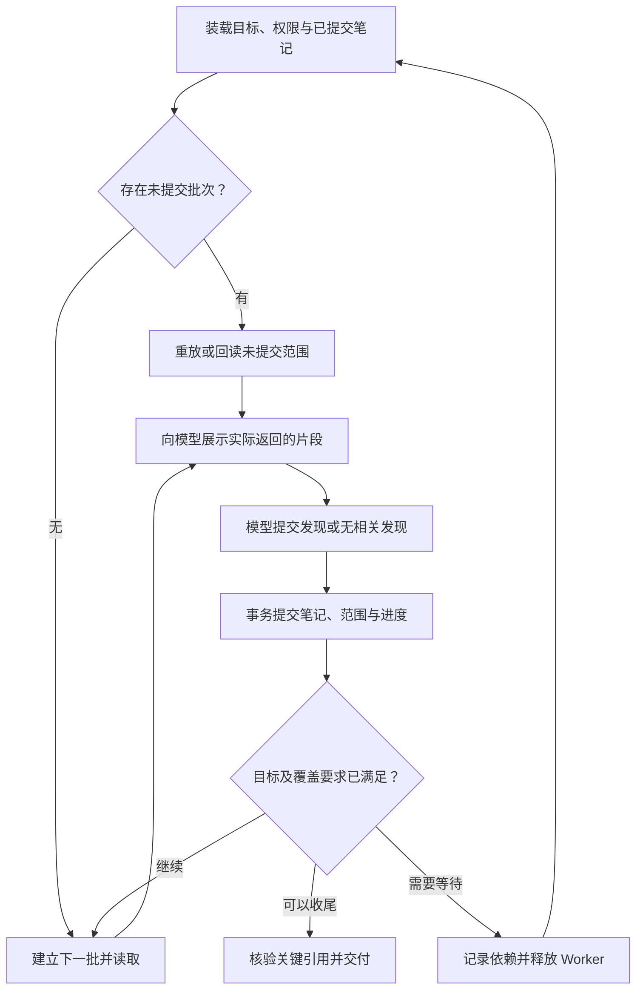

# 大文件、目录与代码仓库的分析记忆

**状态：第一、第二阶段已接入本地 Runtime 与 Task Memory V2。** 初始设计基于 `f5bfffd`。交付目标是在长分析中逐批保留可追溯结论，使下一次模型请求、故障重试和后续 Task 都能复用已经完成的工作。上线验收以“同一版本的哪些范围确实进入了模型输入，哪些已经形成笔记”为依据。

## 1. 与现有工程的衔接

| 当前行为 | 实现入口 | 本方案的改动 |
|---|---|---|
| Task Step 由 `(run,key)` 标识；从 `finish_step` 结构化结果调用 `TaskRepository.deliver` | `src/artorias_server/tasks/executor.py`、`tasks/repository.py`（后续简写相对于 server 包） | 每个长分析 Step 创建一个 Analysis。保存中间 Note 独立提交，最后一次交付才更新 Task |
| 初始 Task 上下文按 Step 缓存在 `context_snapshots`；模型请求前另有历史裁剪 | `tasks/context.py`、`runtime/budget.py` | 保留初始目标快照，每次模型调用单独装配最新分析状态，避免恢复时读到旧进度 |
| 清点工具按页返回聚合和样本；搜索返回片段；批读最多 8 项，整批默认上限 24 KiB | `tools/project_analysis.py`、`tools/registry.py` | 复用只读工具与权限路由。新增真实读取回执、完整清单的分页接口、大文件范围读取 |
| 本机批读取整个 UTF-8 文件后切片，单文件上限 1,000,000 字节 | `src/artorias_device/workspace/analysis.py` | 初版覆盖现有能力范围；大文件专项上线后按字节范围流式读取 |
| 游标缓存位于 Server 进程；审批可恢复原图线程，其他运行中断由 Scheduler 标记 interrupted | `tools/project_analysis.py`、`runtime/service.py`、`scheduler/service.py`、`storage/sqlite.py` | 工具端接管可重放的扫描，Server 保存业务进度。恢复原 Step 另需重新入队和去重 |

与[目录分析与 Agent Loop 方案](project_analysis_runtime.md)共用工具与执行段。该文拟议的扫描队列、条目明细由 Device 或 Cloud 执行端管理。执行段中的 findings 改为引用本文的 Note，避免维护两份结论。批量文件修改继续走原有权限、版本与撤回链路。

## 2. 启用条件、范围和职责

在 Task Plan 的条目上新增可选 `analysis` 配置。程序根据有效 Step 目标和工具能力检查配置，已有单文件短问答继续走普通读取。要求逐份覆盖、需要跨批归纳或要追踪多文件调用链时启用。首次轻量探查后发现规模超出一个请求预算，也可在当前 Step 创建 Analysis。创建按 Step 幂等。已知入口或关键词的定向问题支持直接读取或搜索；全量分析先建立清单，可边枚举边处理。

示例计划配置如下。Task 原目标、约束和操作权限仍由原有链路提供。

```json
{"analysis_type":"codebase","intent":"architecture","roots":["src/artorias_server"],"coverage_policy":"priority_first","goal":"解释审批后如何恢复 Task Step"}
```

`analysis_type` 支持 document_file、document_directory、codebase、mixed、log、other。`coverage_policy` 支持 full、sampled、priority_first。full 指约定根目录、过滤条件、格式和观察版本组成的范围，清单尚未封闭时总量记为 unknown。sampled 记录抽样规则。priority_first 记录选择理由、剩余范围和停止原因。权限按当前 Session、位置和具体资源校验。分析与后续修改可以属于同一用户诉求，只有明确的修改目标才进入写工具链路。

| 归属 | 保存的数据 | 恢复用途 |
|---|---|---|
| 工具执行端 | 遍历队列、目录页、页内位置、文件观察版本、按请求 ID 重放页的凭据 | 按资源位置续扫。设备离线时保留原位置，联网再继续 |
| Server 业务库 | 分析目标、批次、实际读取回执、Note、摘要和最后确认的端点引用 | 判断已分析内容，选择待办，组装上下文并综合交付 |
| LangGraph checkpoint | 当前图线程的消息、待执行节点和 interrupt 等图状态 | 恢复审批节点。模型 API 无需持有分析会话 |
| 模型 | 阅读片段，提炼事实、推断和未决问题，选择下一批或交付 | 将要跨批保留的分析显式写入 Note |

## 3. 持久化模型

Server SQLite 使用项目既有 TEXT ID、UTC 时间、INTEGER 计数和带 schema_version 的 JSON。各表沿用 created_at、updated_at；新表按“标识、归属、业务字段、状态、时间”排字段。所有请求从可信运行上下文注入 Session、Task、Run、Step、位置；应用层验证外键关系。一个 Analysis 有一个创建 Step；后续执行通过关联表获得访问上下文，保留来源归属。

| 表 | 字段、约束与索引 |
|---|---|
| analyses | id PK，session_id，task_id，origin_run，origin_step_key，workspace_id，analysis_type，intent，goal，scope_json，coverage_policy，status，revision，last_commit_seq。UNIQUE(origin_run,origin_step_key)。scope 保存每个根的 location_id、规范路径、过滤条件和范围版本 |
| analysis_step_links | (run_id,step_key,analysis_id) PK，role(owner/continue/reference)，linked_revision。索引 (analysis_id,role)。reference 只读。continue 要求目标与范围兼容并原子取得写入权。新目标可创建新 Analysis 并只读引用旧结果 |
| analysis_batches | id PK，analysis_id，ordinal，purpose，plan_json，state，read_request_id，receipt_json，note_digest，commit_seq，error_json。UNIQUE(analysis_id,ordinal)、UNIQUE(analysis_id,commit_seq)、UNIQUE(read_request_id)。索引 (analysis_id,state)。计划范围与实际回执分别记录，commit_seq 在成功提交时分配 |
| analysis_notes | id PK，analysis_id，batch_id，note_type，summary，findings_json，questions_json，refs_json，facets_json，supersedes_id。首版每批一条 batch_summary，使用唯一部分索引 ON (batch_id) WHERE note_type='batch_summary'。修正通过新记录引用旧 Note；修正也分配单调更新序号以使派生摘要失效 |
| analysis_sources | id PK，analysis_id，location_id，workspace_id 可空，canonical_path，version，source_kind，size_bytes，priority，read_status，metadata_json。按 (analysis_id,location_id,canonical_path,version) 唯一；清点阶段用显式观察标识，获得内容版本后记录两者映射。索引 (analysis_id,read_status,priority) |
| analysis_ranges | (source_id,batch_id,unit,start,end_exclusive) PK，kind(metadata/snippet/content)，state(returned/presented/analyzed)。只合并同版本、同单位的区间；跨批覆盖率按并集计算。索引 (source_id,state,start) |
| analysis_summaries | (analysis_id,version) PK，through_seq，source_revision，summary，key_findings_json，questions_json，next_steps_json，coverage_json，source_note_ids_json。索引 (analysis_id,through_seq)。通过 source_revision 做乐观并发检查 |

MVP 建前四表，范围与引用先保存在 receipt_json、refs_json 中。从第二阶段起规范化到 sources/ranges，并可从回执重建。提交批次、修正笔记都递增 analyses.revision；摘要记录生成时 revision 和 through_seq，读取时检查两者。写入过程仅在短事务中分配序号，模型调用与设备 I/O 在事务之外执行。

**证据引用**由程序生成，至少包含位置、规范路径、版本类型和版本值、范围单位、起止位置、来源类型；代码可附 symbol、module 和 callsite。文本范围持久化采用半开区间。字符偏移从 0、行号从 1 开始；例如读取第 19 至 30 行保存为 line [19,31)。区分 metadata、search_snippet 和 content。搜索片段按真实返回的片段记录，命中一行不能推导出整行已读。模型可用当前批次内的短序号把某条发现关联到具体来源；未提供时记为批次级归因。跨来源的重要主张在最终交付前回读核实。

## 4. 批次协议、工具与执行流程

首版同一 Analysis 顺序提交批次，同一批内仍可并行读文件。分析模式在首次探查后以“上一批笔记 + 下一步读取计划”驱动。Runtime 在 I/O 前分配 batch_id 和 read_request_id。重试复用同一计划和 ID。一个逻辑批次可组合相关范围；搜索结果决定下一跳时允许分为相邻批次。简单目录清点只保存覆盖统计，需要做判断时再形成 Note。

| 接口（拟新增） | 输入 | 输出和所有者 |
|---|---|---|
| analysis_next_batch | previous_note 可空、purpose、reads[]。reads 为带 kind 的 inventory/search/range 请求，沿用既有参数校验、预算、逐目标权限审批 | Server 先提交上批，再创建/复用新批；端点返回结果。返回 batch_id、只读回执摘要、短片段、错误项和续读提示。首批省略 previous_note |
| record_analysis_note | batch_id、summary、findings[]、open_questions[]、可选 facets 与引用序号 | Server 按实际展示记录提交 Note。用于最后一批、挂起前或只提交不再读取。两条提交通道共用一个事务方法 |
| read_analysis_notes | analysis 引用、可选来源/主题/符号/类型、分页与输出预算 | 在当前权限内返回笔记、来源与版本提示，可按引用取详情 |
| list_analysis_sources（第二阶段） | analysis 引用、状态、过滤条件、页大小和游标 | 返回源清单、已分析范围、缺口和错误。读状态由程序计算 |
| Endpoint.scan_page / read_range（第二阶段） | 可信身份、根、查询或版本化范围、稳定 request_id、可选 continuation | 返回同一请求可重放的页、版本、实际范围、观察结果与 next_cursor；不支持的能力显式返回 unsupported |

例：读取审批处理代码后，下一轮模型可以在一个工具调用中提交发现，并索取审批决定的落库逻辑。

```json
{
  "previous_note": {
    "batch_id": "b1",
    "summary": "审批时 Step 进入 waiting。",
    "findings": [{"text":"恢复时复用原 Run 和 Step 的图线程","basis":"observation","refs":[0]}],
    "open_questions": ["审批决定在哪个事务中触发重新入队？"]
  },
  "purpose": "核对审批决定与 Job 状态变更",
  "reads": [{"kind":"range","path":"src/artorias_server/storage/sqlite.py","line_start":115,"line_count":44}]
}
```



**事务与重试约束**

1. 状态按 planned → reading → returned → presented → committed 前进。returned 仅表明端点返回；请求预算层必须保证当前批次实际片段进入模型输入，或准确记录进一步截断后的范围，再标记 presented。模型请求失败时保留批次供重放。只要没有 Note 就不能算 analyzed。
2. 提交前验证当前执行有写入权、批次属于该 Analysis、实际展示的版本/范围和引用序号有效。一个事务内写入 Note、更新已分析区间、标记 committed、推进已确认游标、递增版本。相同 batch_id 和内容摘要返回已有结果；已提交批次收到不同内容返回 conflict，可显式追加修正。纯模型置信度不改变覆盖数。
3. 将“提交上批 + 登记下批计划”放同一事务，通过调用幂等键关联下一批。审批或端点 I/O 在提交后执行。网络超时时重试同一 request_id，禁止仅因响应丢失创建新批。
4. 全部失败的读取记录原因与待办；“读过但没有相关发现”可提交空 findings 和一条简短说明。模型漏交 Note 时一次定向补交，携带原批次与已展示片段；仍失败则保留未提交状态和部分交付。对分析模式下直接调用的旧读取入口，统一产生回执并关联当前批次，或只向该模式暴露受控读取入口，防止绕过覆盖统计。
5. 最后一批已提交后，程序核对范围缺口并对关键结论按版本回读。全覆盖任务存在错误或未支持格式时返回部分结果，列明缺口。业务交付走 finish_step → TaskRepository.deliver。分析 Note 的事务独立于最终交付，失败后可重新综合。最终交付绑定 analysis_id 和 revision，复用原有 Step 幂等检查。分析覆盖不足时将 Step 标记为部分交付。

## 5. 大文件、目录及代码端点

- **大文本和日志**。新增字节范围读取能力，在本机用有界缓冲、UTF-8 增量解码并记录下一有效字节边界。对外区分 byte、unicode_character 和 line；任意字符/行起点需要扫描或稀疏行索引时，限制单页 I/O 并返回可续定位状态。超长单行按字节分片，同一换行或多字节字符不得遗漏。以文件描述符校验读取前后观察版本，云对象优先使用对象版本。日志追加可显式固定初次文件长度并验证前缀，无法验证时开启新版本。普通写工具继续使用既有写基线。
- **完整目录**。端点对条目流分页，样本仅用于排序。保存端点、根、过滤条件、遍历队列、页位置和过期时间。每页在端点事务中先记 request_id 对应的页清单和下一游标，再响应；重复请求复用同一页。可按版本回读内容，无法保证原版本时返回 stale。设备 SQLite 可用于恢复，云端由同位置的共享持久层实现。Server 只存页引用和分析所需的来源信息。两端通过重放与确认对齐进度，避免跨设备数据库事务。
- **代码**。首版使用 name/literal/regex 定位，按源代码行回读。第三阶段接入已有设计中的符号与引用接口，从 Python AST 开始；按语言、解析器版本和文件版本增量索引。调用关系记录 static_resolved、candidate 或 runtime_observed。测试关联区分“找到测试定义”和“该版本实际运行通过”。文档描述与源码不一致时，两条来源分别保留。
- **混合格式**。文档和代码使用同一 Note schema。文档 facets 可含章节、主题、冲突与时效，代码 facets 可含符号、依赖、状态变化、测试与影响面。PDF、Office 或 notebook 需相应解析器；有解析器时记录页码、段落或 cell 和解析器版本，缺少时记录 unsupported 或 metadata_only。

## 6. 上下文、摘要和复用

在 runtime 模型请求中间件动态读取业务库，位置在最终请求预算校验之前。保留当前目标/约束、未完成工具协议、当前待分析片段；随后分配空间给最新有效摘要、摘要之后的高相关 Notes、未决问题和待办。已提交的历史原文可压成 Note 引用；当前批次放不下时缩小读取范围再展示。正文及笔记作为资料注入，不能作为系统指令。复用原有整体字节硬限，额外按模型窗口扣除输出预留、系统提示和工具 schema。首轮压测可给分析历史分配剩余输入预算的 20%，按真实请求指标调整。

达到历史预算软阈值或积累例如 8 条新 Note 时生成滚动摘要。一般批次不单独调模型；跨批综合确需模型时允许一次独立摘要调用。读取截至 through_seq 的一致快照，生成后比较 revision 再发布。期间新增笔记可在下一轮补进；出现修正/撤权/版本失效则过滤来源并重建摘要。摘要失败可临时按预算选用最新和最相关的原始 Notes。最终综合按目标检索全部必要来源，可分组汇总，避免只依据最近若干笔记下结论。

Follow-up 先按 Session 内的同 Task 或显式 source_task 查关联 Analysis，再按目标、来源和版本筛选。搜索服务可作为后续派生索引，返回候选 Note ID 后先回业务库授权，再展示。跨 Session 复用需显式资源授权与业务访问策略。读取任何 Note 或摘要前重新检查其全部来源，对混合授权内容仅投影仍可见的发现，无法拆分时排除整条并重算摘要。一次性文件授权的派生笔记不得自动扩大可见范围。当前文件变化时，旧 Note 可作为带版本的历史结论，涉及现状的主张需重新核验。仅在最终交付时把精选结论和分析引用写入 Task 进展。

## 7. 中断、等待与恢复

| 故障点 | 恢复动作 |
|---|---|
| 端点已读，Server 尚未收到或保存回执 | 使用原 request_id 重放，或按版本和精确范围回读。清单页不可重放时重枚举并去重 |
| 已返回或展示，模型尚未提交 Note | 重新授权后恢复本批输入并分析，保留上一个已确认游标 |
| Note 已提交，调用方未收到成功响应 | 查询 batch_id 和 note_digest，返回已提交结果。按已登记的下一批继续 |
| 工具游标过期或设备离线 | 过期时按同一范围重枚举，按位置、版本、区间去重；离线时保存 endpoint_id、operation_id，等待重连 |
| 模型总结失败、图达到软预算或最终交付失败 | 保留所有已提交 Note 和未提交批次；按剩余总预算决定补交、切段或标记部分结果 |
| 审批或主动取消 | 审批走原 thread 和 interrupt，执行前重校权限；取消保留审计与已提交笔记并终止调度 |

MVP 支持新 Run 关联旧 Analysis 后按批次继续，使用新的 Step 关联记录。自动恢复原 Step 属第二阶段的独立交付项。为分析专用执行段持久化 `(run,key,segment_no)`、analysis_id、graph_thread_id、checkpoint 或业务进度版本、wait_kind、依赖 ID、lease_owner/lease_until、attempt、累计预算。对可挂起的长工具，先持久登记 operation_id，再幂等提交；可查询操作状态来补偿通知早到或丢失。保存 waiting 和依赖后结束本次执行并释放 Worker。唤醒通过条件更新在一个事务中重新排队原 Job/Run，只允许一次领取。普通中断只对有可核对进度的只读分析段自动重排，副作用未确认则先对账。恢复审批继续旧图，分段综合可开启新图线程并注入业务快照；设置总模型次数、总时长与段数上限，防止无限续跑。

## 8. 开发拆分与放行条件

| 交付阶段 | 代码落点与依赖 | 必须通过的验收 |
|---|---|---|
| 1．批次笔记与最终交付 | 新增 `artorias_server/analysis/{models,repository,service}.py` 和工具适配。接入任务执行器、工具注册、请求预算与交付；以现有小文本读取为基础 | 固定三个批次，第 2 批返回后中断；新 Run 复用第 1 批，重放第 2 批，完成第 3 批。并发重复提交只计一次；最后一次 Note 补交失败仍能读到先前结果 |
| 2a．完整清单、大文件与摘要 | 扩展 `artorias_shared/workspace.py`、Device/Cloud Connector 和 `workspace/routing.py`；加入 sources/ranges/summaries、端点页重放与动态上下文构建 | 100 MB UTF-8 日志含中文、跨缓冲字符与超长行；单页峰值读取内存受缓冲预算限制。目录全量跨页无漏计；混入缺权、陈旧、失败和重复范围后，覆盖并集仍正确。旧 Note 被修正或撤权后摘要失效 |
| 2b．挂起与原 Step 恢复 | 扩展 Scheduler、Store 的领取/恢复、执行段及依赖通知。独立验收，生产云端需共享业务存储与 checkpoint | 端点返回前后分别杀 Worker；换 Worker 继续同一 run/key。重复、丢失、乱序通知只完成一次。用户取消后迟到回调无法复活 Job |
| 3．代码增强与跨任务复用 | 设备或云端符号索引，Server 笔记查询和可选 Search 集成。分开启用 | 同名符号、动态调用、测试定义与实际测试结果可区分；Follow-up 在授权和版本有效时复用，撤权后无摘要或片段泄露 |

**固定验收夹具。** 准备一个单文件日志、一组有重复/冲突章节的文档、一个包含间接调用和缺失测试的代码库。保存预期结论、可支持该结论的来源区间、应报告的未知项。相同覆盖要求下比较基线与新模式的模型请求数、图步、输入 token（区分估算）、文件读取字节、重复分析批次数、峰值输入、引用可回读率和端到端耗时。将新能力置于独立配置开关后灰度；关闭新建分析时仍允许读取既有笔记和显式取消等待任务。上线前用真实模型补测长任务质量及延迟，确定预算和摘要阈值。

## 9. 当前实现与运行范围

- 默认启用 Analysis Memory。Task Planner 为长分析输出 `analysis` 时进入只读分析链路。设置 `ARTORIAS_ANALYSIS_MEMORY=0` 可关闭新建入口，已关联的 Step 仍可继续。
- `analysis_next_batch` 支持字节、Unicode 字符和行范围，以及目录清单和文字搜索。大文件使用 UTF-8 字节范围，每项最多 4 KiB；字符和行模式沿用小文件读工具。端点清单和搜索页保存在本地 SQLite。清单按首次枚举快照分页，遇到深度、条目或目录时间上限时报告不完整。正文搜索沿用每文件 1 MB 上限，超过上限时可改用字节范围分析。
- Server 保存已展示回执、已提交笔记和覆盖区间。滚动摘要使用确定性的有界提取，并附来源版本和续读位置。每次组装时重校权限，较早的笔记按页读取。最终报告按模型提示回读关键来源，覆盖率由程序按范围并集计算。
- 本地 Scheduler 支持原 Run 和 Step 续跑。审批用原图线程，普通中断和端点等待通过新的图执行段加载笔记和待重放批次。异步端点返回 `status=pending` 和 `operation_id` 后释放 Worker，调度器按退避间隔再次领取，由 Connector 用原 request_id 查询或重放。原生本地能力为同步读取，异步接口用模拟端点测试。云端多 Worker 租约、独立远程 Connector 和推送式依赖通知仍需部署适配。
- 版本变化时，回读返回 stale。续扫游标过期时，由当前分析重新清点，报告覆盖缺口并保留已提交笔记。同 Session、Task 和 Workspace 下，兼容未完成计划可由新 Run 关联。代码符号索引和跨 Task 搜索属于第三阶段。
