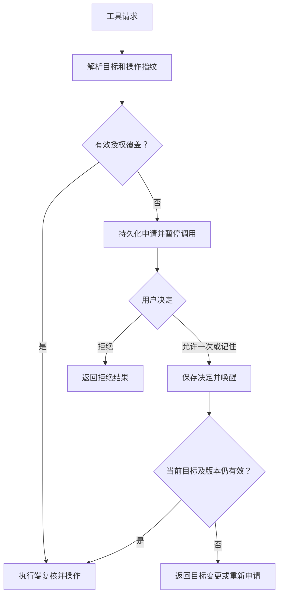

# Artorias Assistant 权限设计

实现基线为 master 提交 5e9666a。首版交付适用于当前单用户部署，使用本机 Device Connector 或已配置的 Cloud Connector，并为 run_python 提供 Session 执行规则。以下列出工程目标与首版实现的边界。

| 项目 | 首版落点 |
|---|---|
| 数据存储 | 新增 permission_grants 与 permission_requests。已有 workspace_grants 继续承载长期 Workspace 授权和旧 Run 授权，升级时无需扩大或迁移现有授权。新增规则按会话隔离。Task ID 仅记录来源 |
| Workspace 设置 | 页面为所选目录显式建立会话只读或读写授权。已有长期规则仍参与匹配。会话权限页可撤销新增规则，长期规则继续使用既有管理 API |
| 缺权恢复 | 文件工具自动申请并恢复原调用。run_python 在准备计划时发现额外输入或输出缺权，由模型发起显式目录授权或由用户设置 Workspace 权限，之后再提交脚本计划 |
| 审批端点 | 沿用 /api/runs/{rid}/decision。页面按中断 ID 提交一组独立选择。会话授权的配置、查询和撤销在 /api/sessions/{sid}/permissions 下。旧接口调用仍可提交单一 approve 或 reject |
| 云部署 | 首版复用单用户身份与 Connector 边界。租户身份字段和独立 Device 凭据属于多租户及分布式部署阶段 |

## 1. 产品规则

授权时要能回答四个问题：谁授予、哪个会话可复用、对哪个资源、允许做什么。推荐默认使用 Session 授权。一个 Session 内的多个 Task 和 Run 可以复用。Task ID、Step、Run 和工具调用 ID 用于追溯授权来源。授权查询只使用可信用户身份、Session、资源及动作。

| 权限 | 资源 | 匹配和含义 |
|---|---|---|
| 文件读取 read | Workspace 根、任意已选目录或单文件 | 包含读取、列目录、搜索和读取版本。单文件权限仅允许读取该文件 |
| 文件写入 write | 同上 | 沿用现有语义，包含 read、创建、编辑、覆盖、删除和回滚。审批页明确列出删除与覆盖 |
| 命令执行 execute | 指定执行端和一份结构化命令规则 | 首版支持按计划匹配 Python 脚本。输入暂存与输出发布另行消费文件权限 |

**授权期限与 Workspace 是两个维度。** “本会话允许”绑定 Session，可跨 Run。“仅本次”绑定一项待执行操作，消费后失效。“长期允许此 Workspace”由用户在空间设置中显式开启，对该用户有权使用此空间的 Session 生效。Session 和 Task 选择 Workspace 只确定相对路径的解析起点。切换空间后，旧授权仍指向原目标。首版无需 bypass，命中既有规则即可自动放行。

**设置入口。** 新建或首次使用 Workspace 时，页面分别展示位置、只读或读写、适用期限。建议默认给当前 Session，托管默认空间可在创建会话时自动建立本 Session 的根目录授权。外部文件默认展示实际请求的单个文件，递归目录操作展示具体目录和“含子目录”。只有用户主动扩大范围时才写入较宽规则。命令审批展示脚本、参数、执行位置、工作目录、依赖安装网络和发布范围，让用户选择“仅本次”或“在本会话记住此规则”。会话设置支持查看来源、撤销授权。拒绝结束此次调用，模型重复提交同一被拒请求不能自动获得权限。

## 2. 校验和匹配

1. 服务端从已认证请求或已领取的 Run 取得 owner、session、task 和绑定空间快照。模型仅提供操作参数。服务端解析相对路径、设备绝对路径或 workspace:// 引用，先确认目标设备或空间属于该用户。
2. 生成统一资源标识。Workspace 授权以 workspace_id 约束解析后的空间，并定位到登记的根；显式指向该根下的绝对路径需按可信目录登记验证归属。外部目录或文件以 location_id 和规范路径识别。不同设备的同名路径分别匹配。目录覆盖按路径组件：对 /work/app 的授权覆盖 /work/app/a，不覆盖 /work/apple。单文件仅精确匹配。列目录先检查目录本身，不能用单文件权限枚举同级文件。
3. 查有效授权。身份、位置、适用范围和动作都须匹配。Workspace 长期授权要求目标属于该空间；Session 授权额外要求 session_id 相同；一次性决定要求操作指纹相同。失效、撤销、路径不匹配均不能放行。若多个授权均命中，优先记录此次操作、Session、长期 Workspace 的顺序，并优先取覆盖范围最小的一条。规则采用允许列表。撤销单条后，设置页展示是否仍有其他授权覆盖同一资源。
4. 本地 Endpoint 在实际打开、创建、替换文件时验证规范化边界，防止符号链接或校验后替换目录改变目标。创建新文件要验证其父目录。云 Connector 校验租户、存储位置及对象键组件或前缀边界。云端的 Session 授权不能扩大操作系统、设备代理或云存储服务身份的权限。

### 命令规则

首版对可执行程序及 argv 逐项精确匹配，不接受 shell 字符串前缀。Python 的可复用规则由程序从已解析计划生成，包含执行端、Workspace、解释器或镜像版本、入口规范路径与内容哈希、代码目录文件清单与哈希、参数顺序、工作目录、模式、依赖与安装策略、网络策略、输入映射、发布目标及覆盖和删除选项。对影响权限的新字段，规则版本升级后重新审批。普通数据文件内容可在授权路径内更新；被当作代码执行的输入必须纳入代码指纹，无法明确区分时使用仅本次审批。

现有 plan_hash 包含 run、call 和执行 ID，适合绑定一次审批。另对规范化的可复用规则计算 rule_hash，排除调用身份。自动生成的本次产物目录可编码为“本次执行的托管产物目录”，由服务端在执行时解析并校验。实际数据路径或命令参数的变化默认重新申请。命中会话规则后仍检查当次输入版本、暂存文件哈希和每个发布目标。将本地输入送到云执行时，审批展示来源设备和云目的地，执行规则绑定这一传输方向。

## 3. 表结构变更

当前 workspace_grants 包含 id、location_id、scope_run、root、access；workspace 注册会写入长期 write，project_authorize 只写当前 Run 的本机目录授权。当前 decisions 按 run 记录工具恢复决定。建议以 permission_grants 取代原权限表，将每次权限审批单独持久化。SQLite 时间统一使用 UTC，与现有项目时间格式一致。

| 表 | 字段设计 | 约束与用途 |
|---|---|---|
| permission_grants | id TEXT PK，owner_id TEXT，scope TEXT，session_id TEXT 可空，workspace_id TEXT 可空，location_id TEXT，action TEXT，resource_kind TEXT，canonical_path TEXT 可空，command_rule_json TEXT 可空，rule_hash TEXT 可空，rule_version INTEGER，source_task_id TEXT 可空，source_run_id TEXT 可空，source_request_id TEXT 可空，created_at、updated_at、revoked_at | scope 为 session 或 workspace。session 要求 session_id；workspace 要求 workspace_id 且限该空间的文件授权。文件规则保存 file、directory 或 workspace_root 及路径；命令规则保存 command、execute、完整规则及哈希。revoked_at 可空。来源 Task 永远不参与授权匹配 |
| permission_requests | id TEXT PK，owner_id、session_id、run_id、tool_call_id、operation_hash TEXT，task_id、step_key 可空，request_json TEXT，state TEXT，choice TEXT 可空，grant_id 可空，created_at、decided_at、consumed_at | request_json 固化规范目标、动作、权限范围和待批计划；state 为 pending、approved、rejected、consumed 或 cancelled。仅本次批准使用此行，无需持久 grant。外键 grant_id 指向记住的授权。唯一键 (run_id,tool_call_id,operation_hash) 防止重放产生重复审批 |
| workspace_locations、workspaces、sessions | 云端增加可信 owner_id，或外键关联现有用户归属表。设备位置绑定设备身份，云位置绑定租户命名空间 | 本机单用户使用安装时稳定的 owner 标识。服务端验证所有关联资源属于同一用户 |

建立两个部分索引覆盖有效授权：文件按 (owner_id,location_id,scope,session_id,workspace_id,canonical_path)，命令按 (owner_id,session_id,location_id,rule_hash)，均过滤 revoked_at IS NULL。文件查询按目标及祖先目录候选匹配；命令查询按指纹定位后核对完整规则。按 (owner_id,session_id,state) 索引待办。授权范围、资源类别和必需字段的组合使用 CHECK 约束；审批状态用条件 UPDATE 转移。优先复用现有事件表记录申请、决定、撤销及使用的 grant_id 或 request_id。

**切换策略。** 新库直接创建目标表。若保留现有数据，已有 scope_run 授权仅按原 Run 使用直至结束，禁止扩大为 Session 授权。原长期目录授权需由用户确认其归属和范围后才转为新规则，特别是同一根对应多个逻辑空间时。原 decisions 可继续传递图恢复消息，权限事实以 permission_requests 和 permission_grants 为准。Workspace 绑定、Task 绑定及 Run 快照沿用现有表。

## 4. 设置、审批与消费流程

- **发起与恢复。** 工具执行器在操作前调用权限服务。仅对结构化的“缺应用授权”发起审批。设备离线、文件不存在、系统拒绝等错误直接反馈。批准、写入可复用授权、投递唤醒在同一事务内完成。恢复后重新匹配目标、有效授权及版本。仅本次授权在领取对应操作时原子消费，重放使用原操作 ID 查询执行结果；对执行结果未知的命令沿用现有禁止自动重跑规则。
- **文件操作。** 每次真实 I/O 均经过 WorkspaceService 和对应 Connector。编辑或回滚应校验写入原资源所需权限以及预期版本。授权不足时，先完成审批，再恢复原工具调用，省去模型发起 project_authorize 的额外往返。跨位置复制分别校验源读取与目标写入。
- **脚本执行。** ExecutionService.prepare 读取脚本和输入前检查读权限。得到当次计划后检查执行规则，批准后再校验输入版本和授权，最后启动沙箱。发布阶段逐目标重新检查写权限。审批等待期间撤销授权，会阻止后续访问或发布。已完成的写入保留变更日志，通过已有回滚流程单独处理。
- **并发与撤销。** 每个审批项有独立 request_id，客户端提交 request_id、期望状态和选择。重复点击返回第一次决定，冲突决定返回 409。恢复消息携带原中断 ID，避免一个 Run 中多个审批串用决定。撤销后新的校验即时生效；已启动命令使用现有取消接口管理。

## 5. 代码落点和接口

| 模块 | 建议变更 |
|---|---|
| artorias_shared | 定义 PermissionContext、文件和命令资源、权限决定及缺权错误。Session 和位置身份由 Runtime 注入 |
| artorias_server/permissions | 统一封装授权匹配、请求持久化、决定、撤销和命令规则规范化。提供 check(context, operation)、request、decide、revoke |
| workspace/catalog.py、routing.py | Catalog 负责位置与绑定；routing 在解析后调用权限服务。注册 Workspace 与选择授权范围使用独立字段并在同一事务保存 |
| tools/executor.py、execution_service.py | 工具入口负责申请与恢复，命令执行器负责计划绑定、实际执行与结果幂等。显式 project_authorize 可复用同一申请服务 |
| Device、云 Connector | 在资源所在端执行最终边界检查。未来独立部署的 Device 接收短期、绑定操作及设备身份的服务端凭据，忽略模型传入的身份或授权声明 |
| API、Web、Scheduler | 会话设置列出有效授权和来源。审批卡提供拒绝、仅本次、记住本会话。建议新增 GET /api/sessions/{sid}/permissions、POST /api/permission-requests/{id}/decision、POST /api/permissions/{id}/revoke。管理接口校验当前用户及资源归属，Scheduler 按指定审批项唤醒 |

**验收用例。** 同会话跨 Task、Run 复用目录权限；不同会话不能借用；切换 Workspace 后相对路径重新定位；两个设备同一路径分别授权；目录名前缀、符号链接和云端租户边界正确；单文件读权无法列父目录；同脚本及参数跨 Run 命中，脚本内容、代码目录或参数变化重新确认；修改输入到发布之间撤销写权能阻止发布；重复确认、重启、多个同时等待的请求均不重复执行。验收时同时断言数据库记录、实际 I/O 和 UI 提示次数。
