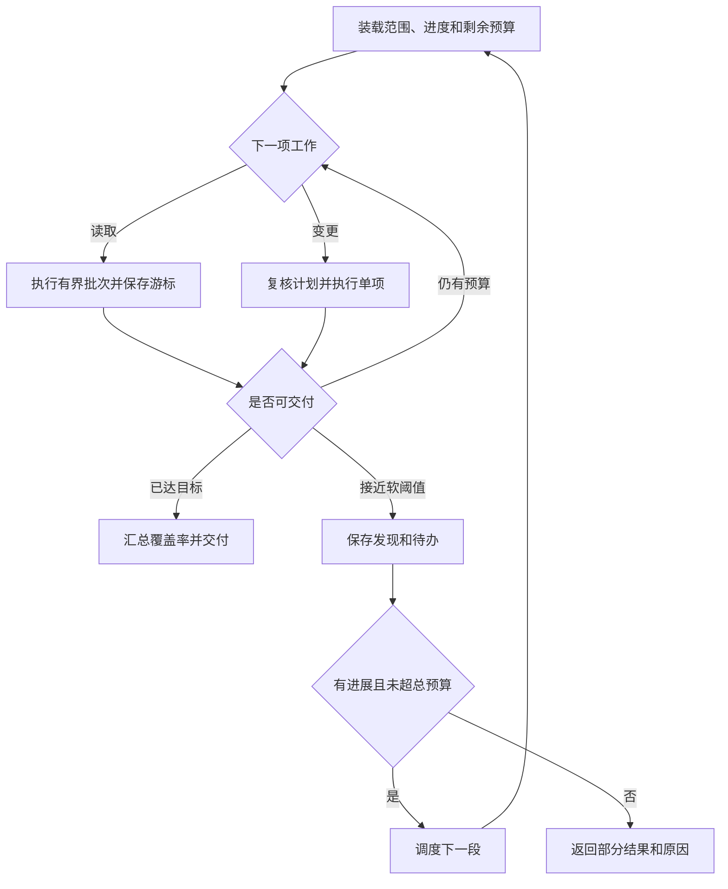

# 目录分析与 Agent Loop 的三阶段实施方案

本文供开发与验收使用。基线是 feature/session-permissions 的 650427c。贯穿用例是“分析一个目录，给出结构优化建议，并按建议整理”；代码库用例是“从审批入口追踪到写入和恢复”。下文的工具名、表名和预算均为拟议设计。预算值是首轮压测起点。

## 基线与交付顺序

当前 runtime/service.py 将 recursion_limit 固定为 50，提示词要求先看 tree，每批最多读 3 次，每次最多 2,000 字符。tools/files.py 的分页限制主要约束模型接收的文本；底层 read_version 会读取文件以获取正文和版本，大文件逐页访问仍可能反复产生全量 I/O。runtime/budget.py 按请求序列化字节数裁剪历史，默认上限 160,000 字节。tasks/executor.py 以 run:key 建立图线程，审批后恢复，收到 assistant.final 后调用 repo.deliver。当前分支的交付入口与 task-memory-v2 分支不同，以下实现应接入前者。

| 阶段 | 可独立上线的能力 | 进入下一阶段的判据 |
|---|---|---|
| 一 | 三个有界只读工具、按意图选工具、成本与覆盖率可观测 | 基准集确认减少模型往返，并能指出未扫描、未读和失败范围 |
| 二 | 持久扫描、预算收尾、同一业务 Step 分段执行、可恢复的批量移动 | 强制耗尽预算、撤权或重启后，验证不漏记、不重复修改 |
| 三 | Python 代码符号地图、引用定位、按需只读 Explore | 对未知调用链，比阶段一文本搜索在相同质量下更省时或更省 token |

LangGraph 的 super-step 是图调度单位。并行节点可以共享一个 super-step。统计时分别记录图步、模型请求、工具调用、底层文件访问；只用工具次数估算剩余图步会误判。参考 [LangGraph Graph API](https://docs.langchain.com/oss/python/langgraph/graph-api)。

## 阶段一：先减少必须经过模型的读取轮次

### 文件工具契约

所有输入用 Pydantic 拒绝未知字段。路径沿用 WorkspaceService 的相对路径、设备绝对路径和 workspace:// 引用。身份和绑定从 Runtime 注入。统一结果包含 coverage、truncated、stop_reason；有后续批次时给 next_cursor。coverage 区分枚举到的条目、已检查内容的文件、仅元数据、跳过原因及错误数量。未知总数返回 null。

| 工具 | 请求字段 | 响应与程序流程 |
|---|---|---|
| project_inventory | root、include/exclude glob、include_hidden=false、max_depth、max_entries | Endpoint 按目录稳定顺序枚举元数据，按后缀、一级目录、大小区间聚合。返回 inventory_id、计数、代表路径和最大文件样本。默认每片最多访问 2,000 项或 2 秒；达到先到的限制即返回。普通遍历不计算内容哈希 |
| project_search | root 或 inventory_id、query、mode=name/literal/regex、include、context_lines、max_hits、cursor | 先过滤文件，再在 Endpoint 搜索。返回 path、line、短 snippet、version 或观察标识。默认最多 50 个命中、2 行上下文；按文件、行号排序。文件名搜索可以涵盖二进制；正文搜索只处理支持的文本。明确报告超大文件、编码或权限问题 |
| project_read_many | items 数组，每项含 path、可选 expected_version，外加 line_start/line_count 或 offset/limit 二选一；max_output_bytes | 最多 8 项，默认并发 4，按请求顺序返回。整批序列化结果上限初值 24 KiB，给各项预留元数据预算，再公平分配正文。每项返回 status、path、version、实际范围、正文及续读位置。单项 stale、缺权、二进制、超预算均独立返回 |

行号从 1 开始，offset 为从 0 开始的 Unicode 字符位置；响应显式标注单位。游标是不透明标识，绑定 Session、位置、根、查询参数、工具版本和排序状态。改查询条件重新扫描。首版使用进程内有界缓存保存遍历队列和命中清单，默认每次运行最多 50,000 条元数据，15 分钟无访问则过期。缓存失效返回 cursor_expired；调用方从根重新开始并告知覆盖率。**本阶段无新业务表**。缓存只代表观察时刻；返回缓存内容前重校权限，发生撤权则丢弃相应缓存。

本机实现优先使用受约束的目录枚举、流式文本读取或固定参数的 rg 子进程。搜索表达式、路径均按参数传递，限制 CPU 时间、输出字节和可搜索文件大小。Endpoint 内排除符号链接、应用数据目录、不可访问项；按需跳过 .git、依赖和构建目录，并在 coverage 中列明。云 Connector 使用对象分页和范围读取；缺少原生搜索时限定下载量做有界扫描，无法满足时返回 unsupported。避免将本机递归路径直接交给无法执行同一权限边界的后端。

对 read_many 的工具级只读版本，可使用稳定对象版本，或本机打开文件前后的 stat 观察标识。对普通本机文本可在同次调用内合并同文件范围并共享解码结果。首次定位很深的行号也要受扫描字节上限限制。已有编辑链路使用的内容版本须保留；后续写操作执行前取得真实写基线，元数据指纹只用于发现变化。批读成功的完整版本应同步给 FileToolService 的 observed_versions，否则会出现“刚读过又被要求 project_read”。

**例。** 用户要求“看 Downloads 如何整理”，先调用 inventory；模型看到 PDF、表格和压缩包分布后，仅对命名不清的文本做 read_many。输出建议同时标注“已枚举 800 项，打开 12 个文本，25 个 PDF 仅按名称和元数据判断”。若要求逐份分析 PDF 内容，应报告格式能力或进入专门解析流程，不把抽样记作全量分析。

### Runtime、代码落点与验收

1. 在共享 Workspace 端口增加分页枚举、内容搜索和范围读取能力。在设备 Connector 实现本地 I/O，在 server/workspace/routing.py 校验资源，最后由 tools/registry.py 注册工具。目录权限覆盖的扫描只申请该根；离散文件先逐项预检，按已有审批项机制请求缺权文件，不自行扩大到共同祖先。每个实际 I/O 重校有效权限。
2. 修改 runtime/service.py 的提示词。已知路径直接读取，已知标识符直接搜索，未知目录分布才先清点。独立读取尽量合为一批，下一跳依赖上一轮结果时再发新请求。续读必须有尚未解决的问题或明确的覆盖要求。保留原工具供精确单文件操作使用。
3. runtime/model_activity.py、runtime/budget.py 和工具结果分别产出模型请求数、用量、序列化字节、工具耗时、实际读取字节、命中数和覆盖率。通过 LangGraph 运行时 metadata 按线程和 invocation 去重记录实际 graph step。供应商未返回 token 用量时标记 estimated。复用 events 存摘要，长正文按引用取回。
4. 固定模型、测试目录、权限和任务指令，对旧版与新版分别做冷缓存和热缓存回放。首个门槛建议用 24 个已知路径各取一个片段：预算足够时最多 3 次 read_many；混入 1 个失效版本，其余结果仍返回。另测大目录截断、中文分页、混合编码、云分页、撤权后继续、总输出上限。端到端比较模型往返、输入 token、p50/p95 延迟、是否找到预先标注的关键文件；使用相同覆盖要求比较，不以少读文件换取达标。

### 第一阶段实现记录

- 三个新工具默认启用。设置 `ARTORIAS_PROJECT_ANALYSIS=0` 后启动服务，可切回基础文件工具与对应提示词。
- 目录清点统计按页返回。游标受 Session、Run、Task Step、路径与参数约束，采用进程内缓存，重启后需重新扫描。搜索按稳定目录遍历顺序及行号输出，支持文件名、区分大小写的正文和单行正则。扫描和耗时预算触发时返回覆盖率及停止原因，端点可报告上限导致的未覆盖范围。
- 批读单文件上限为 1 MB，单次最多 8 项并以最多 4 路并发读取。同一路径的多个范围共享一次读取和内容版本。超长单行可改用字符范围继续。返回正文与元数据合计默认最多 24 KiB。
- 本机和本地启动器的托管云空间已接入。实际云存储或远程设备 Connector 通过 `AnalysisOperations` 提供能力，未实现的操作返回 `unsupported`。
- 在现有事件表记录 `runtime.graph_metrics` 和 `runtime.tool_metrics`，无需业务表迁移。前者按图调用统计图步、模型请求、序列化字节、token 和工具调用次数。估算 token 仅用于趋势观察。后者统计新工具的耗时、序列化字节、内容读取字节、命中和覆盖率。
- 24 个已知文件的固定回放比较了旧工具每轮 3 次与新工具每轮 8 项。两组都读取了全部 24 个文件，包含最终汇总的模型请求数由 9 次降为 4 次。该回放使用确定性的测试模型，实际供应商延迟和 token 需要独立测量。

## 阶段二：可恢复的执行和可撤回的批量修改

### 工具与数据契约

- **inventory/search 续扫。** 沿用阶段一接口，将 inventory_id 与游标改由持久层解析。每片在同一事务中 upsert 条目、累计统计并推进队列；恢复时先比较扫描条件和目录版本。无快照能力的本地文件系统记录扫描开始/结束和变化目录，对变化目录重新枚举去重。仅对同大小疑似重复组按需计算完整哈希。
- **project_plan_moves(items, inventory_id)。** items 含 source、destination、reason，首版仅同一位置、普通文件、禁止覆盖。返回 plan_id、plan_hash、逐项源版本、目标预期不存在、冲突和授权缺口。拒绝目标重名、大小写或 Unicode 等价碰撞、循环和源目标链；目录整树移动及跨位置复制另行处理。只要存在冲突，整份计划先回到建议阶段修订。
- **project_apply_moves(plan_id, plan_hash)。** 仅接受不可变计划引用。上层任务已要求实际整理时才进入该工具；仅请求建议时结束于预览。按权限方案走变更审批，展示路径清单和数量，授权决定绑定计划哈希。逐项复核源版本、目标不存在和两端写权限。返回 applied/conflict/skipped 数量、逐项 change_id 和剩余游标。容量不足时分片继续。
- **撤回。** 支持按清单逆序撤回已完成项，复用原位置、原权限、原版本、Blob 和变更日志。新增可幂等的 Connector.move，若后端不支持原子条件移动，首版返回 unsupported，避免把 copy/delete 当成一个原子动作。明确记录“部分完成”，中途冲突后停止后续移动，允许用户检查或撤回。

### 分段编排与进度保存

Task 仍代表用户目标，Task Step 仍代表该轮执行范围。**执行段**是同一 Run/Step 内的一次有界图调用。审批恢复沿用原图 thread 和 interrupt ID；软预算续跑创建新段线程 run:key:segment，仅加载业务快照、已确认发现、覆盖率、版本引用和待办。不要把上段所有 tool messages 重新灌入。阶段结束不调用 repo.deliver，只有最终交付才写 Task 结果。Task Memory 分支未来合并时，在这一处接 finish_step。

预算分三层。① 每次图调用保留硬上限，以实测收尾路径的 p95 super-step 数加余量预留收尾空间。② 每次模型请求以模型上下文窗口扣除预留输出、系统与工具开销，先保留目标、约束、未决工具协议和来源引用，再分配给历史，保留现有字节硬限。③ 每段限制读取量、扫描时长和并发。另设整个 Run 的模型次数、累计 token、总时长及最大段数；初值可试 3 段。任何总限额触发后保存并给出部分交付，避免不断开新段。

在图 middleware 的模型调用前检查软阈值；达到时仅允许汇总与保存，若模型连汇总预算也不够，由程序根据已保存的事实生成部分结果。无进展判断采用查询条件、游标、版本、行范围的组合；连续两次相同请求且没有新增覆盖或发现时停止重复读取。图硬上限异常在 tasks/executor.py 专门捕获，先判断持久进度和未决副作用，再决定可否续段。通用异常的失败处理保留。区分用户取消、审批等待、预算暂停、真正失败。

### 存储设计

下表是拟新增的 Assistant SQLite 表；TEXT 为 ID、枚举、路径、哈希、UTC 时间及带版本 JSON 的默认类型，计数和序号为 INTEGER。各表沿用 created_at、updated_at。FK 指向实际 sessions、tasks 和 task_steps(run,key)。不可从模型输入接受这些归属字段。

| 表及主键 | 核心列与约束 | 读写时机及索引 |
|---|---|---|
| analysis_scans，id | session_id、task_id、run_id、step_key、workspace_id、location_id、root、query_hash、query_json、state、frontier_json、coverage_json、revision、expires_at | 每个有界批次比较 revision 后事务更新。索引 (session_id,task_id,state)；过期扫描按 expires_at 清理 |
| analysis_entries，(scan_id,path) | kind、size_bytes、mtime、observed_version、content_hash 可空、scan_generation、error 可空 | 单目录重扫按 generation 标记已见并剔除旧项；索引 (scan_id,size_bytes)。库存只存元数据 |
| analysis_segments，(run_id,step_key,segment_no) | state、graph_thread_id UNIQUE、scan_id、findings_json、todo_json、budget_json、stop_reason、lease_owner、lease_until、revision | findings 保存结论、路径、范围和版本；超长明细用扫描引用。索引 (state,lease_until)。条件领取避免两个 worker 同时执行 |
| file_move_plans，id | session_id、task_id、run_id、step_key、location_id、plan_hash、state、approval_request_id | 批准后计划只读；更新清单生成新计划。索引 (session_id,task_id,state) |
| file_move_items，(plan_id,ordinal) | source、destination、source_version、expected_destination、state、operation_id UNIQUE、change_id、error | (plan_id,source) 与 (plan_id,destination) 各唯一，按源端规范化键建约束。索引 (plan_id,state,ordinal)。预检、执行、撤回均逐项记账 |

修改调度行为：jobs 的领取状态允许本段结束后重新 queued。保存段终态、插入下一段 ready、重新排队以及发送事件在同一事务提交；本次执行应直接退出，不得由 Scheduler 走 completed 分支。审批 waiting 保持独立。重启时仅重新领取可恢复段；对 applying 项先按 operation_id 查询 Endpoint journal，已确认成功则补记、确定未执行才重试，结果不确定转 needs_review。禁止仅凭源文件消失断定成功。通过唯一键及条件更新保证重复唤醒只产生一次交付。SQLite 事务不跨文件系统操作；Endpoint 先写持久 intent、备份并记录版本，再执行移动和提交 journal。撤回时若目标已被用户修改，返回冲突。

**实施与放行。** 先建表与只读续扫，再接 middleware 与 Scheduler，最后实现本机移动和撤回，再按能力开放云 Connector。测试在每个事务边界注入进程退出，包括文件已移动、应用表尚未确认的窗口。用极低步数强制分段；反复唤醒同一 job、审批期间撤权、用户修改源/目标、批次超时都应保留正确范围。目录中 100 个规划项若前 30 个成功、第 31 个冲突，要求可准确列出 30 个变更、1 个冲突、69 个未执行，重启后不会重复移动前 30 项。

## 阶段三：符号定位与只读 Explore

**启用条件。** 同一组调用链题中，阶段一仍频繁搜索同名符号、找不到注册入口，或主图上下文主要被探索过程占用时再上线。先做 Python 静态地图，再单独评估 Explore 的增益。

| 接口 | 参数与返回 | 工程行为 |
|---|---|---|
| project_symbols | root、query、kind、max_tokens、cursor → symbol_id、限定名、签名、path、起止行、version | 本机先用 Python ast 提取定义、导入及函数调用位置。索引按文件版本增量维护。解析失败或不支持的语言返回原因，回退阶段一搜索 |
| project_references | symbol_id、direction=callers/callees、depth、max_edges → 边、来源位置、解析方式及未解析项 | 优先精确的模块和限定名；同名、动态分派和装饰器注册返回候选。默认一跳，最多两跳，以 project_read_many 核实实现和运行时注册 |
| explore_code | question、allowed_roots、depth=quick/normal、budget → findings、引用、未解问题、用量 | 主图至多派发一个只读研究子图；仅开放 inventory/search/read_many/symbols/references，禁止派生子图和写工具。只传问题、相关标准与已授权范围，子图独立上下文，回传有限摘要 |

地图以当前出现的符号、入口文件和引用次数排序；将签名及来源裁入指定 token 预算。跨模块别名需显式解析，不能确定时只记录文本候选。调用链回答要求每一条已确认边有 path、行范围和版本，可从原文回查。普通文件整理继续使用阶段一、二。索引绝对路径、搜索摘要与代码内容同属用户数据；任何索引查询及摘要恢复前检查当前授权。增量索引只处理当前获准范围；撤权后先阻止返回，再异步清理缓存。

**表设计。** 由拥有代码的端点维护独立派生 SQLite 索引，本机 Device 与云存储位置分别建库。业务库不复制源码。以下表含 owner/位置隔离键和时间列，可整库重建。首版单用户，部署多用户时按 owner 分区。

| 表及主键 | 字段、约束和索引 |
|---|---|
| symbol_files，id | owner_id、location_id、workspace_id、canonical_path、version、parser_version、language、state；唯一 (owner_id,location_id,workspace_id,canonical_path) |
| code_symbols，id | file_id FK、qualified_name、kind、signature、start_line、end_line；索引 (qualified_name,kind)、(file_id,start_line)。symbol_id 引用须配合文件版本消费 |
| code_references，id | file_id、source_symbol_id、target_symbol_id 可空、target_text、line、resolution；按 source_symbol_id、target_symbol_id、target_text 建索引。更新或删除文件时同事务替换其定义和出边，对关联入边重新解析 |

Runtime 根据任务目标、搜索歧义和剩余总预算决定是否委派。子图绑定父 Session、Workspace、Task 和只读工具白名单，限制目录必须是父授权范围的子集。分配的子预算从父 Run 余额扣除，取消和超时向下传递，重启复用阶段二 segment 记录（增加 parent_segment、role 与 invocation_key 唯一键）。父图收回结果前检查引用版本；过期时仅重查受影响的边。索引故障或 Explore 超时时保留已有发现，回退文本搜索。

**验收。** 准备带同名函数、别名导入、装饰器注册和动态派发的仓库，并人工标注入口、候选边与可证实边。比较“文本搜索”“搜索加地图”“地图加 Explore”三组：正确边召回率、误报数、主图峰值 token、全 Run 总 token、模型请求数和耗时。要求无依据边被标成已确认的数量为零。索引重建、撤权和改名后不得返回旧版本为有效证据。若仅主图 token 下降而总耗时和正确率变差，保留地图并关闭自动委派。

## 发布与回退

三个阶段分别以只读批量工具、持久执行段、符号索引与委派开关灰度。开关关闭时当前已创建的执行段和已批准清单仍需可查询、取消和对账；停止创建新项，不删除已有 journal、Blob 或权限记录。每阶段提交附固定夹具、配置、实际指标及失败样本。先以同一仓库和相同任务复现基线，再决定是否调整 recursion_limit。

研究依据与相关设计：[Codex 工具使用指引](https://github.com/openai/codex/blob/main/codex-rs/protocol/src/prompts/base_instructions/default.md)、[Aider repository map](https://aider.chat/docs/repomap.html)、[Claude Code 子 Agent](https://code.claude.com/docs/en/sub-agents)、[项目权限设计](permissions.md)、[Workspace 设计](workspace_design.md)。
