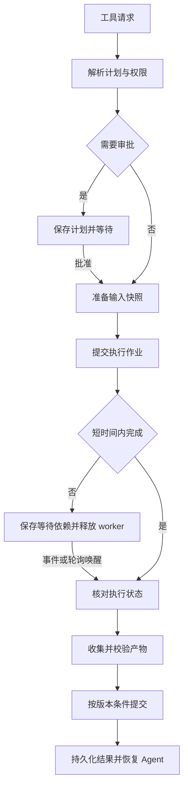

# run_python 功能设计方案

日期：2026-11-19。适用基线：Artorias Assistant v0.7 五模块架构。

本文保留完整目标设计。v0.8 已实现本地 isolated/workspace_copy、审批快照、二进制产物提交及启动核对；尚未实现远端作业、长任务自动释放 worker 和 direct_mount。具体接口差异与验证范围见文末实现对照及 release_v0.8.md。

## 1. 定位与职责范围

run_python 是个人助理的通用 Python 执行能力，服务于模型完成用户任务：数据分析、文档生成、批量转换、代码验证，以及用户明确要求运行的已有脚本。模型生成脚本与用户提供脚本使用相同的权限规则，来源不意味着可信或自动授权。

模型可见的 run_python 是一次完整的执行用例；内部拆分为输入准备、受限执行、产物收集与提交，避免 sandbox 同时承担路径路由、用户授权和文件版本管理。

| 组件 | 负责 | 不负责 |
|---|---|---|
| run_python 工具适配 | 校验参数、关联工具调用、返回执行/提交结果 | 自行扩大权限、猜测最终物理路径 |
| ExecutionService | 解析计划、授权、输入准备、执行调度、产物提交编排 | 直接实现各类文件系统和容器 |
| SandboxExecutor | 启停 Python、隔离资源、日志、退出码、超时与取消 | 决定用户目标目录、直接写任意宿主机目录 |
| WorkspaceService / connector | 目标解析、授权检查、版本条件写入、Blob、变更与撤销 | 执行不受限制的脚本 |
| ArtifactService | 收集、校验、保存临时产物，生成清单 | 将 stdout 中声称的路径视为已交付文件 |
| Runtime / scheduler | 调用工具、审批交互、挂起恢复、整合任务结果 | 根据进程退出码自行推断文件已保存 |

Python 执行成功与产物保存成功必须分别记录。只有提交确认后的资源地址可以向用户报告为最终交付位置。

## 2. 当前实现及不足

v0.7 当前工具签名为 run_python(path)。tools/registry.py 发起一次代码执行审批，tools/executor.py 调用注入的 sandbox；本地启动器注入 device.tools.sandbox.LocalDockerExecutor。

当前 executor 将默认 workspace 中的文件复制到临时目录，只读挂载到 Docker 的 /work，在该目录运行已有 .py 文件。脚本可以先由模型使用 project_write 创建。容器无网络，限制内存、CPU、进程数、运行时间和日志输出，结束后删除容器及临时目录。

现有不足：

- 全空间复制，不能精确声明输入，较大 workspace 成本高。
- 无 argv、依赖环境及输入映射接口；读取范围主要是默认空间。
- 没有持久产物目录、二进制提交接口和产物清单；只能返回日志。
- 审批说明未精确展示实际输入、输出目标与网络范围。
- 执行器由本地配置注入，尚无远端执行作业及断线恢复协议。
- ToolResult.status 当前表示调用完成，不能直接作为 Python 退出成功判据；未来按 exit_code 与提交状态细分。

## 3. 运行模式

### 3.1 isolated：默认隔离产物模式

适用于分析、生成文件、格式转换、脚本验证。只准备声明的输入资源；默认不复制整个 workspace。

| 容器路径 | 权限 | 用途 |
|---|---|---|
| /app | 只读 | 入口脚本和明确声明的代码依赖 |
| /inputs | 只读 | 用户数据，按输入别名映射 |
| /work | 可写、临时 | 中间计算、缓存 |
| /outputs | 可写、受配额限制 | 候选交付产物 |

默认 cwd=/work；固定环境变量 ARTORIAS_INPUT_DIR、ARTORIAS_OUTPUT_DIR、ARTORIAS_WORK_DIR 告知路径。脚本通过 argv 获取具体输入，不依赖用户机器的绝对路径。

数据与 executor 同机时，可经授权和版本核对采用只读挂载；需要稳定快照时采用复制、克隆或内容寻址缓存。跨位置必须经 connector 下载/导出。只读挂载只禁止容器写入，宿主机仍可能修改文件；因此它不是一致性快照。

执行结束后收集 /outputs，先保留为 artifact，再由 workspace 接口提交到指定目标。执行失败默认保留诊断产物但不自动发布。

### 3.2 workspace_copy：授权工作副本模式

适用于运行多文件工程、构建项目、修改已有文件的脚本。对明确授权的目录建立副本或写时复制视图，记录基线 manifest，在副本中允许写入。

执行后比较新增、修改和删除，生成 ChangeSet。新增/修改通过 workspace 提交；删除默认需要明确的删除授权。覆盖与删除必须匹配执行前基线版本。检测外部修改后返回冲突，不覆盖。

默认排除凭证和应用内部数据；排除规则及实际输入清单需要可见。大项目按目录、文件数量、字节数设置上限，缓存复用也必须验证资源版本与授权。

该模式是“授权工作目录执行”的首选实现，并不直接修改原目录。

### 3.3 direct_mount：后续可选高权限模式

仅在副本语义不能满足需求时考虑，例如依赖真实路径的受信任本地工作流。可写挂载严格限定目录，必须单独授权，不能从 isolated 自动升级。

脚本写入会绕过 workspace 写接口，需另行实现可恢复快照、变更采集、并发控制和审计。执行后扫描无法保证捕获所有中间状态，也不能抵消外部并发写入；不能承诺完整逐次撤销。第一阶段不提供此模式，避免把可写挂载误认为已具备现有 Blob/版本语义。

## 4. 权限与位置决策

### 4.1 四个独立维度

1. 读取范围：脚本、输入文件/目录及代码依赖。
2. 写入范围：输出目标、是否覆盖、是否删除。
3. 执行位置与环境：device/cloud、环境 profile、资源配额。
4. 外部能力：网络、凭证、设备访问。

workspace 指定默认资源位置，不决定 executor 必须位于哪里。云端 executor 处理本地数据意味着数据离开设备；授权必须包含处理位置与数据传输范围。设备离线或 executor 不可用时保持等待/失败，不自动把数据改送另一处。

### 4.2 解析优先级

明确指定的资源地址优先，否则使用 Task/Run 的 workspace 快照。已有 Task 不因 Session 改选空间而改变默认输出目标。程序根据 ResourceRef 和部署策略解析最终地址，模型不提供可信的容器宿主机路径。

模型可请求 execution_hint=auto/device/cloud，由策略验证并最终选择 executor；hint 不构成授权。脚本访问本机绝对路径需要先解析为授权资源引用，再映射到容器中。

### 4.3 审批与复用

审批展示：脚本摘要/内容哈希、输入范围、执行位置、网络策略、输出目录、覆盖/删除规则、资源上限。一次性审批绑定计划哈希；脚本、位置、输入或写入范围改变时重新评估，不能复用旧的一次性批准。

用户也可以明确授予 Task 范围的代码执行能力，允许后续脚本在同一权限边界内运行；这种授权需明确包含“代码可能变化”，而非仅批准某一个脚本。范围扩大、授权撤销或目标变化均需重新检查。

所有实际读写与提交再次校验权限，审批不是永久绕过检查。依赖安装/联网采用独立策略，第一阶段默认禁止；凭证不得通过复制整个环境变量或用户主目录传入。

## 5. 接口设计

以下为目标接口，不是 v0.7 已有签名。

### 5.1 模型可见 run_python

```json
{
  "script": {"resource": "workspace://ws-project/scripts/report.py"},
  "args": ["--input", "/inputs/sales.xlsx", "--output", "/outputs/report.xlsx"],
  "mode": "isolated",
  "inputs": [
    {"resource": "workspace://ws-data/sales.xlsx", "mount_path": "sales.xlsx"}
  ],
  "output": {
    "target": "workspace://ws-result/reports/",
    "publish": "auto_if_authorized",
    "overwrite": "deny",
    "include": ["*.xlsx"]
  },
  "execution_hint": "auto",
  "environment": "python-data-v1",
  "timeout_seconds": 120
}
```

| 字段 | 规则 |
|---|---|
| script | 已保存脚本资源引用；模型生成脚本先通过文件工具保存，绑定脚本版本与哈希 |
| args | 字符串数组，直接传给 Python，不拼接 shell 命令 |
| mode | isolated 或 workspace_copy；后者额外提供 working_directory 资源引用 |
| inputs | 文件或目录资源及容器内相对别名；禁止绝对 mount_path、..、别名冲突 |
| output.target | 可省略；程序解析为 Task/Run 默认 workspace 的产物子目录，并在计划中展示 |
| output.publish | auto_if_authorized 或 stage_only；自动提交仅限既有授权范围 |
| output.overwrite | deny 或 if_unchanged；既有目标在执行前记录版本，新文件提交要求目标不存在 |
| output.include | 仅筛选 /outputs 下候选文件，不扩大访问范围；数量和大小仍受配额限制 |
| execution_hint | 请求偏好，由策略选择最终执行器 |
| environment | 受管环境 profile ID，绑定镜像 digest；模型不得任意提供特权容器参数 |
| timeout_seconds | 请求值，由系统上限约束；CPU、内存、磁盘等取部署策略 |

working_directory 与 output.target 分别表示执行基线及产物目的地。workspace_copy 的差异提交回原工作目录；/outputs 中额外产物按 output.target 提交，两类目标都应在计划中明确。

自动输出子目录建议为 artifacts/<execution_id>/，避免默认同名覆盖。用户明确指定文件名时遵循用户目标，不擅自另存；发生冲突返回冲突信息。

### 5.2 内部执行计划

ResolvedExecutionPlan 由程序生成，至少包含：

- execution_id、tool_call_id、session_id、task_id、task_step_id、run_id、request_key。
- 规范化脚本引用/版本/哈希、输入 manifest 引用、容器映射。
- executor_id、location_id、环境 digest、cwd、argv、限制、network_policy。
- 输出目标引用、提交策略、已知目标的 expected_version、权限 grant 引用。
- plan_hash、approval_id、过期时间、当前状态。

这些标识来自 runtime，不接受模型伪造。对同一 request_key 绑定相同 plan_hash；相同 key 不同计划报错。输入过大时 manifest 独立保存，不把全部清单塞入 LLM 上下文。

### 5.3 执行与资源端协议

```python
class ExecutionBackend(Protocol):
    async def submit(self, plan_ref, idempotency_key) -> ExecutionHandle: ...
    async def get_status(self, execution_id) -> ExecutionStatus: ...
    async def cancel(self, execution_id) -> None: ...
    async def collect(self, execution_id) -> ArtifactManifest: ...

class ArtifactPublisher(Protocol):
    async def publish(self, execution_id, manifest_ref, policy) -> PublishResult: ...
```

submit 返回可查询 handle，不依赖调用协程长期存活。后台事件是通知，get_status 是恢复后的核对接口。事件应有 execution_id、单调 sequence、event_id，并支持去重/补查。

Workspace connector 需要扩展：流式 export、二进制 put_file/write_bytes、带 expected_version 的覆盖/删除、变更结果查询；大文件不能经过当前 UTF-8 字符串及 1MB 限制接口。输入读取必须获取“内容与对应版本”，不能分别读取 head 和内容后假定一致。

新增文件使用 expected_absent；已有文件使用 expected_version。目标条件写入必须由实际资源执行端保证，不能只在服务端先检查再无条件写入。

### 5.4 返回结果

```json
{
  "execution_id": "exec_123",
  "execution_status": "succeeded",
  "publish_status": "conflict",
  "exit_code": 0,
  "stdout_tail": "report generated",
  "stderr_tail": "",
  "logs_ref": "log_123",
  "artifacts": [{"id": "artifact_1", "path": "report.xlsx", "size": 12800, "sha256": "..."}],
  "published": [],
  "conflicts": [{"target": "workspace://ws-result/reports/report.xlsx", "reason": "version_changed"}]
}
```

退出码非零、超时、取消、executor 失联分别表达。输出截断明确标记。LLM 接收摘要、尾部日志和资源引用，完整日志与二进制产物不注入上下文。

## 6. 调度流程



1. Runtime 收到工具调用，为它分配稳定 execution_id/request_key，关联当前 task_step。
2. ExecutionService 解析脚本、输入、目标及执行位置，检查权限并生成不可变计划。一次性审批后如计划改变，重新审批。
3. InputStager 准备代码与输入，记录读取版本、内容哈希、目标基线。审批到执行之间脚本改变时不得执行新内容冒充已批准版本。
4. 调度器调用 backend.submit。只有获得可查询 handle 或具备幂等查询依据后，才允许按异步作业处理。
5. 短任务可等待有限时间；长任务由 durable execution 继续运行。保存工具等待、图 checkpoint、依赖 execution_id 后释放 runtime worker。单纯超时离开一个普通协程并不能保证容器继续可靠运行。
6. 完成事件或后台轮询触发恢复；先检查持久状态，处理重复/乱序事件，核对实际退出状态。
7. 收集产物，拒绝越界路径、符号链接、特殊文件、不允许的硬链接和超额文件；计算哈希并写入受控 artifact store。不得信任脚本提供的 manifest，必须由收集器实际枚举验证。
8. 提交前重新检查权限和目标版本。对每个文件持久化提交结果/变更 ID；重复恢复先查提交记录，不再次覆盖。
9. 返回执行状态与提交状态，更新 task_step 结果引用；Runtime 决定继续处理还是向用户报告完成/冲突。

### 挂起、恢复与取消

等待主体可由 task_step 表达，但每一次工具执行必须有独立 execution 记录。一个 step 可以调用多个工具，不能只在 step 上保存一个模糊的“等待中”。

保存：执行计划引用、checkpoint/thread/namespace、tool_call_id、execution handle、等待依赖及超时策略、输入/目标版本 manifest、产物引用和逐文件提交记录。无需复制整个 workspace 作为 runtime checkpoint。

同一次逻辑执行恢复沿用 execution_id；队列 Job/调度 attempt 可重建并关联它，不能因此重新启动脚本。重试 submit 必须使用原幂等键；不确定是否已执行时先查询，不盲重跑。

取消由 runtime 转给 backend，先标记 cancel_requested，确认进程停止后标记 cancelled。若已进入提交阶段，停止后续提交并报告已提交清单；取消不能等同于自动撤销。需要回滚时按 change_id 重新检查版本后执行。

本地 MVP 可保持进程内短任务等待；进程退出后的运行结果核对与长期挂起需下一阶段实现。不得在持久执行机制完成前，仅释放协程并宣称可恢复。

## 7. 产物提交、备份与一致性

- Artifact 是执行输出的暂存对象；workspace 文件才是用户最终资源。artifact store 与用于撤销的 Blob store 概念分开，可复用底层内容存储，但需不同生命周期和访问控制。
- local/cloud 输出位置独立选择；由 connector 上传/下载，不把服务器路径作为用户本机路径。
- 已知覆盖目标在执行前取得基线；产物名称动态产生且未取得基线时，只允许创建不存在的新文件。不能执行结束才读取旧文件版本并据此无条件覆盖用户执行期间的改动。
- 采用现有变更日志及 Blob 机制，但增加二进制与大文件接口、幂等操作 ID。每个提交以 (execution_id, artifact_id, target) 作为幂等身份。
- 多文件提交默认逐文件一致，不宣称跨文件、跨 connector 的原子事务。中途失败返回 partial，保留成功变更和未提交产物；需要项目级原子切换时增加快照/目录交换能力。
- 脚本退出成功而提交冲突时保留 artifact，用户可决定重新计算、另存或在明确授权后覆盖；不自动换目标目录。
- workspace_copy 将新增、修改、删除分别记录，禁止把未被复制的文件误判为删除。

## 8. 持久化结构建议

以下为新增工程表，统一 created_at/updated_at；SQLite 沿用 UTC 文本时间格式，未来 PostgreSQL 映射为 timestamptz。

| 表 | 核心字段 | 约束/用途 |
|---|---|---|
| python_executions | id, session_id, task_id, task_step_id, run_id, tool_call_id, request_key, mode, executor_id, plan_ref, plan_hash, status, publish_status, exit_code, error_code, deadline_at, cancel_requested | request_key 在调用主体范围内唯一；逻辑执行身份 |
| execution_attempts | id, execution_id, attempt_no, backend_handle, status, lease_owner, lease_expires_at, fencing_token | (execution_id,attempt_no) 唯一；部署相关尝试记录 |
| execution_manifests | id, execution_id, kind, content_ref, content_hash | inputs/target_baseline/outputs/changeset 清单 |
| execution_artifacts | id, execution_id, relative_path, content_ref, sha256, size, media_type, expires_at | 暂存产物，执行内路径唯一 |
| execution_publications | id, execution_id, artifact_id, target_ref, expected_version, operation_id, status, change_id, error | 幂等提交与部分失败恢复 |
| execution_waits | id, task_step_id, tool_call_id, execution_id, checkpoint_ref, state, deadline_at | 复用已有通用等待机制时不重复建表 |

审批复用已有审批存储，增加 plan_hash 与授权范围关联；不要另造与现有审批冲突的一套状态。事件沿用现有持久事件系统，增加 execution.queued/running/finished、artifact.collected、publication.completed/conflict 等类型。

execution.status 建议为 awaiting_approval、preparing、queued、running、succeeded、failed、cancel_requested、cancelled、timed_out、unknown；publish_status 单独为 not_requested、pending、publishing、succeeded、partial、conflict、failed。unknown 表示无法核实，不能假装 failed 后立即重跑。

作业数据库为状态事实源；checkpoint 负责 Agent 续执行，两者通过稳定 ID 关联。需要事务 outbox 或恢复扫描处理“状态已写、唤醒通知未发”的崩溃窗口。

## 9. 与五模块架构的对应

| 模块 | 建议新增/调整 |
|---|---|
| artorias_shared | execution/models.py、execution/ports.py：ExecutionPlan、ArtifactManifest、PublishResult 与 backend 协议 |
| artorias_server/tools | run_python.py 工具适配；executor.py 保留执行器选择；execution_service.py 编排；artifact_publisher.py 提交 |
| artorias_server/workspace | export/二进制写入/条件删除/幂等查询；保持 catalog、routing、connector registry 边界 |
| artorias_server/storage | execution repository、migration；未来替换共享数据库实现 |
| artorias_server/scheduler | execution 等待与唤醒；不把短期协程当持久作业 |
| artorias_device/tools | sandbox.py 或 sandbox/ 包：本机 Docker backend、输入暂存、产物收集与清理 |
| artorias_device/workspace | 二进制 Blob/版本操作和设备端幂等提交 |
| artorias_web | 审批范围、执行进度、日志、产物和提交冲突展示 |
| artorias_local_app | 注入本地 executor、artifact store、配额、环境 profile |

云端 sandbox backend 可以实现相同协议，后续按体量独立为部署适配包；server 不反向导入 device。local_app 继续是本地实现的组装位置。网络客户端返回 DTO/流引用，不传递服务端 Store 对象。

## 10. 依赖环境与资源治理

环境 profile 预装常用依赖，例如数据分析与 Office/PDF 处理；绑定镜像 digest 和依赖清单。缺包返回清晰错误，不能偷偷联网安装。后续如开放安装，通过受控构建服务创建可复用环境并限制来源，不在业务容器里注入宿主机包管理权限。

限制包含：输入总字节数/文件数、输出总字节数/单文件大小、运行时长、内存、CPU、PID、临时磁盘和日志。日志采用有界收集或滚动存储；超限策略区分截断与终止。

Docker 挂载目录设置适当 UID/权限，输出允许非 root 写入，但不暴露 Docker socket。网络关闭使用运行环境实际隔离；不能仅依赖提示词。宿主机路径解析需防符号链接及检查后替换竞态。

artifact TTL 必须覆盖等待审批/冲突处理期间，正在被任务引用的产物不能被普通清理任务提前删除。清理幂等、可恢复，同时处理超时容器、孤立临时目录和过期下载凭据。

## 11. 实施阶段与验收

### 第一阶段：可交付的本地 isolated 模式

扩展参数、精确输入 staging、/outputs、二进制产物收集、输出目标解析、权限展示、条件提交和清理。默认无网络、同步等待短任务。兼容旧 run_python(path) 调用，但在文档中明确默认输入范围变化；若已有脚本依赖整个项目，应提示声明目录而非静默失败。

### 第二阶段：workspace_copy 与任务授权

增加工作副本 manifest、差异提交、删除审批、项目缓存及 Task 范围能力授权。处理执行期间外部修改、部分提交、重复恢复和产物另存。

### 第三阶段：持久执行与云端后端

增加 execution repository、远端 backend、设备网关、作业查询/取消、事件 outbox、checkpoint 等待恢复和多 worker 租约。完成独立设备授权校验后再允许云端调度访问本地资源。

### 验收场景

1. 模型生成脚本读取本地 Excel，产出二进制报告并保存到指定目录，产生 Blob 与 change_id。
2. 用户已有多文件脚本通过声明依赖运行，argv 含空格或特殊字符不会触发 shell 解释。
3. 跨 workspace 输入与云端输出按权限路由；设备离线不自动改变执行位置。
4. 未授权目录、越界/链接产物、超额输入输出、未授权联网被实际执行端拒绝。
5. 同名新文件冲突、执行中外部修改、授权撤销均阻止覆盖；产物保留可供处理。
6. 多文件部分提交、重复唤醒、提交中崩溃不造成重复变更；恢复返回已知结果。
7. 超时/取消终止容器并清理资源；长任务挂起不重复执行脚本。
8. 非零退出不报告成功，退出成功但发布失败不报告已保存。
9. 未启用 direct_mount 时任何请求都不能自动获得宿主机可写挂载。
10. checkpoint、日志和模型上下文不包含无关文件内容或环境凭证。


## 12. v0.8 实现对照（2026-11-19）

- 已实现：path/args/inputs/output、code_directory、working_directory、isolated/workspace_copy；稳定工具调用 ID、计划哈希、脚本/输入版本绑定、镜像内容 ID 固定；默认无网络。
- 已实现：输入按声明复制、隐藏配置目录自动排除、只读宿主机挂载、容器内 tmpfs 工作/产物目录、资源限制、超时/取消清理；完整列出权限范围的逐次审批。
- 已实现：输出与工作副本差异收集、二进制提交、执行前声明 expected_files 的覆盖、未获准删除保留、变更 Blob/撤销、端点 operation_id 幂等、逐文件部分成功。
- 已实现：python_executions 与 execution_publications（含时间字段）；输入/目标/产物 manifest 暂存于计划/结果 JSON；产物文件保存在 data/executions 下。
- 已实现：已收集产物在启动时继续提交；执行中崩溃标记 unknown 并尝试清理容器，绝不自动重跑脚本。当前恢复不自动继续原 Agent 对话，需要用户检查状态后继续。
- 已实现：执行状态查询、产物和日志下载 API、网页产物下载按钮；工具响应截断日志与清单，完整结果可通过 API 查询。
- 接口调整：模型入口继续使用 path 而非 script.resource；默认环境名 python-default，通过 ARTORIAS_IMAGE 选择预装镜像，审批时解析为内容 ID。overwrite=if_unchanged 必须同时声明 expected_files；动态文件名仅允许创建不存在的文件。
- 有界本地实现：每文件 32MB，输入与最终候选产物分别最多 96MB/500 文件；文本 project_read/write 仍保持 1MB。当前使用有界 bytes 暂存，真正流式大文件接口后续扩展。日志保存 stdout/stderr 各最后 64KiB，不声称保存无界完整日志。
- 暂未实现：独立执行服务、submit/query/event 协议、长任务释放 worker 后唤醒、远端 RPC、Task 范围免重复审批、直接可写挂载、自动依赖安装、产物 TTL/垃圾回收。这些属于目标方案的后续阶段。
- stage_only 与冲突产物长期保留，提供下载；暂无自动另存/重试发布 UI。不会擅自覆盖或变更目标。

见 [v0.8 发布说明](../releases/release_v0.8.md) 的使用示例、升级及 Docker 实测命令。

## macOS 原生执行

见 [macOS 本地 Python 执行](local_python_venv.md)。
