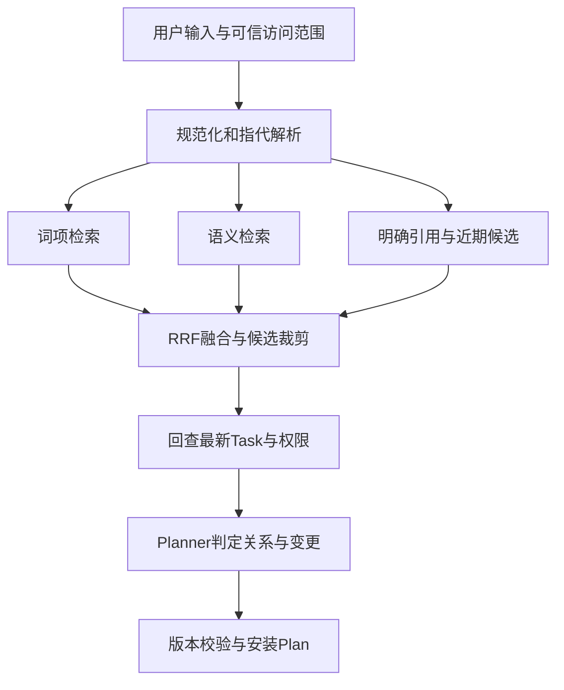

# Task 产品与工程设计：v0.6 实现基线与长期召回架构

日期：2026-11-19。项目：artorias-assistant / ai_agent_project。

本文整合历次 Task、Workspace、Runtime Worker 和云端拆分讨论，作为截至本日的统一 Task 设计文档，替代旧文档中“历史实现 + 后补章节”并存的结构。源码基线为 v0.6.0，Git 提交 `0acaf90`。本次交付仅更新设计文档，不宣称已实现下文的混合检索、异步索引或云端调度。

标记约定：**已实现**指已核对 v0.6 源码；**目标设计**指本次确定的后续方案；**待决策**指需要数据、产品选择或实测确认。实现事实与旧文档冲突时，以源码为准；未来目标与旧建议冲突时，以本文明确的取舍为准。

## 1. 设计目标与历史收敛

### 1.1 产品目标

Task 是一个可跨多次对话持续推进的业务目标，例如“完成季度财报分析”。Task 将长期目标和约束从 Session 的混合聊天中分离，使每次执行能识别正在处理的目标、承接已交付结果、保留用户约束并控制上下文规模。

Task 不等于项目、不等于 Workspace、不等于一次用户消息，也不等于队列 Job 或模型的工具调用。不能为了代码模块、文件或工具步骤逐个创建业务 Task。是否拆分，以能否形成独立交付为判断重点。

### 1.2 历次方案如何衔接

|阶段/依据|主要认识或变化|截至 v0.6 的统一解释|
|---|---|---|
|早期本地与云端架构，2026-11-11|Task 可选；最初计划不自动拆分；区分业务目标与 Run/队列|“尚不自动拆分”已过时；当前 Planner 已支持一轮多 Task|
|旧 Task 设计归纳的 v0.3 至 v0.5 阶段|Plan、Task、Step；跨轮关联；范围、依赖、执行结果与上下文|早期状态由旧文档和保留代码归纳，不声称逐个历史发布包均已重新复现|
|Workspace v0.5|Session、Task、Run 绑定；本地/云端路由；Blob 与变更记录|资源位置与任务目标分离；恢复不重新跟随 Session 选择|
|Runtime Worker 方案|业务 Task、Step、Job/Attempt 分离；持久等待|作为目标架构；当前审批仍复用原 Job，不是已实现的新恢复 Job 模式|
|v0.5.1 拆分计划与实施|Task 拆模块，Runtime 可注入适配器|代码仍在一个分发包、单进程内；不是已完成云端服务拆分|
|v0.6|需求 patch、revision、来源、快照、累积进展、时间字段、成果分页|本文件“当前实现”的基准|
|本轮召回设计|TaskSearch 投影、FTS/BM25、向量召回、RRF、Indexer|尚未实现；见第 7–11 节|

### 1.3 统一的关键决策

- Task 维护当前长期需求；Step 维护某次执行的范围、需求快照与结果。
- LLM 判断语义关系并提出 patch；程序负责归属、版本、事务、幂等、权限和路径解析。
- 先召回候选，再判断关联；相似度不能直接成为任务合并或授权依据。
- 需求变更、执行交付、验收通过、用户确认完成是不同事实。
- Task 为业务真相，检索表和向量都是可以重建的派生数据。
- 同进程模块边界先做好，再按需要部署为云端服务；不为每张表或每个类建立服务。

## 2. 领域对象与产品行为

### 2.1 对象关系

|对象|含义|当前关系|
|---|---|---|
|Session|用户对话与默认配置边界|包含多个消息、Run、Task；现有 Task 归属一个 Session|
|Message|用户输入或助手最终语义消息|原文保留；工具流事件不是普通最终消息|
|Turn|一次用户输入引发的交互轮次|当前 ID 保存在 Run.turn，没有独立 turns 表|
|Run|处理一次输入的逻辑执行，可等待并恢复|当前一条输入一个 Run；可含多个 Step|
|Task|可跨轮持续维护的业务目标|可关联多个 Run|
|Task Step / TaskExecution|某 Task 在一个 Run 内的一次执行分配|当前主键为 (run,key)，不是工具调用步骤|
|Plan|本轮路由、拆分、关联和依赖决定|一个 Run 一份已安装 Plan；可为 chat/clarify/tasks|
|Job|调度请求|当前按 Run 调度；目标区分 start/resume/yield|
|JobAttempt|一次领取执行尝试|目标设计，当前无该实体|
|Workspace|默认资源位置与访问路由依据|Task 可绑定本地或云端空间；不决定业务目标|

Task 与 Run 经 Step 建立多对多关系。一个 Run 可以有多个 Step；当前安装逻辑禁止同一已有 Task 在一个 Plan 内以 continue/refine 重复分配。一个 Task 跨多个 Run 的 Step 串联形成执行历史，但只有包含来源、patch、前后版本及需求快照，才足以解释需求的变化历史。

### 2.2 任务关系

|relation|产品语义|持久化|
|---|---|---|
|new|形成没有关联来源的新交付目标|新 Task、新 Step|
|continue|继续推进同一个目标|复用 Task、新 Step|
|refine|细化或修改同一个目标|复用 Task、新 Step；长期变化必须显式 patch|
|followup|基于旧成果形成新的独立目标|新 Task，source_task 指向旧 Task|

“已交付”不自动意味着新要求必须 followup；“属于同一项目”也不自动意味着 continue。模型要结合目标边界判断，不能确定则 clarify。当前 prompt 倾向将已交付目标的新增范围设为 followup，后续需要用真实语料评估，避免过度拆分。

### 2.3 状态语义

**当前：**Task 新建为 open；永久需求变更重新设为 open；交付后通常为 needs_review。Step 使用 pending/waiting/interrupted/delivered；执行发出 task.started 事件，但未显式将 Step 写成 running。Run 管理 queued/running/waiting/completed/failed/cancelled/interrupted 等状态。

**目标：**Task 可区分 open/in_progress/blocked/needs_review/completed/cancelled；Step 可区分 pending/ready/running/waiting/delivered/failed/cancelled。目标状态机须经集中规则迁移，不应直接把建议字符串写进现有表。

Run completed 表示本轮处理结束，不证明 Task 已完成。Step delivered 表示有交付，不证明 criteria 验证通过。当前没有完整的自动验收与用户完成确认交互。

## 3. v0.6 实际执行流程

### 3.1 提交与规划

1. API 接收原始输入和 request_key。Store 校验输入幂等，保存用户 Message、Run、Job、message.accepted 事件和提交时默认 Workspace 快照。
2. 单 Worker Scheduler 领取 Run。它虽然创建 asyncio Task，但随即 await，当前并非 10 槽位 Worker 池。
3. TaskRuntime 查询 task_plans；已有 Plan 则恢复使用，不重新规划。
4. 新 Run 调用 TaskRepository.candidates()；TaskPlanner 将用户输入、最近消息、候选 Task、路由规则和 Plan JSON Schema 交给 LLM。
5. 模型输出 Plan JSON，经 Pydantic 解析。这里“输出 JSON”是期望的输出格式，不是规划前已经存在的结果。
6. install 校验任务数/唯一 key、归属、引用、依赖无环及需求版本；将 items 按依赖拓扑排序。
7. 在一个业务事务中保存 Plan、新建或更新 Task、新 Task 的空间绑定、Step 与需求快照。默认 Run 空间快照和旧任务兼容绑定可能在此前单独事务准备，不能宣称所有 Workspace 兼容动作都在同一事务。

### 3.2 执行、交付与恢复

- chat：不建业务 Step，交给引擎处理；clarify：直接返回澄清问题。当前没有持久化的待答澄清实体。
- tasks：按安装后的 Step 顺序串行执行，已 delivered 的 Step 直接读取结果并跳过。
- 每个 Step 使用 `thread_id = run_id + ':' + key`，注入原始用户输入、task_id、业务上下文和对应 Workspace。
- ContextBuilder 按 (run,key) 保存一次上下文快照；审批恢复复用快照与框架 checkpoint。
- 审批中断将 Step 设为 waiting，Run 等待；当前 Store.decide 将原 Job 重新 queued，Run/Step 不变。
- 引擎异常或取消可将 Step 标为 interrupted；Run 终态由 Scheduler 管理。不能把当前 Step 状态当完整错误分类。
- 交付事务写入完整 Step.result，累积 Task 进展和摘要、增加执行计数、删除本轮审批决定。重复交付不覆盖结果、不重复计数。
- Run 最终答复拼接所有 Step 的成果；该合并答复不会直接作为单 Task 的历史成果注入。

当前 Snapshot 构建发生在引擎执行 try 块之前；上下文超限等错误可能导致 Run failed 而 Step 仍 pending。这是后续状态一致性需要补齐的点。

## 4. 当前数据库模型与时间字段

以下列出逻辑完整字段，类型与约束以源码和迁移为准。JSON 当前序列化为 SQLite TEXT。所有业务表有 created_at、updated_at。

### 4.1 business_tasks

|字段|类型/语义|
|---|---|
|id|TEXT 主键，业务 Task ID|
|session|TEXT，所属 Session|
|source_task|TEXT 可空，followup 来源；不是执行依赖边|
|goal|TEXT，当前长期目标|
|constraints|TEXT JSON 对象，约束 ID 映射到约束内容|
|criterias|TEXT JSON 对象，验收标准 ID 映射到标准内容|
|revision|INTEGER，长期需求版本，初始 0|
|status|TEXT，业务状态|
|summary|TEXT，最近一个已交付 Step 的完整结果|
|progress|TEXT JSON，最近 20 条交付索引|
|execution_count|INTEGER，交付计数|
|created_at / updated_at|TEXT UTC 时间|

三个字段共同表示 Task 的长期需求。迁移会从旧 `requirements` 保留已有的稳定 ID；只有旧约束列表时，按原顺序生成 ID。旧 `updated` 计数合并到 `execution_count`。

### 4.2 task_plans

字段为 `run TEXT PRIMARY KEY`、`plan TEXT NOT NULL`、created_at、updated_at。表业务列没有因 v0.6 再次拆成多列，变动主要在 plan JSON 的 Item schema。

Plan：kind(chat/tasks/clarify)、question、items（最多 6 个）。Item：key、relation、task_id、goal、constraints、criteria、depends_on、task_patch、input_locations、output_target。

新 Task 的 ID 由程序创建，原 Plan 中 new Item.task_id 仍可为空；实际对应关系通过 Step.task 查找。Plan 是本轮规划记录，不是 Task 的当前状态表。

### 4.3 task_steps

|字段|用途|
|---|---|
|run、key|联合主键，本轮执行分配身份|
|task|关联业务 Task|
|scope|Item 的完整 JSON；goal 表示本次范围|
|status、result|执行状态和完整交付文本|
|source_message_id|由程序绑定本轮用户 Message，不由模型编造|
|task_patch|本次变更提案的持久记录|
|base_revision、applied_revision|应用前后长期需求版本；临时 patch 不增加长期版本|
|baseline_requirements|变更前需求快照|
|effective_requirements|本次执行依据的有效需求快照|
|created_at、updated_at|审计时间|

Step 记录可解释新版本需求变化，但尚不是覆盖所有类型操作的完整审计系统：独立于执行的需求编辑、拒绝的 patch、权限审批和人工验收需要额外记录。旧版 Step 缺失的历史不能凭当前状态回填为事实。

### 4.4 相关表

|表|当前关键字段/约束|
|---|---|
|context_snapshots|run,key 联合主键；body 为业务上下文 JSON|
|session_workspaces|session 主键，workspace_id|
|task_workspaces|task 主键，workspace_id|
|run_workspace_bindings|run,task 联合主键，workspace_id；task 为空串表示提交时默认值|
|messages|id、session、run、role、content|
|runs|id、session、turn、status、input、request_key；(session,request_key) 唯一|
|jobs|id、run、status；当前无 lease/attempt/fencing|
|decisions|run 主键、value；当前审批为 Run 级简化记录|

现有 SQLite 中多处关系由程序校验，不应把逻辑关联误写成已经存在严格外键。云端 Repository 要补 tenant、组合约束、归属验证及必要索引。

### 4.5 时间与索引

SQLite 时间采用固定 UTC ISO 8601 文本，例如 `2026-11-19T00:21:35.123Z`。旧记录回填迁移时刻，不声称恢复真实历史时间。DATETIME 名称在 SQLite 中不等于原生日期存储；未来 PostgreSQL 使用 TIMESTAMPTZ。并发控制依赖 revision，而不是毫秒时间戳。

当前召回查询使用 updated_at；旧索引仍是 `(session,updated)`。应增加 `(session,updated_at DESC,id)` 等匹配新查询的索引，并将未来稳定次序由 SQLite 专属 rowid 改为明确字段。

当前自动时间迁移扫描 sqlite_master 中普通名称的全部表。**新增 FTS5 前必须改造：只迁移应用拥有的普通业务表，排除虚拟表与 shadow tables。**不能只用“不以 sqlite_ 开头”判断，FTS5 的内部表也可能符合这个条件。应集中维护迁移清单，必要时利用 PRAGMA table_list 区分 table/virtual/shadow；不得向 FTS 内部表添加业务时间字段或触发器。

## 5. 需求识别、patch 与演进规则

### 5.1 模型与程序分别做什么

规划模型获得候选 Task 的 id、goal、status、revision、source_task、updated_at、summary（末尾最多 2000 字符）和 effective_requirements。它判断关系与变化语义，输出结构化 patch；程序不靠关键词自行推断“本次例外还是永久变更”。

```json
{
  "key": "update_report",
  "relation": "refine",
  "task_id": "已有候选Task的ID",
  "goal": "更新报告语言",
  "task_patch": {
    "scope": "execution",
    "expected_revision": 3,
    "operations": [
      {
        "op": "replace",
        "field": "constraints",
        "id": "constraint_1",
        "value": "中文",
        "evidence": "仅这次使用中文"
      }
    ]
  }
}
```

示例中用户确实输入“仅这次使用中文”才可通过 evidence 原文校验。它只证明引用存在，不证明语义或意图解释正确。

### 5.2 确定性 reducer

- scope 为 persistent：合并长期 requirements，revision 增加，Task 重新 open。
- scope 为 execution：不修改长期需求，仅产生本次 effective_requirements。
- 未提及字段保持；add 必须使用未占用 ID；replace/remove 必须引用已有 ID；goal 仅允许 replace。
- 有 operations 时 expected_revision 必须与当前需求版本一致；复用 Task 即使无 patch，也检查候选 revision 是否过期。
- 校验通过的永久要求在执行前生效。执行失败不会自动退回旧需求；撤销需求须提交新的显式变更。
- 同一 Run 的已安装 Plan 被复用，不重复应用 patch；冲突当前直接失败，后续可在有限次数内重新读取并规划，不盲目覆盖。

本次 Item.constraints 是执行补充；复用任务时长期变化必须通过 patch 表达，否则不会自动成为未来要求。临时要求与旧要求冲突应使用 execution patch 明确替换，避免同时向执行模型提供互斥规则。

### 5.3 进展与验收

当前 progress 是交付索引：run_id、step_key、source_message_id、status、delivered_at、result_ref。summary 保存最近一次交付的全文；所有历史交付结果仍保存在 Step.result。

目标增加 decisions、completed、pending、blockers、artifact_refs、source_refs。模型可以提议事实摘要，但引用必须能回查；文件存在、测试通过等结论由证据支持。可设置 `task_artifacts` 和 `task_acceptance_checks` 存放固定资源版本、验证方法和结果；用户确认另记确认人、时间及对应 revision。

新 revision 生效后，旧版验收证据不能自动证明新版完成。无执行的需求调整可增加 task_requirement_events；不强制为了修改目标启动一个空 Agent Run。

## 6. 上下文：当前行为与长期边界

### 6.1 规划、执行和框架状态分别管理

|阶段|v0.6 注入内容|
|---|---|
|TaskPlanner|系统路由规则、Plan JSON Schema、当前原始输入、最近 6 条其他 Run 消息、候选 Task|
|Task 执行|固定系统规则、Workspace 描述、当前输入、有效需求与本次范围、依赖结果、进展和相关历史|
|普通 chat|当前或已完成 Run 的语义消息中最近最多 30 条，另加系统与 Workspace 信息|
|框架循环/恢复|模型消息、工具调用与工具结果、框架 checkpoint；不是仅靠业务 Snapshot 恢复|

Planner 的最近 6 条是“消息数”，不是 6 轮，也没有限定对应 Run 必须 completed；可包含 user/assistant。执行上下文的最近消息则只取已完成 Run 的 user 消息，最多 6 条。二者不能混称为同一套最近对话策略。

### 6.2 当前 ContextBuilder 的精确选择

1. 已有 (run,key) Snapshot 直接返回。
2. 有效需求来自 Step.effective_requirements；旧 Step 为空时退回当前 Task 需求，该兼容行为不能提供完整历史还原保证。
3. Task 描述只保留部分字段；goal 与 revision 使用 Step 对应值。执行上下文里带 summary 的末尾最多 3000 字符，以及 progress 最近 5 条交付索引。
4. 依赖仅来自当前 Run 内 depends_on 指定的已 delivered Step；当前直接注入完整 result。
5. 从同 Task 的其他 Run 中按交付时间取最近 5 个已交付 Step。每条带结果的前 4000 字符和完整结果引用。
6. 再加入最近 6 条完成 Run 的用户消息，在字符预算内逐条选择。
7. 默认业务上下文预算 24000 字符；必要上下文超限直接失败，不悄悄丢弃约束。

有直接来源 Task 时，上下文会优先带入同一 Session 的最多 3 条来源交付（`source_results`）。每条附结果引用、长度和是否需要续读，预算内带前 4000 字符。保存已有摘要时应直接复用来源交付。

`task_result_read(run_id,step_key,offset,limit)` 按页读取当前 Task 或其直接来源 Task 的交付结果，默认 4000、最大 8000 字符；校验 Task 与 Session。使用 `next_offset` 续读。其他任务及间接来源不在授权范围内。

### 6.3 目标上下文设计

TaskRetriever 解决“找哪个 Task”，TaskEvidenceRetriever 解决“从已选 Task 找哪些 Step/成果”。这两次检索可复用底层索引端口，但作用域、预算和返回模型必须不同。

重要要求优先于历史；依赖大结果改成摘要 + 显式证据引用，并允许只读访问已授权的 dependency/source 成果。source_task 本身不意味着自动导入全部旧成果。工具调用及回应必须成对保留。

每次模型请求按 Provider tokenizer 计算输入，并预留输出、工具及协议开销；当前 160000 UTF-8 序列化字节保护不是精确 token 预算。Snapshot 记录选取策略、Task revision、证据版本和引用；完整模型调用审计单独管理，避免混为一张表。

新用户要求进入新的 Step 或显式 steering 协议；不能在审批恢复时悄悄改写旧 Snapshot。Task 当前状态、Step 执行状态、框架 checkpoint、文件版本是不同真相。

## 7. Task 召回：现状与长期流程

### 7.1 当前已实现的召回

同 Session 按 `updated_at DESC,rowid DESC` 选最近 200 个 Task；取最近 8 个，加与 goal + summary 词项重合的前 8 个，再加用户明确引用的同 Session 32 位十六进制 Task ID；去重后最多 20 个。

英文以正则词组切分；中文按非重叠的两个汉字切分。它不是中文分词，也不是滑动 bigram；没有 FTS、BM25、embedding 或 RRF。200 条窗口会遗漏未明确提 ID 的老任务。updated 是旧计数，不参与当前排序。

### 7.2 长期流程（目标设计）



1. **可信范围**：由认证和业务上下文提供 principal/tenant/session，不从 query 或模型输出采信权限。当前默认同 Session；长期跨 Session 需显式产品能力与 ACL，不能因为同 Workspace 就自动开放。
2. **QueryAnalyzer**：规范化大小写/Unicode、识别明确 Task 引用和资源标识、分词；“继续刚才那个”优先用最近关联或显式活跃 Task 引用。确需消歧时再做 LLM query rewrite，保留原句，不编造目标。
3. **三类候选**：明确引用/近期活跃；关键词 BM25；向量相似度。关键词和语义可并行，但统一施加范围限制。检索全部授权任务，不先截最近 200 条。
4. **融合**：关键词与向量分别取 top-N，按 Task ID 去重，用 RRF 融合。明确有效引用单独优先保留；近期候选设小配额，不能占满全部容量。
5. **回查**：从业务库取最新需求、status、revision、摘要；检查删除、撤权及归属。索引不是执行授权和最终状态的来源。
6. **Planner 关联**：在有限候选上判定 new/continue/refine/followup/clarify；低相似度不必强行关联，结果相似也不等于同一个目标。
7. **安装与追踪**：仍经过 Task 版本校验；记录检索策略与入选来源便于评测，不保存或要求模型隐式思维过程。

示例起始配置：关键词/语义各取 30；融合后取约 12，补少量近期与明确引用，总候选上限 20。数字是待压测的起点，不是已验证的最佳配置。

### 7.3 RRF、重排与降级

RRF 示例：`score(task) = sum(weight_channel / (k + rank_channel(task)))`。rank 从 1 开始；某路未召回不贡献分数。k 可先试 60，通过语料调优。它融合排名，不直接相加不可比的 BM25 与余弦原始分数。

近期权重、任务状态和项目线索可作轻量补充，但不能盖过明确引用或强相关证据。初期复用 Planner 的判断，不必再增加一次 LLM 重排；候选量增大或准确率不足时再评估独立 reranker。

向量服务超时则关键词 + 近期降级；FTS 不可用时返回可用候选并记录退化原因；空 query/全停用词不执行无意义 MATCH。普通无关问题允许 new/chat，而不是总选择“最像”的旧 Task。

## 8. 检索投影、全文索引与向量表

以下是目标设计，不是 v0.6 已存在的表。

### 8.1 数据职责与长期表结构

初期可以将 embedding 放在 task_search，一 Task 一行；长期建议把文本投影和多模型向量拆开。这样更容易处理向量异步更新、模型切换和索引重建。

|表|关键字段|约束与职责|
|---|---|---|
|task_search|id（SQLite INTEGER PRIMARY KEY）、task_id、tenant_id（云端）、session_id、search_text、goal_terms、constraint_terms、progress_terms、content_hash、projection_version、source_revision、source_change_seq、index_generation、created_at、updated_at、fts_indexed_at|本地 task_id 唯一；云端 (tenant_id,task_id) 唯一；id 对应 FTS rowid|
|task_search_fts|goal_terms、constraint_terms、progress_terms；外部内容指向 task_search|FTS5 虚拟表，倒排索引由引擎维护；无业务时间字段|
|task_search_embeddings|task_id、tenant_id、model_key、dimension、content_hash、index_generation、embedding、status、indexed_at、created_at、updated_at|一任务/模型版本一份向量；pending/ready/failed；校验有限数值、维度和非零范数|
|index_jobs 或 outbox/inbox|job_id、task_id、generation、model_key、status、attempt、available_at、error；事件 ID|去重、重试与失败观测；可复用通用基础设施，避免两套队列事实|
|task_retrieval_audits（可选）|run_id、strategy_version、scope 摘要、candidate IDs/ranks、chosen IDs、latency、degraded_reason|按保留策略审计；不是必须存完整敏感 query|

source_revision 只追踪长期需求；summary/progress 变化不会增加当前 revision，因此不足以独立判断索引变化。目标 source_change_seq 是检索相关业务变化的单调序号；index_generation 是当前投影期望的代数，供向量写回 CAS。两者与 requirements revision 分离。

content_hash 对“规范化检索文本 + projection_version”计算。分词器版本另记录在 projection_version 或显式 tokenizer_version；模型标识包含提供方、模型版本、维度、归一化及 query/document 模式。换模型不等于改 Task 需求，但需要重建对应向量。

### 8.2 search_text 的构造

确定性构造，不必每次额外调用 LLM：目标、当前有效约束/验收点、精简进展、必要的项目或产物名称。示例：

```text
目标：编写季度财报分析
约束：中文；每个关键数据标注来源
验收：覆盖收入、现金流及风险
进展：收入分析已交付；现金流待处理
```

向量使用自然语言 search_text；FTS 使用分词后的 *_terms。不要把原始长聊天、工具日志、重复的摘要和全部 Step 结果一起拼接。长期如需凭旧交付细节找 Task，可增加独立 StepEvidence 索引，再将命中的证据聚合到 task_id；不能无限扩大每个 Task 文本。

更新触发：Task 新建、永久需求变化、纳入摘要的交付变化、授权/归属变更、删除/归档、投影规则升级。纯时间触发器更新和不影响检索的统计变化不应重复计算 embedding。

### 8.3 FTS5 建表与查询示意

应用先对中文分词，文档和 query 使用同一套规则；英文标识符、文件名、路径要有一致的保留策略。普通 task_search 不会自动生成全文索引，需要显式创建 FTS5。

```sql
CREATE VIRTUAL TABLE task_search_fts USING fts5(
    goal_terms, constraint_terms, progress_terms,
    content='task_search', content_rowid='id', tokenize='unicode61'
);

SELECT s.task_id, bm25(task_search_fts, 3.0, 1.0, 1.0) AS score
FROM task_search_fts
JOIN task_search s ON s.id = task_search_fts.rowid
WHERE task_search_fts MATCH :match_expr AND s.session_id = :session_id
ORDER BY score ASC, s.task_id ASC
LIMIT :limit;
```

示例字段权重仅为起始配置。FTS5 的 bm25 结果越小越优，因此升序；云端查询还必须限制 tenant/ACL。MATCH 是参数化查询，但也有自己的检索语法：QueryAnalyzer 应对 token 做字面量转义、控制 OR/AND、限制长度和词数，不能把任意用户字符串当检索表达式执行。

外部内容表模式需维护 insert/update/delete 同步：update 用旧词项删除索引，再插入新词项；不能仅修改 task_search 就假定索引已同步。可选数据库触发器或同事务 Indexer，**只选一套写入所有者**，避免重复维护。新建触发器不会自动补齐旧数据，需显式 backfill/rebuild。参见官方 FTS5 文档的外部内容表与 BM25 章节。

### 8.4 本地与云端后端

本地首期：SQLite + FTS5，向量保存在普通表，以授权范围内的候选向量做精确余弦计算；大量扫描不得直接阻塞事件循环。向量编码需记录格式与维度，JSON 便于调试，float32 BLOB 更紧凑。是否使用扩展取决于实测规模，不必先部署独立向量服务。

云端：PostgreSQL + 支持中文分析的全文检索实现 + pgvector。规模需要时采用近似索引；ANN 配合过滤可能返回不足，应评估过采样、过滤策略与实际 Recall@K。中文不能默认依赖英文全文配置。跨租户 corpus 的 BM25 统计和近似检索泄漏边界也需评估；要求严格统计隔离时采用分区或独立索引。

本地 Task 的文本与 embedding 也属于用户数据。使用云 embedding 服务意味着传输任务摘要，必须受产品配置和授权控制，不能仅因 Runtime 在云端就默认上传所有本地内容。

## 9. 索引维护：事务、异步与一致性

### 9.1 本地推荐流程

1. Task 应用用例在短事务中修改业务状态。
2. TaskIndexer 使用当前 Task 构造规范化投影；比较内容散列及投影版本。
3. 文本变化时更新 task_search，增加 index_generation，标记对应向量 pending；同步更新 FTS；同事务登记持久 embedding job。无文本变化时可只更新必要元数据。
4. 提交事务后，后台 worker 读取指定 generation 的文本并调用 embedding 服务。网络调用不能在 SQLite 写事务中等待。
5. 写回时检查 Task 存在、未删除，generation、content_hash、model_key 仍匹配；匹配才设 ready，否则丢弃过期结果并处理最新任务。

正文与 FTS 保持本地事务一致，向量允许短暂最终一致。查询只使用与当前投影 generation/hash 匹配且 ready 的向量；不把旧向量当新内容。pending 时关键词检索立即可用，必要时补查近期 Task。

伪代码：

```python
with uow.transaction():
    task = task_service.apply_change(command)
    projection = projector.build(task)
    changed = indexer.upsert_text_and_fts(projection)
    if changed:
        index_jobs.enqueue_unique(task.id, projection.generation, model_key)

# 在事务之外运行；外部调用可能失败或被重试
vector = await embedder.embed_document(text_snapshot)
with uow.transaction():
    indexer.publish_vector_if_current(task_id, generation, content_hash, model_key, vector)
```

示意接口中的 generation 由索引持久层原子分配，而不是模型或调用方任意指定。任务仅状态变化时，过滤条件回查业务库，避免将所有状态改变都变成 embedding 更新。

### 9.2 为什么不把 SQL event 监听器作为核心抽象

TaskIndexer 表达业务投影规则；触发方式可以是用例内调用、数据库 trigger、outbox 消费或 CDC。SQL trigger 适合本地 FTS 同步，不负责调用网络 embedding 或执行复杂中文语义摘要。索引更新不能依赖仅存在于进程内、崩溃就丢失的通知。

若允许管理脚本直接修改 Task，必须调用同一用例，或提供可靠脏标记/CDC/对账；不能声称业务代码通知覆盖了所有数据库写入。

### 9.3 云端 outbox 流程

Task 状态和 TaskChanged outbox 同事务提交；dispatcher 至少一次投递。索引 worker 按可信事件归属读取最新 Task，更新文本投影和全文索引，再生成或排队生成向量。事件重复使用唯一 ID 去重；乱序事件通过 source_change_seq/generation 拒绝倒退，不根据“最后收到”决定版本。

业务 DB 与外部搜索服务不共享事务，应采用单调文档版本、幂等 upsert、重试和周期对账。worker 读取的业务版本也需检查，避免较慢的旧投影覆盖新投影。即使 outbox 消费失败，业务 Task 仍是权威数据。

### 9.4 删除、重建与模型切换

- 删除/撤权优先影响查询权限，不能等向量删除后才生效；持久 tombstone/generation 阻止迟到 worker 复活数据。
- FTS 和向量可由 Task 重新生成；业务 Task 不因索引损坏丢失。
- 初次启用需全量 backfill；云端全量期间并行记录增量，切换前追平水位。
- 换模型/维度时建立新 model_key 索引，旧模型继续服务到新索引可用，再切查询配置；不同模型空间不能混算余弦。
- 分词器/投影规则升级需要对应版本重建，不能以 content_hash 恰好相同就跳过规则变化。
- 设置重试上限、退避、dead-letter、错误信息脱敏及人工重建入口；监控索引滞后和 pending 年龄。

## 10. 代码架构与可替换接口

### 10.1 当前模块映射

|当前文件|职责|仍存耦合|
|---|---|---|
|tasks/models.py|Plan/Item/patch/location schema|需要后续协议版本|
|tasks/planner.py|模型规划与 JSON 解析|直接查询 Store，直接构造模型|
|tasks/repository.py|候选召回、SQL、计划安装、交付|业务用例、召回和持久化尚未完全分离|
|tasks/requirements.py|确定性需求合并|已独立，适合保留为纯逻辑|
|tasks/context.py|业务上下文选取与快照|直接 SQL；仍使用简单词项匹配|
|tasks/results.py|当前 Task 成果分页工具|耦合 LangChain tool 与 Store|
|tasks/executor.py|Plan 消费、Step 串行执行和等待|依赖具体 Repository 默认构造|
|tasks/service.py|兼容导出|不应继续新增核心逻辑|
|runtime/service.py、budget.py|框架执行、工具/模型绑定、请求大小保护|普通聊天历史仍直接查询 Store|
|scheduling/service.py|Run 调度|单 Worker，无分布式所有权|

### 10.2 目标职责

|组件|接口/输入输出|不承担的职责|
|---|---|---|
|TaskService|install_plan、apply_requirement_change、deliver、review；管理 UoW|不调用全文数据库特有 SQL|
|TaskRepository|get/list/CAS/save Step；持久化端口|不调用模型、不决定召回排名|
|TaskSearchProjector|Task 当前状态 → SearchProjection；确定性纯函数|不访问网络或提交事务|
|TaskIndexer|upsert/delete/rebuild、登记向量任务、版本写回|不判断用户应关联哪个 Task|
|QueryAnalyzer|query + 最近关联 → QuerySpec|不生成或扩大授权|
|TaskRetriever|retrieve(scope,query,limit) → Candidate[]|不改 Task、不执行 patch|
|KeywordSearchPort|search(scope,terms,top_k) → RankedHit[]|不对外暴露 FTS 内部表|
|VectorSearchPort|search(scope,vector,model_key,top_k) → RankedHit[]|不混合模型空间|
|EmbeddingPort|embed_query、embed_documents，含超时/批处理|不长期持有业务写事务|
|RankFusion|融合各路 rank，去重、稳定排序|不把相似度当用户授权|
|TaskEvidenceRetriever|选定 Task/依赖范围内召回 Step/Artifact|不扩大任务关联范围|
|ContextAssembler|预算、来源、需求快照、证据组装|不修改长期需求|

Candidate 建议含 task_id、当前 revision、精简当前状态、matched_channels、各路 rank、融合分数、证据引用、索引版本/是否降级。给 Planner 的载荷与审计载荷分别裁剪，避免把全部向量或调试字段塞给模型。

建议首期目录：tasks/retrieval/{analyzer,retriever,fusion,models}.py；tasks/indexing/{projector,indexer,worker}.py；ports/search.py；adapters/search/sqlite_fts.py、local_vectors.py、postgres.py；adapters/embeddings/；集中 migrations/。这是模块安排，不要求都变成独立服务。

入口 bootstrap 注入 Repository、Retriever、Embedder、索引配置；避免 TaskRepository 在构造函数里隐式启动网络客户端。纯 reducer/projector 同步即可；网络和大批扫描使用异步端口或受控线程适配。

## 11. Workspace、文件成果与云端执行的衔接

### 11.1 绑定与位置意图

Session 选择的是新任务默认空间；提交 Run 固定当时选择，新 Task 继承该提交快照；continue/refine 保留已有 Task 绑定。followup 当前创建新 Task，使用本轮默认空间，而不是自动继承来源 Task 的空间。

实际文件目标优先明确授权资源地址，其次 Task 默认空间。模型表达位置意图，程序解析 ResourceRef/相对路径、路由 Connector 并检查授权。Downloads 只是意图，不能由模型猜测用户绝对路径。v0.6 已保存 input_locations/output_target，但尚未实现系统目录别名解析器或全新的结构化路径消费协议。

Task 绑定不代表所有输入输出只能位于该目录；也不代表被召回 Task 的空间自动成为当前用户操作目标。跨空间读取、跨设备传输和写回都独立校验权限。

### 11.2 Blob、checkpoint 与成果索引

Blob 保存文件内容版本；框架 checkpoint 保存可恢复 Agent 状态；Task/Step 保存业务目标和执行事实。三者不能互相替代。

Blob 位置遵循实际资源位置与备份策略，不因 Session 或 Runtime 部署云端就默认统一上传。文件成果索引目标需关联 task_id、run_id、step_key、resource_ref、version/change_id、来源工具调用和验收证据；当前已有资源变更关联基础，但没有完整 Artifact/验收服务。

读取版本保存路径/资源 ID 与令牌即可，不必为每次读取额外保存整份内容。文件写入前校验版本，恢复时令牌丢失则重新读或显式保存基线；不能偷偷把新版本当旧基线。Task revision 不能防止文件冲突。

### 11.3 云端调度目标

推荐方向仍是常驻 Python 进程 + asyncio Worker 池，外部重计算进入独立沙箱/工具服务。持久等待后原 Task、Run、Step 保留；目标设计创建新的恢复 Job，失败领取产生新的 Attempt。当前 v0.6 审批复用原 Job，需要专门迁移，不应只改一个状态字段便称已完成。

等待记录需引用 checkpoint、tool_call_id、外部 operation、依赖、有效需求版本、Workspace 绑定和必要资源版本。租约/fencing 防止旧 Worker 迟到提交；outbox/inbox 防重复唤醒；checkpoint 与业务事务不天然原子，需要关联 ID 和对账。索引 worker 与 Runtime worker 可以共享基础设施，但工作类型、配额和失败策略分离。

跨 Session Task 是长期扩展：Task 属于用户/租户，Session 经显式关联表引用。只有完成权限模型后才开放跨会话召回；跨会话引用、编辑权限和 Workspace 授权分别检查。

## 12. 已知问题、优先级与实施路线

|优先级|改动|完成判据|
|---|---|---|
|P0|普通业务表迁移白名单/排除 FTS；补 updated_at 索引；集中迁移|新旧库启动成功，FTS 内部表未被改动|
|P0|完善 Step 状态/错误边界；明确审批和失败恢复语义|上下文失败、引擎失败、取消均有一致可解释状态|
|P1|TaskRetriever/TaskIndexer 接口、中文分词、task_search + FTS|旧任务不受 200 条窗口限制，增删改同步与全文重建通过|
|P2|EmbeddingPort、持久索引 job、向量状态与 CAS、RRF|同义表达可召回；模型超时可降级；旧向量不会覆盖新版本|
|P2|检索审计、真实语料评测、候选预算调优|比现有关键词基线有可量化收益，而非只看样例|
|P3|TaskEvidenceRetriever、成果索引、Provider token 预算|大依赖结果按引用读取，输入/输出预算可验证|
|P3|结构化进展、验收和人工完成确认|结论有来源，不将交付等同验收；旧证据不覆盖新 revision|
|P4|Repository/UoW、PostgreSQL、outbox/租约、多 Worker|跨进程恢复、重复消息和迟到提交测试通过|
|P4|跨 Session 权限、设备 RPC、真实云存储与索引服务|权限撤销立即生效，资源位置不随 Worker 改变|

自动 revision 冲突重规划需限制次数并保留失败来源。ContextSnapshot 对当前进展的选择需要明确版本边界；同 Task 并发执行在具备运行互斥和交付版本策略前不开放。单纯增加 worker 数量或换向量数据库不会解决这些问题。

## 13. 验证、指标与迁移

### 13.1 已有验证证据

v0.6 发布记录为 44 项 pytest 通过，覆盖实际 Deep Agents 图与模型替身、审批恢复、资源路由、文件版本/撤销、时间迁移、永久/临时 patch、版本冲突、幂等交付、成果读取隔离与静态路由。本次是文档核对，没有新增混合检索实现或重新声称真实模型/云部署验证完成。

### 13.2 新增验收场景

- 同义改写、中文分词边界、英文文件名、数字标识、短指代、同项目不同目标、老 Task、无关输入。
- 明确 ID 与自然语言冲突时澄清；不同 Session/租户同名任务不越权。
- Task 新建、改约束、交付、归档/删除、撤权后，全文与向量查询遵循版本和权限。
- embedding 生成中再次更新、重复事件、乱序事件、删除后迟到结果、失败重试和模型切换。
- FTS 全量重建与增量同步、事务回滚、首次回填、中文 tokenizer 规则升级。
- 依赖结果过长、工具消息成对裁剪、审批恢复不重写 Snapshot、旧 patch 不重复应用。
- 同任务需求版本冲突、交付与新需求交叉、文件等待期间外部修改。

### 13.3 指标

检索阶段：Recall@K、MRR、候选数量、分渠道贡献、无命中率、p50/p95 延迟、索引滞后、向量 ready 比例、成本。关联阶段：错误合并率、错误拆分率、澄清率、人工确认一致性。上下文阶段：模型输入 token、有效证据命中、约束违背和任务成功率。

测试集标注“允许多个候选”“应新建”“必须澄清”，不仅标一个相似 Task。比较当前正则、中文关键词、纯向量、混合四条基线；用不同时间段/任务族区分调参与验证，避免重复语料让效果虚高。第一阶段收集基线再确定上线门槛，不预先虚构准确率承诺。

### 13.4 迁移与回退

先备份业务库/checkpoint/Blob；保持旧召回可配置；增加检索表、修正迁移范围、回填文本和 FTS，再异步生成向量。可影子运行记录候选差异但不影响实际 Planner，达标后切换。

回退只切回旧 Retriever 或停用新模型索引，不删除权威 Task。旧版应用的无列名 INSERT 与新数据库列数不兼容，不能随意用旧代码打开已迁移库。全文/向量缓存可重建，历史业务记录与文件版本不能当索引清理。

## 14. 依据与文档使用规则

本次整合读取了以下历史文档，提取与 Task 相关部分。早期全文保留为历史资料，不再用其“第一版”描述替代当前实现。

|来源|采用内容与冲突处理|
|---|---|
|[原 Task 设计（本文件历史版本）](https://chatgpt.com/library?file_id=libfile_8a5349d919a08191818a9c8e1ea903d7&account_id=personal)|产品边界、Step 与变更历史、上下文问题；本次重写为统一现状与目标|
|[v0.6 实施说明](https://chatgpt.com/library?file_id=libfile_0598dedc362c8191a801be2b6fd860c4&account_id=personal)|已完成字段与行为、测试和未完成项|
|[Workspace v0.5](https://chatgpt.com/library?file_id=libfile_475c43804a8c8191b1c6211a7a5c33b0&account_id=personal)|空间绑定、位置意图、权限、Blob 和文件变更|
|[Runtime Worker 方案](https://chatgpt.com/library?file_id=libfile_f3edff7423288191af022196cf20dce9&account_id=personal)|Job/Attempt、等待恢复及其与 Step 的关系；保持目标标记|
|[云端代码拆分计划](https://chatgpt.com/library?file_id=libfile_2833e1823c548191827e1f04895c960f&account_id=personal)|模块端口、事务、部署、Workspace/Tool 的本地云端边界|
|[早期云端架构](https://chatgpt.com/library?file_id=libfile_b2a1cd2a75388191ae46f7f574c1c2af&account_id=personal)|长期领域关系；WorkItem 统一为 Job，Attempt 收敛为 JobAttempt|
|[早期本地架构](https://chatgpt.com/library?file_id=libfile_5f930b9175088191ab0bdbd1cef9ed95&account_id=personal)|单机落地与可替换适配器；“暂无自动拆分”以当前代码纠正|
|v0.6 源码及 CHANGELOG|核对 planner/repository/context/executor/requirements/results、迁移、调度及空间绑定|
|本轮 Task 召回讨论|task_search/FTS/向量、TaskRetriever/TaskIndexer 与事务外 embedding|

技术核对资料（2026-11-19）：

- [SQLite FTS5](https://www.sqlite.org/fts5.html)：虚拟表、外部内容同步、BM25 排序。
- [SQLite PRAGMA table_list](https://www.sqlite.org/pragma.html#pragma_table_list)：区分普通表、虚拟表和 shadow table。
- [pgvector 官方说明](https://github.com/pgvector/pgvector)：向量检索、过滤及全文混合检索方向。

本文的投影字段、事务、权限、融合配置和迁移路线是本项目设计，不是以上组件自动提供的完整 Agent 方案。后续每次落地应更新能力状态、实际迁移版本和验证记录，避免再次把目标方案写成当前事实。


> 2026-11-19 v0.7 更新：代码已拆为 shared/device/server/web/local_app 五个包。当前模块路径、依赖方向、数据兼容和云端扩展边界见 [模块拆分说明](module_split_v0.7.md)。本文原版本路径作为历史记录保留。
