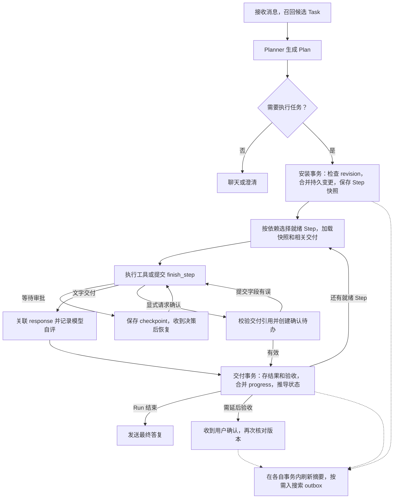
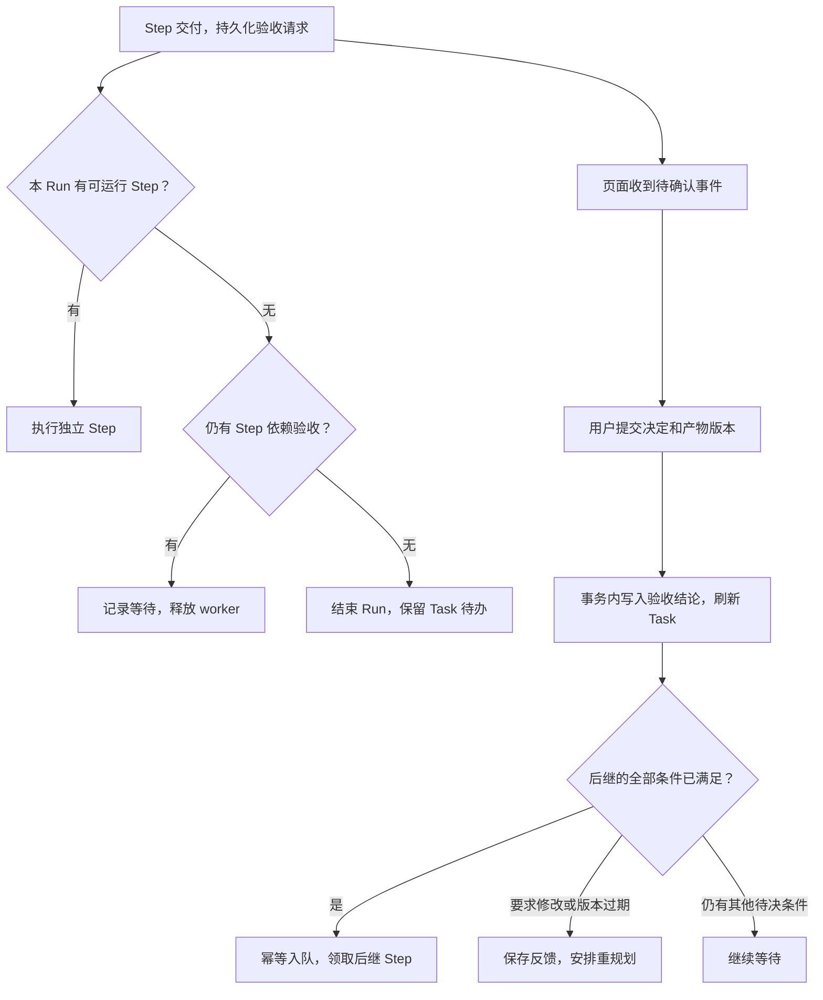

# Artorias Assistant · Task 记忆设计与实现方案

**基线**　master / a1c5687。本版采用全新空库结构。目标是让一个 Task 跨 Turn、跨 Run 持续回答三个问题：用户现在要什么、已经交付了什么、凭什么认为交付满足要求。

## 1. 范围与现状

User 记忆描述个人偏好，Workspace 记忆描述资源范围内的约定，Session 记忆描述本次会话的约定，Task 记忆描述一项任务的有效要求、进展和证据。按 task_id 精确加载 Task 记忆。Task 绑定创建时的 Workspace；恢复旧 Task 时沿用原绑定。Task 中的局部决定只在本任务生效。跨任务复用交付物通过受权限约束的引用完成。

tasks/models.py 定义 V2 Plan、StepSpec 和 FinishStep。一个 Run 可包含多个不同 Task 的 Step；数据库以 (run,key) 定位 Step。

repository.install 在事务中绑定 Task 与 Workspace、应用持久需求变更并保存 Step 快照。deliver_result 记录交付以及验收证据，refresh 归并当前 Task 状态并刷新搜索投影。

## 2. 数据模型与所有权

使用 SQLite 空库启动。Task DDL 集中在 src/artorias_server/storage/task_schema.sql。列按身份和关联、业务内容及要求、状态及结果、审计时间分组。部署时由使用者清理原运行数据，启动程序只创建新表。以下 JSON 字段以 TEXT 持久化，应用层用带版本的 Pydantic 模型校验，拒绝未知字段。每份事实只有一个权威写入点。

| 表 | 字段和类型 | 新版语义与写入者 |
|---|---|---|
| business_tasks | id、session、source_task、goal TEXT；revision INTEGER | 身份与来源沿用原值。revision 只对有效的持久要求变更递增。goal、constraints、criteria 由 Plan 安装事务维护 |
| business_tasks | constraints、criteria TEXT | 有效条目字典。数据库与协议统一使用 criteria。删除的条目从有效集合退出，历史保存在 Step 的修订快照 |
| business_tasks | progress TEXT；status TEXT；execution_count INTEGER | progress 改为有界的当前进展对象。status 由程序推导。execution_count 每个首次交付的 Step 只增加一次 |
| business_tasks | summary TEXT；新增 summary_input_hash TEXT NULL、memory_version INTEGER NOT NULL DEFAULT 2 | summary 是面向召回及上下文的短摘要。hash 对应渲染输入。memory_version 标识存储格式，当前格式为 2 |
| task_plans | run、plan TEXT | plan 内含 schema_version；存程序校验后的计划。按 run 重入时读取已安装版本 |
| task_steps | scope、task_patch、baseline_requirements、effective_requirements、base_revision、applied_revision、source_message_id | scope 保存本步计划。快照记录当时的要求、条目版本和局部覆盖，支持重放、审计与旧结果核对 |
| task_steps | status、result TEXT；新增 result_json TEXT NULL | result 保留用户可读交付正文和分页语义；result_json 存 Step 结束时的结构化事实，首次提交后不可变 |
| 新表 task_criterion_assessments | id TEXT PK，task_id、criterion_id、criterion_version、run、step_key、method、verdict、evidence_ref、evidence_version、reason、created_at、updated_at | 追加式验收记录。criterion_version 为整数；组合唯一键去重；索引 (task_id,criterion_id,criterion_version)。以 Task ID 和 Step 复合键关联。待确认的标准可在 Step 结束后追加独立评审或用户确认 |

### 2.1 Task 字段内部 schema

以下是同一个 Task 在预览交付后的字段示例，省略数据库身份列。criterion ID 在本 Task 内唯一，版本从 1 开始。程序分配新 ID，退休后不得重用。

```json
{
  "memory_version": 2,
  "revision": 3,
  "goal": "交付完整销售明细",
  "constraints": {"K1": {"v": 1, "text": "金额保留两位小数"}},
  "criteria": {"C1": {
    "v": 2, "text": "发布含500条数据行的Excel明细",
    "required": true,
    "verification": {"method": "self"}
  }},
  "progress": {
    "milestones": [{"key": "preview_delivered", "text": "十行预览已交付",
      "step_ref": {"run": "R8", "key": "preview"}, "artifact_id": "A10"}],
    "blockers": [],
    "deliverables": [{"artifact_id": "A10", "role": "preview", "version": "h10"}],
    "assessment_heads": {"C1": {"v": 2, "verdict": "pending", "assessment_id": null}}
  },
  "status": "open",
  "summary": "交付完整销售明细。十行预览已交付，全量500行Excel待验收。"
}
```

verification.method 取 self（默认）或 user（用户明确要求确认）。Planner 将工作表或数据行数等要求写在标准正文中。self 记录模型自述理由，user 记录待确认问题。文本、方法、阈值或必选性改变均递增条目 v。验证结论独立于规则正文，assessment_heads 汇总最近的验收记录与对应 Step 的模型声明。

milestones 按业务键合并，blockers 按稳定 ID 开启或解除（内部字段 id、text、state、step_ref），deliverables 按角色与产物版本归并。投影保留未解决阻塞、当前有效交付物与最近重要里程碑；历史完整明细按 Step 分页，不能截掉尚未解决的事项。现有每 Task 最多 30 条有效约束和 30 条有效标准的上限继续作为显式校验，达到时让 planner 合并重复项或建议拆分独立交付任务；禁止静默丢弃。

## 3. Task Plan 输出契约

沿用顶层 kind、question、items，以及 item.key、relation、task_id、depends_on、input_locations、output_target。新版将原 item.goal/constraints/criteria 明确收进 step_spec，避免把本轮范围误写入 Task。以下是完整的继续执行示例。

```json
{
  "schema_version": 2, "kind": "tasks", "question": "",
  "items": [{
    "key": "preview", "relation": "refine", "task_id": "T1",
    "depends_on": [], "input_locations": [], "output_target": null,
    "initial_requirements": null,
    "task_patch": {"expected_revision": 2, "operations": [{
      "op": "replace", "field": "criteria", "id": "C1",
      "value": {"text": "发布含500条数据行的Excel明细", "required": true,
        "verification": {"method": "self"}},
      "evidence": "最终改交500行Excel"
    }]},
    "step_spec": {
      "goal": "做十行预览", "constraints": ["只处理前十行"],
      "criteria": ["预览已发布，可供用户查看"], "criterion_refs": ["C1"]
    }
  }]
}
```

- new、followup 必填 initial_requirements，形状为 {goal:string, constraints:string[], criteria:CriterionDefinition[]}；CriterionDefinition 使用上例 value 的对象结构。new 不引用旧 ID，followup 记录来源并建立新 Task。初始规范直接落库，首轮 Step 可仅执行其中一个子目标。continue、refine 必须引用本 Session 合法候选并提交期望 revision，即使 operations 为空也校验。chat、clarify 不创建 Step。
- task_patch 专管持久要求。goal 仅允许 replace，value 为字符串；constraints 为字符串值；criteria 为结构化定义。add 不接受持久 ID，可用仅在本 plan 内有效的 client_ref 供 step_spec 引用，安装后由程序写入真实 ID。replace、remove 必须引用有效 ID；remove 无 value。每个持久变更引用当前用户消息的原文证据，程序记录消息 ID。
- 重复诉求返回空 operations；同一维度改值用 replace；可独立交付的新要求用 add；取消用 remove。程序拒绝精确重复和无效操作。模糊的语义重复由 planner 对照有效条目判断；“替代”还是“额外交付”影响范围且无法判断时返回 clarify。只在 Step 生效的要求存在 step_spec。
- 安装前校验依赖无环、同一 Run 无重复继续执行同一 Task，校验 Workspace 权限与来源。事务中再次检查 revision，保存 plan、基线、变更后要求与 Step 快照。一个计划项多个有效持久操作只使 Task.revision 加一，复述或局部要求不递增。

## 4. Step 结束协议、证据与结果存储

以文字分析为例，模型提交以下参数即可结束本步。服务端从 Step 快照补全 C1 的版本，并给正文生成 response 引用。

```json
{"step_outcome":"completed","final_text":"销量下降主要来自渠道 A。","criterion_claims":[{"id":"C1","claim":"met","reason":"正文指出了主要渠道。"}]}
```

自评写入 Task progress 的 assessment_heads。claim 表达模型判断，verdict 保持 pending。普通任务完整交付后进入 needs_review，Run 可结束，用户可在后续消息提出修改。只有显式 user 标准产生确认待办。普通依赖使用 depends_on，wait_for 只等待显式用户确认。声明部分或未完成的必选标准仍需后续工作。用户需要确认指定文件时，交付项给出发布工具返回的 artifact_id，确认标准通过同名字段选择文件。

执行器把 finish_step 注册为终止工具，schema 为以下提交对象。普通文本交付仅需正文、执行结果和适用标准的自评。程序校验成功后终止工具循环；校验出错返回可修复的字段错误。常规路径使用执行模型最后一次响应提交，无需再次调用模型。

```json
{
  "schema_version": 2, "step_outcome": "completed",
  "final_text": "十行预览已交付，请查看预览文件。",
  "delivery_summary": "已生成十行预览",
  "deliveries": [{"artifact_id": "A10", "role": "preview"}],
  "milestones": [{"key": "preview_delivered", "text": "十行预览已交付", "evidence_refs": ["A10"]}],
  "blocker_changes": [],
  "criterion_claims": [{"id": "C1", "claim": "partial", "reason": "已交付预览，全量数据仍待生成"}]
}
```

step_outcome 允许 completed、partial、blocked、failed；中途等待审批走原 waiting/checkpoint 路径，恢复后才终结 Step。claim 为 partial、met、unmet；未触及的标准省略。blocker_changes 每项为 {op:open|resolve,id,text,evidence_refs[]}。工具错误或取消由 runtime 按真实事件生成终态记录，可缺交付物。纯文本任务可以将本次持久化答复作为 result_ref 证据；用户确认必须引用真实用户消息。文本限制长度，各数组设上限，超出时返回校验错误，长正文仍按原接口分页读取。

程序生成的 result_json 封套如下。submitted 保存前述结构化提交（final_text 只存 result 列），其余字段由服务端填写，客户端和模型无权填写。示例以简写表达类型。

```text
StepResultV2 {
  schema_version: 2, task_id: string, step_ref: {run, key},
  applied_revision: int, final_hash: sha256,
  submitted: FinishStepWithoutFinalText,
  verified_deliveries: {evidence_ref: {artifact_id, version, role, change_id?}},
  initial_assessment_ids: [id], merge_status: applied | historical_only
}
```

证据按所属用户、Session、Task、Workspace、产物版本校验，再从发布日志或结果正文核实。只生成候选文件可证明“已生成”，对“已交付”须查发布成功。部分进展记入 milestone；验收 verdict 取 pending、met、unmet。self 由程序关联本次 response，使用相关交互和工具事实生成的 claim、reason 推进 Task。自评的 verdict 保持 pending。user 的 verdict 由用户决定更新为 met 或 unmet。评审可在事务外执行，落库时再次核对条目与产物版本。每个幂等键包含标准版本、证据版本及评审事件标识。

## 5. 合并规则与贯穿示例

| 输入 | 持久变更 | 合并规则 |
|---|---|---|
| Plan 持久 delta | goal、constraints、criteria、revision | 程序做增量合并。修订 C1 后旧结论留历史，新版本回到 pending；退休项退出当前摘要 |
| Step 的临时 goal、constraints、criteria | Step 快照 | 不向 Task 回填。失败也不撤销已经由用户确认的持久要求 |
| Step 的交付和阻塞 | progress | 校验证据后按业务键更新当前投影。重复 (run,key) 返回已保存结果；同键不同内容作为冲突处理 |
| 模型 claim、用户确认 | assessments、assessment_heads | 自评更新进展和摘要。显式用户确认绑定当前标准与交付物版本 |
| Step 终态 | execution_count、Task.status | Step 完成可对应 Task.open。全部必选项 met、交付条件满足且无阻塞才可 done。无显式标准的任务由明确验收策略或用户确认结束，避免空集合自动完成。待用户验收用 needs_review |
| 有效 Task 投影变化 | summary、summary_input_hash；必要时搜索 outbox | 按第 6 节规则更新。Step 原文只进入交付历史 |

**例一：计划与交付。** 原 Task 为“交付完整销售明细”，C1 v1 要求 CSV，K1 要求金额两位小数。用户说“先给我看前十行，最终改交500行Excel”。安装计划后 C1 变为 v2，K1 保留，Step 的“十行”只进入局部快照。执行结果引用已发布的 A10。程序写入预览里程碑，C1 v2 仍 pending，Task 为 open。下一个 Step 发布 A500，模型依据发布和行数统计的工具结果将 C1 v2 自评为 met。其余必选条件已完成且无阻塞时，Task 进入 needs_review。

**例二：晚到和重试。** A500 的 Step 尚未交付时，用户将 C1 改为 1000 行，版本成为 v3。晚到的自评归入 C1 v2 的历史，不会完成 v3。对于仍相关的真实交付可以保留事实，不能用旧 Step 重开已解除阻塞、覆盖新的当前交付物或降级新状态。自 base_revision 以来无法确认兼容的进展只记历史。重放相同 Step 或异步评审不重复计数或入队。用户只说“还是 Excel”且数量等要求未变时，保留原 ID、版本及证据。

## 6. 一次 Run 的执行与 summary 更新点



安装事务、交付事务及后续验收事务共用同一个刷新函数。创建 Task 时初始化摘要；以后取规范化 summary_inputs，包括目标、有效约束与验收定义/状态、重要里程碑、当前主要交付物、未解除阻塞和状态。按稳定键排序，排除时间戳、调用次数、工具日志、临时 Step 条件及用户答复原文。加入模板版本后计算 hash，相同直接返回，不同则用确定性模板渲染并同事务保存摘要和 hash。建议首版摘要上限 1000 中文字符，优先保留目标、阻塞、主要交付及待验收项；全部要求和证据另有精确读取入口。禁止把历史摘要反复输入模型滚动改写。

示例：创建“交付完整明细，待发布 CSV” → Plan 改成“待发布 500 行 Excel” → Step 发布预览后“十行预览已交付，全量待验收” → 完整交付后“500 行 Excel 已发布，自评完成”。工具内部试读、重试、单纯关联旧 Task 不改变该摘要。搜索索引单独比较其文档投影，内容变化才写现有事务 outbox；搜索服务延迟不影响本轮读取。

## 7. 代码落点、初始化与验证

1. **模型与规划**：扩展 tasks/models.py 和 planner.py，新增 V2 Plan、FinishStep、存储封套及判别联合。requirements.py 保留当前原文依据校验和事务版本校验，增加 ID 分配、条目修订和退休。新格式区分初始化 Task 与第一步范围。Planner 读取当前有效条目及版本；同一 Run 重入使用已持久化的 V2 Plan。
2. **运行与回写**：在 runtime 工具装配处加入 Step 专属 finish_step，绑定服务端 run/key/task。executor.py 接收终止信号并保持原 SSE 最终正文；区分 waiting、失败及正常交付。repository.py 抽出要求、结果及验收的确定性合并函数。长评审用持久待办与幂等回调；服务端异常且没有有效 finish_step 时记录中断或失败，不凭最终文本宣布通过。
3. **上下文与索引**：context.py 改读 progress 对象，加载当前目标、必须约束、本步引用的标准及版本、必要阻塞和交付引用。完整历史保留分页读取。results.py 继续返回纯文本。integrations/search/tasks/projection.py 从条目取 text，升级 projection_version，并通过现有快照重建机制重建 tasks 集合。
4. **空库启动**：首次启动直接执行新 DDL。使用新的 ARTORIAS_DATA 或自行清理原运行数据后再启动。结构变更涉及业务库和图 checkpoint，程序不会删除用户文件。
5. **验收**：覆盖重复标准、替换与退休、Goal 更新但执行失败、仅生成预览、发布冲突、自评部分完成或未完成、人工确认、标准修订后旧评审晚到、同 Run 多 Step、同 Step 重放、无关日志不刷新摘要、Search 暂停恢复、相同协议下的进程重启与 checkpoint 恢复。重点断言持久要求、证据版本、进度与摘要，以及实际 outbox 条数；只检查最终聊天文本无法验证上述行为。

## 8. 页面确认与依赖唤醒

**交付、验收和调度各有自己的完成条件。** Step 提交 finish_step 后可以完成交付。Runtime 对每个相关 criterion 按 verification.method 分派；执行模型提交 claim 沿用本次调用，user 验收生成页面待办。只有计划明确要求“验收通过后继续”的后继 Step 才等待该结论。最终交付只等用户签收时，Run 可以正常结束，Task 保持 needs_review。

### 8.1 计划依赖和持久化

保留第 3 节 depends_on 字符串数组，含义为依赖指定 Step 成功交付所需产物。给 step_spec 增加可选 wait_for，默认空数组。所有声明的条件均须成立。例如全量处理 Step 可声明：

```json
{
  "depends_on": ["preview"],
  "step_spec": {
    "goal": "按确认版式处理全量明细",
    "constraints": [], "criteria": ["全量文件已发布"], "criterion_refs": [],
    "wait_for": [{"step_key": "preview", "criterion_ref": "C_preview", "verdict": "met", "artifact_role": "preview"}]
  }
}
```

C_preview 表示“用户认可预览版式”，与最终交付 500 行的标准分别建模。Plan 安装时检查来源 Step、标准归属及版本，把验收依赖也纳入环检测。局部预览如果只是本轮门槛，可给生产 Step 的局部 criterion 分配稳定引用，绑定 (run,key,local_id)，仅为此次执行保存验收与等待，不提升为永久 Task 要求。对此扩展第 2 节验收记录的 criterion_scope 为 task 或 step，实际存储用 local 标志区分。生产者发布后将 artifact_role 解析为唯一已发布产物及版本，再激活确认。产物缺失或映射不唯一时返回可诊断的阻塞原因。

| 建议增量表 | 核心字段与约束 |
|---|---|
| task_review_requests | id、session、task_id、producer_run/key、criterion_scope/id/version、artifact_ref/version、question、state、decision、feedback、decision_key、created_at、updated_at。按生产 Step、标准版本及产物版本唯一创建；纯文本交付可绑定不可变 result_ref 及正文摘要哈希 |
| task_step_waits | consumer_run/key、producer_run/key、criterion_scope/id/version、artifact_role、绑定后的 evidence_version、state、resolved_assessment_id、created_at、updated_at。每个消费者按条件唯一，按待决条件建索引。一条确认可释放多个消费者 |

review.state 从 pending 单向转为 accepted、changes_requested、superseded 或 cancelled。用户要求修改产生 unmet 和反馈；变更标准、替换交付物或取消任务分别关闭过期请求。wait.state 可从 pending 变为 satisfied、needs_replan 或 cancelled。没有后继等待时仍可建立最终交付的确认请求。验收记录存结论和证据，review 存交互生命周期，wait 存调度条件。

### 8.2 页面、API 与重连

1. **发起。** 保存 Step 交付、pending 确认、已绑定等待条件和 review.requested 事件时使用同一业务事务。SSE 只传递已提交事件。页面显示标准原文、产物版本与预览入口、确认问题，以及“通过”和“需要修改”。浏览产物沿用 Session/Workspace 权限。
2. **响应。** 建议新增 GET /api/sessions/{sid}/reviews?state=pending 与 POST /api/sessions/{sid}/reviews/{id}/decision。POST 包含 decision（accept 或 request_changes）、decision_key、criterion_version、evidence_version、可选 feedback。服务端从请求身份取得操作者，校验归属、待决状态与两个版本。相同幂等键和内容返回首次结果；相反决定、旧版本或已关闭请求返回 409，并附最新状态。
3. **离线与多端。** 复用现有 /api/sessions/{sid}/events?after= 游标流。待办列表响应附同一数据库快照对应的事件游标；页面加载列表后从该游标订阅，按 review_id 和事件序号去重。review.resolved 或 review.closed 更新所有打开的页面。刷新、关闭网页或 SSE 断线均不丢失待办。
4. **区别工具审批。** 现有 POST /api/runs/{rid}/decision 与 approval.requested 服务于执行中的工具授权。交付验收有自己的 review_id 和事件，可以发生在 Run 结束后，页面应显示“是否接受此版本交付物”，不将点击操作送入工具授权接口。

### 8.3 调度、释放与恢复



- **进入等待。** 调度器扫描当前 Run 全部可运行 Step；遇到单个待验收项仍可执行其他独立项。仅当尚有未终结 Step 且均不可运行时，把 Run 置为 waiting，记录原因 assessment，释放 worker。已经交付的生产 Step 无需恢复模型 checkpoint。工具在执行中断点等待的路径继续使用原 checkpoint。
- **用户决定事务。** 以 pending 为前提更新 review，追加一次 assessment，更新匹配证据版本的 waits，重新计算 progress、Task 状态和摘要，按需入搜索 outbox。所有依赖满足的消费者通过条件更新转为 ready；把对应等待 Run 置为可领取并持久化唤醒任务（若 Run 行本身是调度队列，直接更新该行）。事件与状态同事务落库。用户只确认最后一份交付时只更新 Task，已经结束的 Run 不重新入队。
- **防止漏唤醒。** 注册等待与读取已有验收结论在同一事务内完成。停车前重查就绪条件，避免确认先到、worker 后停车。使用持久状态领取及幂等键；进程重启扫描 ready 和满足条件的 waiting 记录。重复 SSE、重复点击或两个 worker 竞争只产生一次有效转换。
- **拒绝与旧结果。** “需要修改”保存用户反馈，将相应依赖转为 needs_replan，由后续修订 Step 生成新版本并重新申请验收；原全量 Step 不放行。旧页面请求不改变新版本，取消的 Run 不被迟到的确认唤醒。待用户处理期间不占用 worker，也不因超时自动通过。

### 8.4 实施与验收补充

后端在 storage/task_schema.sql 定义交互与等待表及索引，在 tasks 中实现确认服务与统一验收回写；扩展 tasks/executor.py 的依赖扫描及 scheduler/service.py 的领取条件，在 api/app.py 注册确认路由。前端在 artorias_web 的 Session 事件处理和待办视图接入列表、按钮、反馈输入及重连。首版可沿用本地 SQLite 和现有调度器；多进程部署时使用事务领取及有期限的执行租约。

端到端测试至少覆盖：预览等待期间独立 Step 正常运行；确认恰好先于停车；断线期间产生待办后重连；同一决定重复提交；多端提交冲突决定；标准或产物换版后的旧页面；取消后回调；进程在写入确认后、领取后继前重启；最终签收只完成 Task。每例应同时断言页面可见状态、验收记录数、后继 Step 实际执行次数。

## 9. Task 记忆如何进入模型上下文

上下文按调用目的投影。业务库持有完整事实；模型只读取本次决策需要的字段。Task.summary 用于定位和概览。解释精确要求时使用条目及版本，解释验收时使用具体证据。

| 构建时机 | 应提供的内容 | 实现落点 |
|---|---|---|
| Plan 生成前 | 本轮原文、有限最近对话、同 Session 候选的 ID、关联来源、目标、短摘要和 revision。可被修改的候选附有效条目 ID、版本和短文本；对引用含糊或候选被截断的变更，先按 ID 补读或澄清 | integrations/search/tasks/recall.py 组装候选，tasks/planner.py 同步更新提示词、schema 和纠错提示。提交时事务内再校验版本 |
| Step 首次执行 | Task 与 Workspace 绑定、当时的要求快照、本步目标和局部约束、所有适用的必守约束、所涉及标准及验收方式、相关未解阻塞、已满足的依赖和交付引用 | tasks/context.py 从新版 progress 对象选择字段。tasks/executor.py 在依赖就绪后构建并保存快照。执行模型的工具 schema 中加入 finish_step，其 claim 引用本步可见的标准与证据 |
| Step 内工具循环 | 沿用本步快照，增量加入本轮工具调用和结果。默认只附交付预览、版本与 result_ref；确需复用全文时按引用分页获取 | runtime/service.py 与 tasks/results.py 约定同一种引用格式，统一使用 run_id 与 step_key。按依赖过滤后获取投影，避免先加载同 Run 所有交付全文 |
| 独立评审与最终签收 | 自评复用本次执行上下文。用户签收可直接处理事件并更新投影 | 评审回调复用第 8 节回写逻辑；只有后继 Step 需要运行时才构建执行上下文 |

**快照与恢复。** 使用 task-memory-v2 选择策略，按 (run,key) 保存首次构造的上下文。后继 Step 就绪时读取验收和证据版本；已经执行的 Step 保留原要求快照，用于审计。工具审批沿用同一 checkpoint，交付写回时再次核对当前 Task revision。

**预算。** 当前 ContextBuilder 默认以 24000 字符筛选，而 Planner 与 Runtime 另有请求级预算。字符筛选作为第一层，在实际模型调用前统一核算系统词、schema、工具描述、消息和输出预留。优先保留本轮原文、本步目标、必守约束、相关 criterion 的 ID/版本及证据引用；先缩减旧对话和重复摘要，再缩减产物预览。同一交付出现在 progress、依赖和历史时按 result_ref 去重。必要信息仍超过预算时拆分执行范围或显式报告预算不足。禁止通过截断旧约束改变任务语义。

**示例。** “先预览十行，确认后再处理五百行”拆成两步。预览 Step 看到局部十行要求及其角色；全量 Step 在确认后看到五百行要求、有效的预览版本和确认记录 ID。默认两者都无需加载预览文件的全部内容。若目标已改为一千行，旧五百行验收可作为历史，不能注入为当前要求已经满足。

## 10. 其他影响面与上线验证

以下为基于 a1c5687 的代码影响评估。优先级 P0 表示新库启用时必须同时上线，P1 表示随相关功能上线验证。

| 优先级与位置 | 当前行为与潜在问题 | 建议及验收重点 |
|---|---|---|
| P0 · 业务存储 | 新表直接使用 criteria 对象、progress 对象与 result_json | 检查空库冷启动、重复启动以及各表 PRAGMA table_info 的列序 |
| P0 · 搜索投影与召回 | projection.py 直接拼接字典 values，传入条目对象会失败；摘要从完整交付变为短摘要后，命中关键词的范围也会变化 | 提取有效条目 text，升级 projection_version 并重建；用已有任务查询核对排序。需要检索交付全文时单独建交付物索引。事务 outbox 按投影变化入队 |
| P0 · 结果读取与授权 | task_result_read 当前允许同 Session 内本 Task 或直接来源 Task 的交付。将同 Run 依赖从全文改为引用后，独立依赖 Task 的引用可能无法分页读取 | 执行器为消费者提供限定到已声明生产 Step 的读取权限；验证 Session、依赖边和资源授权。统一 result_ref 的 run/key 与 run_id/step_key 两种历史命名。测试合法依赖可读、同 Session 无关 Task 不可读 |
| P0 · 调度、事件和页面 | executor.py 的 task.delivered 目前固定发送 needs_review；页面 app.js 消费该事件。会与已通过验收、局部交付或仅等待依赖的真实状态冲突 | 事件带 step_outcome、task_status 及 review_id，状态来自提交成功后的事务。同一 Step 仅发一次逻辑交付；重复 SSE 可去重。最终签收不触发重复 assistant.final，工具审批入口仍按原语义运行 |
| P0 · 工具协议与恢复 | 引入终止工具会影响模型调用结束条件、流式最终文本、失败及取消处理 | 仅为 Task 执行绑定 finish_step，拦截并校验它；固定 run/key/task 由服务端注入。测试模型只给文本、重复调用、无效证据、已交付后重放 |
| P1 · Workspace、产物与撤回 | 交付证明绑定 Workspace 和文件版本。后续修改或撤回可能使当前文件失去已验收内容 | 历史验收引用当时版本，向用户展示历史状态；若后继需要读取当前文件则核对版本与权限，再决定重新取证或重规划。仅按路径相同不能复用验收 |
| P1 · 成本与定位 | 评审可能增加模型请求；把完整证据塞入快照、日志和 SSE 会放大存储与上下文 | 分别统计规划、执行、评审的请求和预算，记录 selection_policy、裁剪原因、版本冲突与唤醒延迟。快照按引用保存可回读证据，日志只记必要元数据 |

**发布门槛。** 校验新库的 Task 投影、跨 Task 依赖授权、超大正文分页、旧确认晚到、预算裁剪、最终签收不重复调用模型。

## 11. 本地实现与运行边界

- 首次安装只接受 V2 计划；Task 数据库存储列名统一为 criteria。普通任务无强制签收。提交结构化结果后可结束 Run；需要阻塞后继时，由 planner 显式声明 wait_for。
- 文件引用的校验用于定位可回读的交付版本。文件交付证据可引用本步成功发布的 Python artifact_id，或同一 Task、Run 内已提交的 Workspace change_id；文本证据引用 response。程序对文件的历史版本做核验。用户从确认卡片可读取完整文本或下载相应版本。
- finish_step 只注册到 Task 图。self 自评不触发独立模型请求。user 持久等待，页面通过 Session 事件游标重放恢复待办。所有用户决定按本地单用户授权处理。多租户身份系统、分布式 worker 租约及独立评审队列属于云端扩展。
- 需要修改时保留意见和未通过的证据，将受影响的后继标为 needs_replan，下轮规划可继续原 Task。当前执行器不自动循环重做主观验收失败的产物。
- 物理表定义以 task_schema.sql 为准。确认记录以 assessment_id 关联标准与证据，提交的 decision_key 与 state 共同实现重复点击幂等。result_json 中 verified_deliveries 按 evidence_ref 索引，含 role、version 与可用的 change_id、execution_id；完成时间由 Step 的 updated_at 记录。独立 Search 服务维持搜索库，业务事务通过 outbox 推送新版搜索文档。
