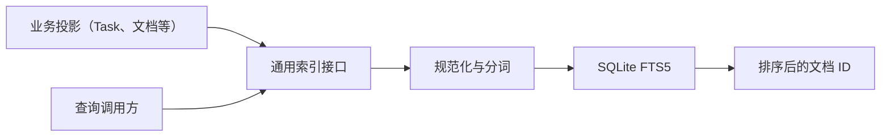

# 通用分词与关键词匹配服务方案

> 部署版本更新：默认已切换到独立 HTTP 搜索服务。当前跨进程协议、outbox 同步、
> 重建和部署方式以 [Search 独立部署方案](search_service_deployment.md) 为准。
> 下文中的“同 SQLite 事务”“启动直接构建”描述保留用于 embedded 兼容实现；
> 远端模式仅保证 Task 与 outbox 同事务，索引最终一致，启动不要求服务在线。


## 目标和部署边界

提供可复用的文本分析、文档索引与关键词排序能力。服务只理解文档、集合和授权分区，既不理解 Task，也不调用 LLM。适用对象包括任务、文档元数据和可搜索的短文本。第一版提供中文词级检索、混合文本检索和 BM25 排序；同义改写和语义检索另立阶段。

当前默认独立 HTTP 部署：搜索服务拥有自己的 SQLite 索引库，assistant 通过 HTTP 客户端查询，
通过业务库 outbox 与同步 worker 更新索引。`artorias_search` 保留纯搜索核心，
`artorias_search_service` 承担 HTTP/认证/数据库边界，`artorias_search_client` 承担调用与 outbox。
本地事务只覆盖业务数据与 outbox；远端索引最终一致。具体协议、重建、部署见
[独立部署方案](search_service_deployment.md)。embedded 兼容模式仍支持同库事务。



## 分词与匹配规则

- **规范化**：查询和文档执行同一套 Unicode NFKC 与大小写折叠；原文只用于重建和展示。中文使用固定依赖 `jieba==0.42.1` 的默认词典，关闭 HMM，保证查询和索引的词典行为一致。索引使用搜索模式，保留原词和有用子词；查询使用普通模式，避免把每个扩展子词都变成必选条件。词典在进程内共享，不为每个 Repository 重复加载。
- **混合文本**：中文与非中文片段先分开，避免「修改API-client.py文件」被误识别成整个文件名。英文、数字、下划线标识符、英文文件名和路径保留完整 token，索引额外保留路径中的文件名和组件。例如 `API-client.py` 命中全名查询，也能通过 `api` 或 `client` 命中。中文文件名按中文词项与扩展名组合检索，路径是检索文本，不用于路径授权或精确路径判等。
- **FTS 编码**：不超过 32 UTF-8 字节的 token 使用十六进制编码，更长的 token 使用带不同前缀的 SHA-256 摘要。两者均为单个字母数字词项，避免 FTS 二次切分、语法注入及超长 token 被截断。`tokenizer_version` 同时保存分词规则和 FTS 编码版本。这里的 SHA-256 处理检索文本，不读取或计算用户文件摘要。
- **匹配**：默认 `any`（任一词命中）；调用方可选 `all`（每个词都命中）。首版 BM25 权重建议 `title=5`、`keywords=2.5`、`body=1`，同分按文档 ID 稳定排序。空查询或仅停用词时返回空结果。词典、停用词、规范化或编码变化都要更新版本。
- **输入约束**：调用方传自然语言或标识符，服务端根据分词结果生成 FTS 表达式，SQL 使用绑定参数；不执行输入文本里的 `OR`、`*` 等 FTS 语法。默认取前 32 个不同的有效查询词，`all` 表示这些保留词均命中；返回最多 100 条，查询原文最长 30,000 字符。超过结果数或原文长度限制报错，限制可通过构造参数配置。

## 存储设计

| 对象 | 关键字段 | 职责 |
| --- | --- | --- |
| `text_search_collections` | `collection`、`tokenizer_version`、`projection_version`、`built_at` | 保存实际生效的索引版本，决定是否重建。 |
| `text_search_documents` | `rowid`、`collection`、`scope`、`document_id`、`title`、`keywords`、`body`、`content_hash` | 保存业务方提供的有限检索文本和指纹。对 `(collection, scope, document_id)` 建唯一索引。 |
| `text_search_fts` | `rowid`、`scope_token`、`title_terms`、`keyword_terms`、`body_terms` | FTS5 虚拟表，只写分词后的文本，`rowid` 与文档表对应。查询时 `scope_token` 权重为零。 |

选择由索引服务单独维护两张表。新增、覆盖、删除在同一事务中写文档表与 FTS5；更新先移除旧词项，再写新词项。指纹包含投影版本与字段内容，同版本的相同输入直接跳过。重建从权威数据或保存的检索字段生成新索引，事务成功后才更新版本，失败能回滚。小型 SQLite 库可直接事务化重建；数据量大到影响写入时再采用影子索引切换。

时间戳迁移已使用 `PRAGMA main.table_list` 排除 `virtual`、`shadow` 和 SQLite 内部表，不向 FTS5 内部表添加列或触发器。需要 SQLite 3.37 或更高版本并启用 FTS5。索引缺失或数据过时时可重建，业务数据仍由原系统管理；底层数据库损坏不作为「没有匹配」处理。

## 接口设计

| 进程内接口 | 可选 HTTP 映射 | 输入与返回 |
| --- | --- | --- |
| `Tokenizer.tokenize(text, for_index=False)` | `POST /v1/tokenize` | 返回词项列表；版本从 `tokenizer.version` 读取。 |
| `index.initialize(conn)` | 部署初始化 | 创建索引表。缺失 FTS 或文档表时失效化集合版本，要求重新构建。 |
| `index.is_current(conn, collection, projection_version)` | 管理检查 | 检查分词、编码与投影版本。 |
| `index.upsert(conn, scope, documents, projection_version=...)` | `POST /v1/index/upsert` | 批量 `Document`；返回 `WriteResult(updated, skipped)`。 |
| `index.delete(conn, scope, document_ids)` | `POST /v1/index/delete` | 同分区幂等删除，返回实际删除数。 |
| `index.search(conn, scope, query, projection_version=..., mode='any', limit=20)` | `POST /v1/search` | 返回有序 `SearchHit(id, score)`；SQLite BM25 分数越小越相关，只用于本次排序。 |
| `index.rebuild(conn, collection, documents, projection_version=...)` | 管理命令或管理端点 | 流式接收 `(partition, Document)`，替换整个集合，返回文档数。 |

`Scope(collection, partition)` 由可信调用方创建，`Document(id, title, keywords, body)` 是通用数据对象。`TextTokenizer`、`TextIndex` 是可注入的 Protocol；SQLite 核心实现不自建连接或提交事务，独立 HTTP 服务负责开启与提交索引库事务，异常必须回滚。所有更新必须使用已经构建的同版本集合，版本不兼容会抛出 `IndexUnavailable`，不会把新规则词项写进旧集合。

**方案修正：重建粒度为集合，而非单分区。** 分词版本记录在集合层；只重建一个分区就宣布整个集合升级，会造成其他分区仍使用旧词项。日常增删改按分区执行，版本升级从权威来源重建整个集合，其他集合保持不变。没有权威模型的通用调用方也可先读取保存的检索字段，作为 `rebuild` 的文档来源；投影规则变化时必须重新生成投影。

```python
import sqlite3
from artorias_search import Document, Scope, SQLiteTextIndex

index = SQLiteTextIndex()
scope = Scope('notes', 'user-1')
with sqlite3.connect(':memory:') as conn:
    conn.execute('BEGIN IMMEDIATE')
    index.initialize(conn)
    index.rebuild(conn, 'notes', [], projection_version='notes-v1')
    index.upsert(conn, scope, [Document('note-1', title='分析机器学习报告')],
                 projection_version='notes-v1')
    hits = index.search(conn, scope, '机器学习', projection_version='notes-v1')
```

服务以 FTS 分区词项过滤，并用普通 SQL 字段再次复核集合和分区。独立 HTTP 部署时，认证凭据必须绑定可访问的集合和分区，重建需要管理权限。共享 FTS5 的逆文档频率计算整个索引的统计量；若多个租户要求严格隔离统计量，使用独立索引或数据库。DEBUG 查询和 upsert 日志记录耗时、命中/更新数量和索引版本；INFO 记录集合重建，不记录查询或正文。

## 实施顺序与验收

已实现可注入接口、混合分词、批量增删改、BM25、版本化重建与 Task 接入。`tests/test_text_search.py` 覆盖中文词边界、混合文件名、权重与排序、any/all、分区和集合隔离、FTS 语法输入、超长 token、指纹跳过、覆盖删除、事务回滚和版本切换。

真实语料的 Recall@K、无命中率和查询 p95 仍需在实际使用中采集；本次没有引入额外监控服务或声称已达到生产性能指标。独立 HTTP 适配层和跨数据库 outbox 同步现已实现，见独立部署方案。

参考：[Jieba 中文分词](https://github.com/fxsjy/jieba) · [SQLite FTS5](https://www.sqlite.org/fts5.html)
