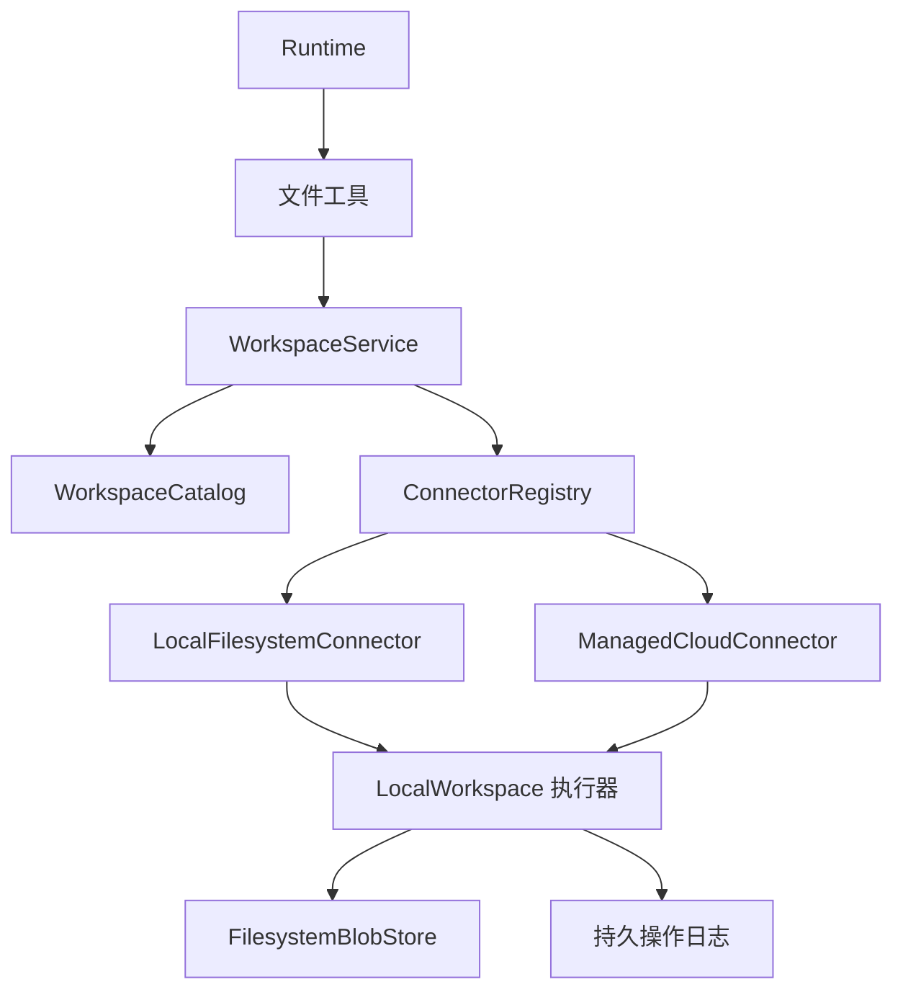

# Workspace 产品与工程设计

版本：v0.5.0 · 2026-11-17

本文是本版本 Workspace 行为的规范，取代早期文档中的“Session 永久绑定唯一目录”描述。既给出本地与云端统一的目标架构，也明确本次已实现范围，避免把接口预留当成完整云端服务。

## 一、产品设计

### 1. Workspace 的定义

Workspace 是用户组织工作资源、查找资料和保存新产物的默认空间。本地空间对应某设备上的目录；云端空间对应逻辑文件空间，不要求与一台机器的目录永久对应。

区分四个概念：

| 概念 | 含义 |
|---|---|
| Workspace | 默认工作位置及资源组织空间 |
| Location | 文件实际所在的设备或云端存储空间 |
| Grant | 允许读取、修改的资源范围和有效期 |
| 执行目录 | 脚本运行时使用的临时环境，不等于最终产物位置 |

客户端位置、Runtime 运行位置和输出资源位置相互独立。例如从 Mac 网页发起请求，云端 Runtime 通过设备连接器修改 Mac 文件，其产物和主要备份仍位于 Mac。

本版本一个 Workspace 对应一个根位置，先不引入多挂载。后续需要多挂载时，可增加 workspace_mounts，并设置明确的默认输出挂载；不能只用 workspace_id 猜测保存位置。

### 2. 默认空间与选择体验

- 每个安装实例有稳定的本地 device_id，可注册多个本地目录作为 Workspace。
- 新会话默认使用 ARTORIAS_WORKSPACE；未配置时使用 data/workspaces/default，多个新会话共享此默认空间。
- 旧会话已绑定的目录保持不变，包括 v0.4 的 data/workspaces/<session_id>。
- 默认云端逻辑空间为 personal。网页可以选择本地或云端空间，也可以新增空间。
- 添加本地空间是用户发起的持久读写授权动作，网页明确提示其含义。
- 切换 Session 的空间只影响后续新任务，不移动文件，也不迁移正在执行或历史 Task。
- 文件面板展示 Session 当前选中空间；变更面板保留整个 Session 的操作历史。

v0.5 的“云端空间”是服务所在机器上的托管逻辑目录。在本地运行服务时，它并不代表文件已经上传到互联网；在服务器运行时它保存于服务器。它用于验证空间隔离和路由，不等于完整云端产品。

### 3. Session、Task、Run 的产品语义

Session 是对话容器，Workspace 是默认资源位置，Task 是可持续推进的业务目标。

1. 新任务继承本次输入提交时 Session 选中的 Workspace。
2. continue/refine 复用旧任务及其 Workspace。
3. new/followup 创建新任务，继承本次输入的默认空间。
4. 一个 Run 可以顺序消费多个 Task，各自使用各自的空间。
5. 审批恢复继续使用已固定的执行绑定，不重新读取 Session 当前选择。
6. 仅聊天不创建 Task，但 Run 仍有固定的默认空间，以支持其工具调用。

“提交时”而不是“排队执行时”取默认值，避免用户发送消息后立即切换空间导致排队任务写错位置。

### 4. 输入与输出位置规则

对于新产物：用户明确指定的位置优先，否则使用当前 Task 的 Workspace。Session 和用户默认空间只用于建立任务绑定，不在每次写入时再次参与竞争。

对于已有文件：资源引用或明确路径确定目标，默认原位修改；另存为才创建新目标。读取某处文件不意味着输出必须放在同一处。

模型理解位置意图、文件名和相对路径；程序解析最终资源地址并检查权限。本版本工具支持：

| 形式 | 解析含义 |
|---|---|
| docs/result.md | 当前 Task/Run 空间下的相对路径 |
| /Users/name/Downloads/result.md | 本安装实例对应设备上的明确绝对路径 |
| workspace://<id>/docs/result.md | 指定 Workspace 下的相对路径 |

通过结构化 Workspace 元数据将当前空间传给模型。位置不清晰时应澄清。当前版本不支持从“另一台 Mac 的下载目录”自动发现设备；未来必须显式解析 device_id，不能把服务器上的 /Users 路径当成用户电脑路径。

任务的显式输出约定目前保存在任务需求/上下文中，并由模型体现在文件工具参数里；没有独立的 task_output_target 表。每次成功操作保存确切资源地址。需要严格的多产物交付合同，可后续增加 task_output_targets。

### 5. 跨空间访问与授权

Workspace 是默认位置，不是唯一可访问范围。外部路径在已有授权内时直接执行；缺少授权时调用 project_authorize，网页审批后授予当前 Run 范围的 read 或 write 权限。write 包含读取权限。拒绝后不应绕过限制。

授权检查在每次操作执行时进行，审批恢复也重新检查。API 提供授权列表与撤销能力，撤销不删除 Workspace 元数据。授权指向目录及其后代；本版不支持单文件粒度授权 UI。

当前保护策略拒绝将应用数据目录、其后代及祖先作为新注册本地空间/外部授权根，以保护数据库、备份和 checkpoints。因此当应用数据位于用户 Home 内时，不能直接授权整个 Home，需分别授权 Documents、Downloads、Projects 等目录。受系统管理的默认空间和旧版本绑定有专用兼容路径。

路径拒绝 ..、符号链接、反斜杠歧义和非法空字符。本版仅面向 macOS/Linux，不支持 Windows 路径语义。

### 6. 不可用、离线与回滚体验

目标连接器不可用时，明确失败，不静默写入其他空间。未来设备离线可进入 waiting_device 状态，再恢复原操作。本版尚未实现设备在线状态和自动重试调度。

回滚基于原变更中的资源位置和备份引用，不根据 Session 当前 Workspace 推断。文件被外部修改后，冲突回滚应拒绝；回滚本身再次产生备份及新变更记录。

## 二、工程设计

### 1. 分层与实际代码

| 文件 | 当前职责 |
|---|---|
| workspace/catalog.py | 表初始化、旧绑定兼容、空间注册、Session 选择、Task/Run 绑定、授权 |
| workspace/routing.py | WorkspaceService；路径解析、授权消费、路由、按原记录回滚 |
| workspace/connectors/__init__.py | Connector/FileOperations 协议、注册表、本地及单机云端适配器 |
| workspace/service.py | LocalWorkspace 执行器；真实目录、备份写入、冲突检测、日志恢复 |
| workspace/blobs.py | BlobStore 协议、BlobRef、文件系统内容寻址备份 |
| tasks/service.py | 新任务绑定、复用旧任务、执行时注入 task_id |
| runtime/service.py | 为每个 Task 创建 WorkspaceService，向模型描述固定空间 |
| tools/registry.py | 模型可见文件工具、权限申请与 Docker 脚本执行 |
| storage/sqlite.py | 提交消息、Run/Job 与提交时空间快照在同一事务保存 |
| api/app.py / web/index.html | 空间注册和切换、文件及变更查看、审批 |

服务目前是同一进程中的模块。Connector 接口为同步操作；同步 LangChain 工具由框架调度执行。远程适配器必须设置超时，后续可以统一迁移为异步接口，不能在事件循环里执行阻塞 RPC。

LocalWorkspace 名称保留是为兼容 v0.4 测试与调用。新 Runtime/API 均通过 WorkspaceService 访问；Connector 创建执行器时 bind_session=False，使目录选择不再依赖旧的 Session 根目录。内置 Deep Agents 文件工具仍只用于内部草稿。

### 2. 表结构与绑定关系

业务数据继续使用 SQLite，新增独立关系表，避免改变旧表 INSERT 的列数。以下为已实现字段，未标可空的业务必需字段为 NOT NULL；旧表 nullable 声明维持原样。

| 表 | 字段与约束 | 作用 |
|---|---|---|
| workspace_locations | id PK, kind, root, blob_root | 设备/存储位置及本机适配器配置；kind 为 device_fs/cloud_storage |
| workspaces | id PK, name, location_id, root；UNIQUE(location_id,root) | 空间根目录；本地绝对路径，云端逻辑前缀 |
| session_workspaces | session PK, workspace_id | Session 当前默认空间 |
| task_workspaces | task PK, workspace_id | BusinessTask 的持久默认空间 |
| run_workspace_bindings | run, task DEFAULT '', workspace_id；PK(run,task) | 空 task 表示输入提交快照，非空 task 表示具体任务执行绑定 |
| workspace_grants | id PK, location_id, root, access, scope_run DEFAULT '' | read/write 授权；空 scope_run 为持久授权，否则仅指定 Run |
| resource_changes | change_id PK, backend, location_id, root, blob_root, task_id 可空, workspace_id 可空 | 变更对应的实际资源、备份位置与任务归属 |

保留旧表：

- sessions(id)：对话容器。
- business_tasks(id, session, source_task, goal, constraints, status, summary, updated)：目标及状态；workspace 通过 task_workspaces 一对一关联。
- workspace_bindings(session PK, root)：v0.4 兼容数据，不再作为新执行路径的当前空间来源。
- workspace_operations(id PK, root, session, run, path, before_hash, after_hash, before_mode, after_mode, reverts, kind, status)：文件变更持久日志。
- changes(id PK, session, run, path, before_hash, after_hash, reverts)：供历史接口使用的变更投影。

主要关联：

- 多个 Session 可选择同一 Workspace。
- 多个 Task 可关联同一 Workspace；Task 不随 Session 的切换自动迁移。
- 一个 Run 的不同 Task 可绑定不同 Workspace。
- 一个 Task 可操作默认空间之外的授权资源；resource_changes.workspace_id 在绝对外部路径操作时可空，实际地址仍完整保留。
- 变更文件地址为 backend + location_id + root + path；云端适配器本版日志中的 root 为实际托管目录，外部工具返回逻辑地址。

当前通过服务入口做存在性和授权校验，SQLite 没有启用外键约束。这是单用户 MVP 的明确限制。云端改造应增加 owner_id/tenant_id、数据库外键、访问范围索引以及绑定变更审计；不能将本版 API 直接开放为多租户服务。

### 3. 创建、继承、复用和消费流程

#### 3.1 Session 初始化

优先读取 session_workspaces；缺失时导入 v0.4 workspace_bindings；再缺失则选择 ARTORIAS_WORKSPACE 或新默认目录。不会移动或覆盖已有文件。

#### 3.2 提交输入

Store.submit 获取当前 Workspace，在同一数据库事务内创建消息、Run、Job 和 run_workspace_bindings(run,'',workspace_id)。请求幂等命中时返回原 Run，不覆盖其绑定。

#### 3.3 计划安装

TaskRepository.install 先校验模型计划及依赖。new/followup 创建 business_tasks，并在同一事务插入 task_workspaces，使用提交快照中的 Workspace。continue/refine 复用已有 Task 绑定。旧任务缺少绑定时根据旧 Session 位置进行兼容补齐；切换 Session 前也先补齐其旧任务。

#### 3.4 执行任务

TaskRuntime 将当前 step.task 作为 task_id 传给 DeepAgentRuntime。WorkspaceService 加载 Task 的绑定，并写入/复用 run_workspace_bindings(run,task)。当前 Workspace 元数据进入模型上下文；实际文件工具持有同一服务对象，模型不能通过伪造 task_id 改变绑定。

#### 3.5 工具消费

1. 解析相对路径、绝对路径或 workspace:// 引用。
2. 得到资源类型、location_id 和目标路径。
3. 检查目标是否被当前持久授权或 Run 授权覆盖；读写区分检查。
4. 选择最具体的授权根作为执行器边界。
5. ConnectorRegistry 按 (kind, location_id) 选择连接器。
6. 执行器再次检查路径和符号链接，并执行读取/修改。
7. 写入结果携带变更 ID、版本和实际资源地址。

对于已存在文件，project_write 要求本次工具实例先读过文件，并用读取时的内容哈希作为 expected version。新文件以 expected=None 表示必须不存在。project_edit 读取当前内容，要求 old 唯一匹配，再携带该版本写入。delete 会备份并校验刚读取的内容。

### 4. Connector 设计与云端扩展

Connector.open(workspace, store, session, run, task) 返回 FileOperations。后者提供 path、files、read_bytes、read_version、head、write、delete、revert。修改方法必须在资源所在执行端完成备份、版本检查及日志记录，不能由中心端先读备份后发送无条件写命令。

现有适配器：

| 适配器 | 当前行为 |
|---|---|
| LocalFilesystemConnector | 直接访问当前 device_id 的真实目录；Blob 在 data/blobs |
| ManagedCloudConnector | 逻辑空间映射到 data/cloud/files/<prefix>，Blob 在 data/cloud/blobs |
| 远端设备/对象存储 | 未实现；未注册时抛 ConnectorUnavailable，不回退其他位置 |

未来 DeviceConnector 应返回设备 RPC 代理，设备端负责本地授权复核、写前备份、操作日志与回执。注册表支持替换具体 (kind, location_id) 的实现。本版 FileOperations 接口可用于初步代理，但生产 RPC 仍须补充 operation_id、状态查询、幂等执行与能力协商。

未来 ObjectStorageConnector 将逻辑路径映射为租户下对象键，使用对象版本/ETag 条件写；不依赖磁盘绝对路径。中心元数据不应再保存设备端物理 blob_root，而应保存不透明 blob_store_id，并由对应设备或存储服务解析。

云端扩展步骤：先补身份/租户和设备注册，再补设备安全通道及 RPC 幂等，再替换数据库与对象存储，最后引入多 Worker 调度、租约和任务级资源锁。同步函数签名可逐步改为异步，但业务定位和权限规则保持一致。

### 5. Blob 备份与回滚

#### 5.1 放置策略

备份跟随被修改资源位置，不跟随 Session、Task 或 Runtime 所在位置。

- 本地设备文件：该设备 Agent 的 BlobStore。
- 云端文件：云端 BlobStore。
- 可选本地备份同步云端：需上传授权、同步状态和保留策略；本版未实现。

本版两个 BlobStore 都由 FilesystemBlobStore 实现，分别保存于 data/blobs 和 data/cloud/blobs。BlobRef = store_id + sha256；当前 store_id 为执行器上的备份目录，迁移云端时应替换为稳定逻辑 ID。数据库以 resource_changes.blob_root 与 workspace_operations.before_hash/after_hash 表达完整引用。

#### 5.2 修改协议

1. 获取文件实际内容与 mode，检查 expected version。
2. 将修改前后内容写入不可变内容寻址 Blob，并 fsync；备份失败不继续修改。
3. 同一 SQLite 事务保存 resource_changes 和 pending 操作日志。
4. 再次检查文件内容与 mode，缩小外部修改竞争窗口。
5. 临时文件 + 原子替换，或执行删除，并 fsync 目录。
6. 提交 changes 投影、事件和操作状态 committed。

新建前不存在的文件 before_hash 为 NULL；删除后的 after_hash 为 NULL。删除支持 1 MB 以内二进制文件的备份恢复；文本读写按 UTF-8。

#### 5.3 中断恢复

pending 操作的磁盘状态与 after 一致则补交记录；与 before 一致则标记 aborted；两者都不一致时保留 pending，阻止同一路径的新修改。重试不会盲目重新写文件。不同授权根可能覆盖同一文件，因此未解决操作按完整物理地址检查，不能只比较某个相对路径。

普通文件系统缺乏对外部编辑器的通用原子 CAS。当前使用进程锁、文件锁、两次内容检查和原子替换，仍不能宣称完全消除外部并发写入竞争。多个机器共享挂载路径不属于本版支持范围。

#### 5.4 回滚

回滚读取原操作和 resource_changes，复核当前授权，打开原资源位置与 BlobStore。当前文件必须匹配原 after_hash，才用 before Blob 恢复；备份内容还会校验哈希。回滚新建文件会删除它；回滚删除会恢复内容和 mode。回滚本身产生一条 reverts 指向原操作的新记录。

旧 v0.4 变更没有 resource_changes 时，以其原 root 和旧 data/blobs 兼容恢复。旧 Blob-only 数据继续通过 export_legacy 单独导出，不擅自覆盖真实目录。

本地回滚备份不能替代异地灾备。保留期、配额和垃圾回收尚未实现；不可手工清理仍被变更引用的 Blob。云端去重应在租户边界内进行。

### 6. API 与工具

| 接口 | 用途 |
|---|---|
| GET /api/workspaces | 列出空间 |
| POST /api/workspaces | name/root/kind；注册并授予持久权限 |
| GET /api/sessions/{sid}/workspace | 当前 Session 空间描述 |
| POST /api/sessions/{sid}/workspace | workspace_id；切换后续任务默认位置 |
| GET /api/workspace-grants | 查看授权 |
| POST /api/workspace-grants/{id}/revoke | 撤销授权 |
| GET /api/sessions/{sid}/files、/file | 当前空间文件列表与内容 |
| GET /api/sessions/{sid}/changes | Session 操作历史 |
| POST /api/sessions/{sid}/changes/{id}/revert | 按原地址回滚 |

project_authorize(path,access) 使用 LangGraph interrupt，批准后才保存 Run 授权。网页显示请求路径、权限及授权范围。API 与网页仍只面向受信任的本机用户。

run_python 只接受默认空间内的相对脚本路径，把默认空间文件导出到临时只读 Docker 挂载。它不是访问其他目录的绕过入口；容器输出文件仍不自动导入，通用 shell 未实现。

### 7. 验证与已知边界

测试涵盖提交快照、新任务继承、旧任务细化保留绑定、两个 Task 的真实 Deep Agents 工具循环、跨目录授权和撤销、审批暂停恢复、云端逻辑读写及独立 Blob、Session 切换后回滚、旧版本迁移、连接器缺失禁止回退、文件版本冲突和中断恢复。

真实模型 API、Docker 实机、macOS 实机、真实远端设备和分布式云端存储未在本次验证。文件操作仍受 1 MB 单文件限制；无 Blob 自动清理；无多租户认证；无跨设备自动同步；无 RPC exactly-once 保证。
