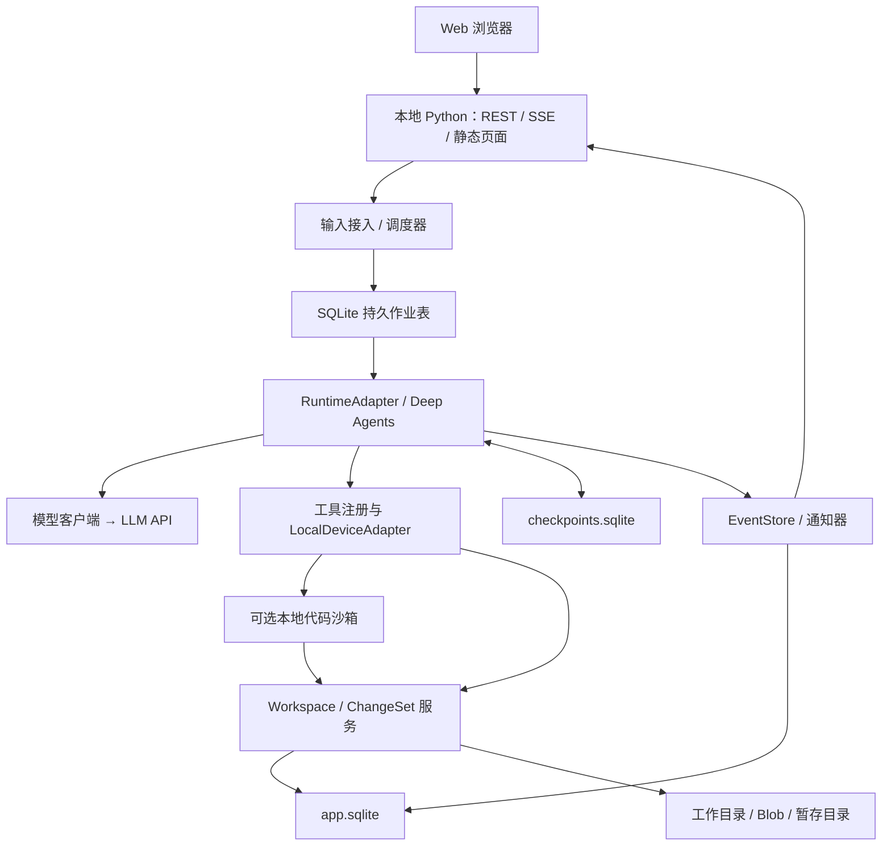
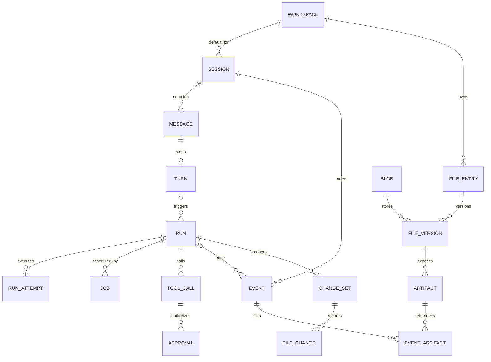

> v0.5 更新：Workspace 的绑定、路由、备份以 [workspace_design.md](workspace_design.md) 为准；本文保留原有架构背景。

# 个人助理 Agent：本地 Web + Deep Agents 实现设计

版本：1.0 · 日期：2026-11-11 · 状态：第一阶段实现蓝图

配套文档：[云端 Runtime 架构与全局领域模型](cloud_runtime_architecture.md)。本地版沿用其 Message / Turn / Task / Run / Event / ChangeSet 定义。本文件给出部署裁剪、执行流程、领域模型和可直接建库的核心 SQLite DDL；示意代码不等于已交付的可运行应用。

## 1. 对本地简化方案的确认与修正

| 原设想 | 采用方式 |
|---|---|
| Web 客户端与 SSE 合并 | 合并成同一个本地应用与同源访问；浏览器仍是客户端，SSE endpoint 在 Python 后端。一个服务可同时提供静态网页、REST 和 SSE |
| Runtime Worker 与工具服务合并 | 一个 Python 后端进程内按模块调用。异步网络工具直接 await；阻塞 I/O 用受控线程池，CPU/命令执行用子进程或沙箱，不阻塞事件循环 |
| 本机 Agent 与工作空间都在本机 | v1 将 Device Agent 收敛为 LocalDeviceAdapter 模块；WorkspaceService 管理本地工作区。以后可换成远程 DeviceClient |
| 会话、任务、Event/transcript 用 SQLite | 采用 app.sqlite 保存业务记录，checkpoints.sqlite 保存框架 checkpoint。两者都在本机，但不要把框架内部表当业务 API |
| 临时文件与产物本地存储，支持 ChangeSet | 内容放文件系统，元数据/版本/Event 映射进 SQLite；不是把所有文件内容塞进数据库 |
| Runtime 使用 deepagent | 使用 Python 的 Deep Agents SDK（包名 deepagents），应用层包装 RuntimeAdapter，避免前端依赖框架细节 |

本地运行指后端、数据和工具在本机；若使用远程 LLM，模型请求仍会离开本机。模型密钥由后端读取，浏览器不持有。

## 2. 部署与模块图



部署约束：一个后端进程、一个 uvicorn worker。该进程内一个调度循环承接多个会话的异步 Run；同 Session 同时只允许一个活动/挂起的逻辑 Run 持有 thread。等待审批时仍保留逻辑所有权，但不占运行协程。普通新消息进入队列；审批和取消走独立控制接口，避免被排在等待自己的 Run 后面。v1 不做随时插话修改执行中的目标。

后端默认绑定 127.0.0.1，采用本地会话凭据、来源校验和 CSRF 防护；只允许预期的 Web origin。未来手机访问需显式启用局域网访问、认证和传输保护，不能直接把无认证本地文件操作服务暴露出去。

### 2.1 建议代码模块

| 模块 | 功能 | 核心对象 |
|---|---|---|
| web_api | 页面、消息提交、SSE、审批、文件下载 | Session、Message、Event、Approval |
| application | 编排用例、幂等接入、取消/恢复 | Turn、Run、Job |
| scheduler | 领取 jobs、并发 semaphore、重启恢复 | RunAttempt、Lease |
| runtime | Deep Agents 构造、上下文、流式适配、checkpoint | Run、CheckpointRef、ToolCall |
| tools | search/fetch、MCP 适配、设备动作、执行器 | ToolCall、ToolResult |
| workspace | 路径权限、内容版本、ChangeSet、Artifact | Workspace、FileVersion、ChangeSet |
| storage | SQLite Repository、EventStore、BlobStore | 业务表与文件内容 |
| policy | 授权、审批、执行预算、访问范围 | Approval、PermissionGrant |

模块间使用领域接口，如 EventStore.append、Workspace.commit、ToolExecutor.invoke、RuntimeAdapter.start/resume/cancel；不要让业务代码到处直接操作框架 messages 或文件路径。

## 3. 最小领域模型

### 3.1 第一阶段必须实现

- Workspace：本地受管根目录及存储策略；用户可有多个项目，但 v1 单用户。
- Session：会话，绑定默认 Workspace；thread_key 唯一映射框架 thread_id。
- Message / Turn：语义输入输出与一轮响应；助手输出可能包含多条消息。
- Run / RunAttempt / Job：逻辑执行、实际承接、调度项；执行恢复保留 run_id。
- ToolCall：工具调用审计和幂等身份；框架 tool_call_id 可作为关联字段，不能只依赖可变工具名称。
- Event：有序、可补发的事实日志；session_seq 按 Session 分配。
- Approval：一次具体调用的授权记录。
- FileEntry / FileVersion / Blob：路径身份、不可变版本、真实内容。
- ChangeSet / FileChange：一次受管操作导致的文件变更集合。
- Artifact / EventArtifact：有业务含义的交付物，及 Event 到固定文件版本的引用。

### 3.2 预留但不强制启用

Task、RunTask、MessageTask 用于跨轮目标；Schedule 用于未来定时器；Device、ExternalConnection 用于远端设备与账号集成。v1 普通问答 Task 为空，不需要额外 LLM 意图拆分调用。Deep Agents 内部 todo 与子 Agent 的 task 工具均不自动写入业务 tasks。

### 3.3 关系与关键选择



Session 可以在逻辑上拥有 sessions/{session_id}/outputs 目录，但项目文件归 Workspace 管理，不要求复制进每个会话目录。后续会话继续编辑同一项目时保持同一个 file_id。文件被读、被修改、被交付是三种关系；映射使用版本 ID，不能只记录路径。

## 4. SQLite 与本地文件布局

建议数据根目录由配置决定，例如用户应用数据目录下 ai-agent/。其内部内容：

| 路径 | 用途 | 是否持久 |
|---|---|---|
| db/app.sqlite | 业务模型、事件、消息、作业、文件元数据 | 是 |
| db/checkpoints.sqlite | LangGraph checkpointer 状态 | 是 |
| workspaces/{workspace_id}/projects/{project_id}/ | 用户可见工作树 | 是 |
| workspaces/{workspace_id}/sessions/{session_id}/outputs/ | 会话默认产物位置 | 是 |
| blobs/sha256/{前两位}/{完整hash} | 不可变文件内容与历史版本 | 是 |
| staging/{change_set_id}/ | 提交前的新内容及恢复日志 | 提交/恢复后清理 |
| scratch/{run_id}/ | 执行临时文件、下载缓存 | 到期可删 |
| sandboxes/{sandbox_id}/ | 本地隔离执行的可写工作目录 | 按策略清理 |

app.sqlite 开启 WAL、foreign_keys、busy_timeout，写事务保持短小；数据库调用使用异步驱动或受控串行执行器。不要在写事务中 await LLM、HTTP、文件复制或审批。只有一个 SQLite writer，增加协程不能提高无限写吞吐。

EventStore 用一个短写事务更新 sessions.last_event_seq、插入 Event，并执行相关状态更新。令牌按小批合并后写入，避免每 token 一次磁盘事务。进程内通知只作唤醒；SSE 即使通知丢失也能从数据库继续查询。

### 4.1 核心可执行 DDL

下面是单用户 v1 核心表。status/type/relation 值由领域枚举校验；JSON 使用 TEXT 存储并由 Repository 校验。迁移云端时添加租户组合约束和 PostgreSQL JSONB 等类型。跨 Session 的引用一致性由应用事务校验，单个外键不足以验证所有归属关系。

```sql
PRAGMA foreign_keys = ON;
PRAGMA journal_mode = WAL;
PRAGMA busy_timeout = 5000;

CREATE TABLE workspaces (
 id TEXT PRIMARY KEY, root_path TEXT NOT NULL UNIQUE,
 name TEXT NOT NULL, created_at TEXT NOT NULL
);
CREATE TABLE sessions (
 id TEXT PRIMARY KEY, workspace_id TEXT NOT NULL REFERENCES workspaces(id),
 thread_key TEXT NOT NULL UNIQUE, title TEXT NOT NULL DEFAULT '',
 last_event_seq INTEGER NOT NULL DEFAULT 0, created_at TEXT NOT NULL
);
CREATE TABLE messages (
 id TEXT PRIMARY KEY, session_id TEXT NOT NULL REFERENCES sessions(id),
 role TEXT NOT NULL, content_json TEXT NOT NULL, revision INTEGER NOT NULL DEFAULT 1,
 source_event_id TEXT REFERENCES events(id), created_at TEXT NOT NULL
);
CREATE TABLE turns (
 id TEXT PRIMARY KEY, session_id TEXT NOT NULL REFERENCES sessions(id),
 input_message_id TEXT NOT NULL UNIQUE REFERENCES messages(id), status TEXT NOT NULL
);
CREATE TABLE runs (
 id TEXT PRIMARY KEY, session_id TEXT NOT NULL REFERENCES sessions(id),
 turn_id TEXT REFERENCES turns(id), status TEXT NOT NULL,
 checkpoint_ref TEXT, context_json TEXT, state_version INTEGER NOT NULL DEFAULT 0,
 thread_owned INTEGER NOT NULL DEFAULT 0,
 cancel_requested INTEGER NOT NULL DEFAULT 0,
 created_at TEXT NOT NULL, updated_at TEXT NOT NULL
);
CREATE UNIQUE INDEX one_thread_owner ON runs(session_id) WHERE thread_owned=1;
CREATE INDEX runs_status ON runs(status,updated_at);
CREATE TABLE run_messages (
 run_id TEXT NOT NULL REFERENCES runs(id), message_id TEXT NOT NULL REFERENCES messages(id),
 relation TEXT NOT NULL, PRIMARY KEY(run_id,message_id,relation)
);
CREATE TABLE run_attempts (
 id TEXT PRIMARY KEY, run_id TEXT NOT NULL REFERENCES runs(id),
 worker_id TEXT NOT NULL, fencing_token INTEGER NOT NULL,
 lease_until TEXT NOT NULL, started_at TEXT NOT NULL, ended_at TEXT,
 UNIQUE(run_id,fencing_token)
);
CREATE TABLE jobs (
 id TEXT PRIMARY KEY, run_id TEXT NOT NULL REFERENCES runs(id),
 command TEXT NOT NULL, dedup_key TEXT NOT NULL UNIQUE,
 status TEXT NOT NULL, payload_json TEXT NOT NULL,
 available_at TEXT NOT NULL, lease_until TEXT,
 attempts INTEGER NOT NULL DEFAULT 0, last_error TEXT
);
CREATE INDEX jobs_ready ON jobs(status,available_at);
CREATE TABLE tool_calls (
 id TEXT PRIMARY KEY, run_id TEXT NOT NULL REFERENCES runs(id),
 framework_call_id TEXT, name TEXT NOT NULL, args_json TEXT NOT NULL,
 args_hash TEXT NOT NULL, idempotency_key TEXT NOT NULL,
 status TEXT NOT NULL, result_json TEXT, external_operation_id TEXT,
 UNIQUE(run_id,idempotency_key)
);
CREATE TABLE approvals (
 id TEXT PRIMARY KEY, tool_call_id TEXT NOT NULL REFERENCES tool_calls(id),
 request_hash TEXT NOT NULL, status TEXT NOT NULL, decision_json TEXT,
 expires_at TEXT, decided_at TEXT, consumed_at TEXT
);
CREATE TABLE events (
 id TEXT PRIMARY KEY, session_id TEXT NOT NULL REFERENCES sessions(id),
 session_seq INTEGER NOT NULL, run_id TEXT REFERENCES runs(id),
 turn_id TEXT REFERENCES turns(id), tool_call_id TEXT REFERENCES tool_calls(id),
 type TEXT NOT NULL, schema_version INTEGER NOT NULL DEFAULT 1,
 payload_json TEXT NOT NULL, producer TEXT NOT NULL, producer_event_id TEXT NOT NULL,
 causation_id TEXT REFERENCES events(id), created_at TEXT NOT NULL,
 UNIQUE(session_id,session_seq), UNIQUE(producer,producer_event_id)
);
CREATE INDEX events_run ON events(run_id,session_seq);
CREATE TABLE tasks (
 id TEXT PRIMARY KEY, workspace_id TEXT NOT NULL REFERENCES workspaces(id),
 goal TEXT NOT NULL, status TEXT NOT NULL, summary TEXT,
 criteria_json TEXT, evidence_json TEXT, updated_at TEXT NOT NULL
);
CREATE TABLE run_tasks (
 run_id TEXT NOT NULL REFERENCES runs(id), task_id TEXT NOT NULL REFERENCES tasks(id),
 relation TEXT NOT NULL, PRIMARY KEY(run_id,task_id)
);
CREATE TABLE message_tasks (
 message_id TEXT NOT NULL REFERENCES messages(id), task_id TEXT NOT NULL REFERENCES tasks(id),
 relation TEXT NOT NULL, PRIMARY KEY(message_id,task_id)
);
CREATE TABLE blobs (
 id TEXT PRIMARY KEY, sha256 TEXT NOT NULL UNIQUE, storage_path TEXT NOT NULL UNIQUE,
 size_bytes INTEGER NOT NULL, mime_type TEXT, created_at TEXT NOT NULL
);
CREATE TABLE file_entries (
 id TEXT PRIMARY KEY, workspace_id TEXT NOT NULL REFERENCES workspaces(id),
 path TEXT NOT NULL, head_version_id TEXT REFERENCES file_versions(id), deleted_at TEXT
);
CREATE UNIQUE INDEX live_paths ON file_entries(workspace_id,path) WHERE deleted_at IS NULL;
CREATE TABLE change_sets (
 id TEXT PRIMARY KEY, workspace_id TEXT NOT NULL REFERENCES workspaces(id),
 run_id TEXT REFERENCES runs(id), tool_call_id TEXT REFERENCES tool_calls(id),
 status TEXT NOT NULL, manifest_json TEXT NOT NULL,
 commit_event_id TEXT REFERENCES events(id),
 reverts_id TEXT REFERENCES change_sets(id), created_at TEXT NOT NULL, committed_at TEXT
);
CREATE TABLE file_versions (
 id TEXT PRIMARY KEY, file_id TEXT NOT NULL REFERENCES file_entries(id),
 blob_id TEXT REFERENCES blobs(id), parent_version_id TEXT REFERENCES file_versions(id),
 change_set_id TEXT NOT NULL REFERENCES change_sets(id),
 is_deleted INTEGER NOT NULL DEFAULT 0, created_at TEXT NOT NULL
);
CREATE TABLE file_changes (
 id TEXT PRIMARY KEY, change_set_id TEXT NOT NULL REFERENCES change_sets(id),
 file_id TEXT NOT NULL REFERENCES file_entries(id), operation TEXT NOT NULL,
 old_path TEXT, new_path TEXT,
 before_version_id TEXT REFERENCES file_versions(id),
 after_version_id TEXT NOT NULL REFERENCES file_versions(id), UNIQUE(change_set_id,file_id)
);
CREATE TABLE artifacts (
 id TEXT PRIMARY KEY, file_version_id TEXT NOT NULL REFERENCES file_versions(id),
 kind TEXT NOT NULL, title TEXT NOT NULL, retention_until TEXT, created_at TEXT NOT NULL
);
CREATE TABLE event_artifacts (
 event_id TEXT NOT NULL REFERENCES events(id), artifact_id TEXT NOT NULL REFERENCES artifacts(id),
 relation TEXT NOT NULL, PRIMARY KEY(event_id,artifact_id,relation)
);
CREATE TABLE request_dedup (
 scope TEXT NOT NULL, request_key TEXT NOT NULL, request_hash TEXT NOT NULL,
 response_json TEXT NOT NULL, created_at TEXT NOT NULL, PRIMARY KEY(scope,request_key)
);
```

框架 checkpoint 表由对应 saver 自动维护，不在上述 DDL 中手写。原始模型供应商通信、计费统计、完整权限表、计划任务与外部账号表可后续增量迁移；核心工具结果先用 result_json 存结构化摘要与 Blob 引用。

## 5. Deep Agents 接入设计

### 5.1 框架能力与应用职责

Deep Agents 提供 Agent loop、规划/子 Agent 能力、可替换文件后端以及基于 LangGraph 的执行机制。本项目只依赖明确需要的能力，不把内部计划列表当业务任务数据库。[官方概览](https://docs.langchain.com/oss/python/deepagents/overview)

文件后端选择应显式配置：默认 StateBackend 中的文件与图状态关联；真实项目文件需要文件/沙箱后端或自定义后端。建议实现 VersionedWorkspaceBackend，将读写路由到 WorkspaceService；可以复用 FilesystemBackend 的实现，但写入最终必须通过 ChangeSet。CompositeBackend 可区分内部临时文件、受管项目和长期记忆目录。[官方后端说明](https://docs.langchain.com/oss/python/deepagents/backends)

root_dir 是路径配置，不是完整的 OS 安全边界；virtual_mode 等路径限制仍不能隔离任意 shell。该应用虽然运行在本机，仍有 Web API 与外部内容输入，默认不把 LocalShellBackend 暴露给整个宿主机。代码运行采用限制挂载目录的沙箱；本机特定操作通过权限明确的 LocalDeviceAdapter。[LocalShellBackend 官方参考](https://reference.langchain.com/python/deepagents/backends/local_shell)

### 5.2 构造与执行接口

以下是职责示意，不是可直接复制运行的完整代码；VersionedWorkspaceBackend、configured_model、custom_tools 与 adapt_chunk 均为本项目组件。具体流结构以锁定版本为准。

```python
from deepagents import create_deep_agent

agent = create_deep_agent(
    model=configured_model,
    backend=VersionedWorkspaceBackend(workspace_service),
    tools=custom_tools,
    checkpointer=persistent_checkpointer,
    interrupt_on={"execute": True},  # 只配置确实注册的工具
)

config = {"configurable": {"thread_id": session.thread_key}}
async for chunk in agent.astream(
    {"messages": [{"role": "user", "content": message.content}]},
    config=config,
    stream_mode=["messages", "updates"],
):
    await persist_and_notify(adapt_chunk(chunk, run_id=run.id))
```

在应用 lifespan 中打开并关闭持久 checkpointer，使用与锁定 LangGraph 版本兼容的异步 SQLite saver；MemorySaver 不能满足进程重启恢复。thread_id 由服务端生成，不接受客户端随意指定。v1 一个 Session 一个 thread，新消息只增量加入，避免再把整份 transcript 重复注入。未来并行分支使用独立 thread/namespace 与显式上下文引用。

官方同时提供传统流与新的事件投影接口。v1 选定并锁定一种，通过 RuntimeAdapter 转为本项目 Event；UI 不直接消费框架 chunk。仅把主助手面向用户的文本映射为 assistant.delta；子 Agent 和工具输出作为进度或结果，不全部拼入最终回答。[官方 Streaming](https://docs.langchain.com/oss/python/deepagents/streaming)

### 5.3 审批、中断、取消与恢复

敏感工具可用 interrupt_on 接入审批，要求 checkpointer；应用将 interrupt 请求映射为 Approval 和 approval.requested。用户批准后，通过框架的恢复命令继续原 thread/checkpoint；不得将“同意”作为普通聊天输入另起工具操作。[官方 Human-in-the-loop](https://docs.langchain.com/oss/python/deepagents/human-in-the-loop)

多工具批量中断时，一次审批回复必须覆盖相应的每项待决请求；approval_id 需关联具体 interrupt、调用参数散列和 checkpoint。编辑工具参数等于新执行请求，重新校验权限。策略服务在真正执行前仍做硬校验，不能只依赖模型决定是否触发审批。

取消包含两件事：停止 Runtime 的后续决策，以及向已执行的工具/子进程请求停止。关闭 async stream 不等于撤销外部动作；已提交文件变更保留，是否撤销由新的 ChangeSet 完成。审批等待和正常工具等待必须分别显示。

本地 v1 对普通工具直接 await，工具返回后继续同一个协程；长时间审批使用框架 interrupt 释放执行协程。云端长工具持久挂起作为第二阶段能力，不假设 Deep Agents 自动把任意 Python await 变为可迁移作业。

## 6. 一次请求的完整流程

### 6.1 输入、调度与流式输出

1. 浏览器 POST 消息，携带 request_key。服务端在一个事务中写输入 Message、Turn、Run(QUEUED)、Job、输入 Event、幂等响应；同 key 不同正文返回冲突。
2. HTTP 立即返回 ID。浏览器通过独立 GET SSE 连接按 Session 订阅；先建立 SSE 也可以，事件日志保证不丢已经产生的输出。
3. 调度器以短事务领取可执行 Job，验证 thread 未被占用，更新 Run 状态/所有权并创建 Attempt；事务外启动 asyncio Task。内存 Task 是执行容器，不是业务 Task。
4. RuntimeAdapter 加载 thread 状态，加入当前输入，通过工具/模型推进；流式适配层持久化批次 Event 后通知 SSE。
5. 工具调用由 ToolExecutor 登记 ToolCall，再授权并调用。受管文件操作进入 WorkspaceService，生成 ChangeSet；结果返回引擎并产生事件。
6. 完成时一个事务保存完整助手 Message、相关 Event、Run/Turn 状态，释放 thread_owned。Job 的处理结果亦需持久化。

调度器可以用进程内 asyncio.Event 降低轮询延迟，但重启后必须扫描 jobs 与 runs；只有 asyncio.Queue 或 FastAPI BackgroundTasks 不满足持久任务要求。

### 6.2 SSE 发送算法

循环执行「读取 events WHERE session_id=? AND session_seq>cursor ORDER BY session_seq LIMIT n → 发送 → 更新连接游标 → 无结果时等待通知/短超时」。这样通知仅是优化，不存在必须先订阅才能收到事实的问题。

连接需校验本地认证和 Session 权限。EventSource 可用同源安全 Cookie；若采用带 Authorization 的 fetch 流则自行处理重连。响应设置 text/event-stream、禁缓存和代理缓冲。消息结束不代表整个 Session SSE 必须关闭。

SSE 连接断开只取消发送协程，不取消 Run。单连接发送队列设置上限，落后过大则关闭并要求重连；客户端以 event_id 去重。最终 Message 以 message_id 覆盖对应的增量结果。

### 6.3 重启与执行恢复

启动时扫描过期 lease、RUNNING/WAITING 状态及 PREPARED/APPLYING ChangeSet。已持久化 checkpoint 的 Run 在修复业务状态后恢复；未取得可用恢复点的 Run 明确标记失败或需重试。工具执行记录先查询是否已有结果；未知的外部副作用不可自动重放。

checkpoint DB 与 app DB 分开，不存在天然跨库原子性。通过稳定 message_id/tool_call_id、输入已注入标记或框架 message ID、checkpoint 引用和终态对账避免重复注入。不能简单重启后重新发送完整用户输入。恢复适配器必须在锁定框架版本上验证消息去重和中断重放行为。

## 7. 文件变更、Event 映射与撤销

### 7.1 可追踪范围

只对受管工作空间、经过适配器的本机文件操作和已收集的沙箱变更承诺版本追踪。文件 watcher 用于发现外部修改，不是完整可靠的事务日志。任意 shell 可改动的全宿主机文件无法仅通过 Deep Agents backend 拦截得到完整 ChangeSet。

读外部文件先验证允许目录，必要时导入为受管快照；编辑用户原目录需要明确授权和独立适配器，记录实际 before 内容。遇到符号链接、路径穿越、硬链接等情况要校验真实路径及打开方式，拒绝越界目标。仅字符串前缀检查不足以保护目录。

### 7.2 一次变更的提交协议

1. 为 Workspace 获取应用内写锁；读取当前 head 和实际工作树散列，发现用户外部修改时先登记外部版本或报冲突。
2. 创建 PREPARED ChangeSet，记录 file_id、路径、before_version 和预期基线。原始内容尚无版本时先快照保存，不能只在修改后扫描。
3. 在 staging 生成新内容，计算 sha256，写入不可变 Blob；需要落盘时执行 flush/fsync。删除产生 tombstone；重命名保留 file_id 并记录 old/new path。
4. 设置 APPLYING；按 manifest 将新内容替换到工作树。单文件在同一文件系统内使用原子 rename/replace；多个文件不具有统一文件系统事务。
5. 成功后一个 SQLite 事务写 FileVersion、FileChange、head 指针、Artifact、EventArtifact、提交 Event 并标记 COMMITTED；必须验证操作前基线仍成立。
6. 事务提交后通知 SSE，清理 staging；保留 before/after Blob 供审计和撤销。

若第 4～5 步之间崩溃，启动恢复根据 manifest、before/after hash 判断已应用的文件：可安全补齐则完成提交；可安全回退则恢复；发现第三方修改则标 CONFLICT 并停止自动覆盖。数据库和文件系统不能靠一个 SQLite transaction 保证原子性。对一致性要求高的读取走固定 FileVersion；读取工作树的工具需要等待 APPLYING 结束。

代码执行建议在独立工作副本运行，执行前后按受管范围比较清单，过滤依赖目录、缓存、超大文件和明确忽略项，再提交差异。仅采用整目录最终差异会把删除后重建表现为最终变化，这是 v1 的可接受粒度；不承诺记录每次磁盘 write 系统调用。

### 7.3 Event 与文件关系实例

用户要求修改 app.py：

| 记录 | 示例 |
|---|---|
| ToolCall | call_7：edit_file(app.py) |
| ChangeSet | cs_8：来源 run_1、call_7 |
| FileChange | file_3：v4 → v5，operation=update |
| FileVersion | v5 → blob_sha256_abc |
| Event | evt_90：workspace.changeset_committed，payload 引用 cs_8 |
| Artifact | art_9：file_version_id=v5，kind=modified_file |
| EventArtifact | evt_90 → art_9，relation=modified |

查询「某事件修改了哪些文件」沿 Event → ChangeSet → FileChange；查询「该文件为何变化」沿 FileVersion → ChangeSet → ToolCall → Run → 输入 Message。查询「该回答引用哪份文件」走 EventArtifact → Artifact → FileVersion。不要只把路径字符串塞在消息文本里。

读取已有文件同样可关联 Artifact(kind=referenced_file)，relation=read；无需把每个临时文件都定义为用户交付物。文件下载解析到 Blob 固定版本，用户随后修改工作树不会改变历史回答的附件。

### 7.4 撤销、垃圾回收与备份

撤销生成新 ChangeSet，reverts_id 指向原变更；逐文件确认当前 head 与原 after_version 相同，否则返回冲突，不覆盖后续修改。删除的文件从 before Blob 恢复；重命名还需检查目标路径未被占用。恢复框架 checkpoint 不会自动恢复真实文件。

GC 采用引用扫描和宽限期：当前 head、历史保留版本、Artifact、未完成 ChangeSet、仍需恢复的 checkpoint 引用都不可删。scratch 按 Run 终态和 TTL 清理；不能依据文件年龄直接删除 blobs。备份使用 SQLite backup API 或停写快照，同时保存 checkpoint DB 与对应 Blob 集；不能仅复制运行中的 app.sqlite 主文件而忽略 WAL。

## 8. 最小 API 与 UI

| 接口 | 作用 |
|---|---|
| POST /api/sessions | 建会话与默认 Workspace |
| POST /api/sessions/{id}/messages | 提交输入，返回 Message/Turn/Run |
| GET /api/sessions/{id}/events | SSE，支持 after 和 Last-Event-ID |
| GET /api/sessions/{id}/messages | 恢复页面语义历史 |
| GET /api/runs/{id} | 状态、等待原因、错误与产物 |
| POST /api/runs/{id}/cancel | 请求停止 |
| POST /api/approvals/{id}/decision | 批准/拒绝具体操作 |
| GET /api/artifacts/{id}/content | 下载固定文件版本 |
| GET /api/change-sets/{id} | 查看变更列表和 diff |
| POST /api/change-sets/{id}/revert | 有冲突检查的撤销 |

UI 最小范围：会话列表、消息输入、流式回答、工具进度、等待/审批卡片、文件附件、变更 diff 与撤销按钮。运行状态从 Event/Run 投影，不靠「SSE 是否仍连接」推断。

## 9. 实现顺序与验收

| 阶段 | 实现内容 | 验收标准 |
|---|---|---|
| 1 | SQLite 核心模型、REST、持久 jobs、SSE | 刷新页面不丢消息；重复请求不重复 Run；断线可补读 |
| 2 | Deep Agents RuntimeAdapter、模型配置、checkpoint | 多轮上下文不重复；跨 Session 不串话；模型错误有终态 |
| 3 | WorkspaceBackend、Blob、ChangeSet、Artifact | 文件 before/after 可查；历史附件稳定；外部改动不被静默覆盖 |
| 4 | 工具审批、取消、恢复和本地沙箱 | 批准只消费一次；拒绝不执行；取消反馈真实；崩溃可对账 |
| 5 | Task 可选关联、定时器、MCP/邮件等 | 增量加入且不改变现有事件/文件契约 |

关键故障测试：POST 提交后响应丢失；事件持久化后通知丢失；修改文件后 DB 提交前被杀；LLM 断流；审批等待中重启；相同 ToolCall 重放；用户手工改文件后撤销；执行结果未知；慢 SSE 客户端；跨会话访问错误附件。测试关注这些可观察结果，不以内部函数调用次数代替正确性。

v1 暂不实现多用户、自动意图拆分、多设备同步、分布式 Worker、任意宿主机 shell、完全自动外部副作用回滚；这些不是让第一版能运行的前置条件。

## 10. 迁移到云端

| 本地实现 | 云端替换 | 保留契约 |
|---|---|---|
| app.sqlite Repository | PostgreSQL Repository + 租户隔离 | 领域 ID、状态机、幂等键 |
| SQLite jobs | DB Outbox + 持久 MQ | WorkItem/run_id、重试语义 |
| 单进程调度器 | 多实例 Runtime Worker + lease/fencing | Run/Attempt、恢复契约 |
| 进程内工具函数 | HTTP/MCP 工具服务或工具池 | ToolCall、结果、权限和幂等 |
| LocalDeviceAdapter | Device Gateway + 端侧 Agent | DeviceCommand、双端权限检查 |
| 本地 BlobStore | 对象存储 | Blob/FileVersion/Artifact ID |
| 工作区写锁 | 乐观版本校验与资源锁 | ChangeSet 基线与冲突语义 |
| 本地沙箱 | 按需云沙箱 | ImageSpec、挂载清单、产物收集 |
| SSE 同进程 | 独立 SSE 服务 | Event 信封、session_seq、重连协议 |
| SQLite checkpointer | 兼容的持久云端 saver | 框架语义；已有 checkpoint 不保证直接跨版本迁移 |

迁移前冻结并备份本地状态，验证文件版本与 Blob 清单；对无法安全转换的旧 checkpoint，保留会话语义历史并从新 Run 继续，不能宣称可以无损恢复任何运行中的 Python 状态。

## 11. 资料与版本约束

参考资料于 2026-11-11 核对：

1. [Deep Agents Overview](https://docs.langchain.com/oss/python/deepagents/overview)
2. [Deep Agents Backends](https://docs.langchain.com/oss/python/deepagents/backends)
3. [Deep Agents Streaming](https://docs.langchain.com/oss/python/deepagents/streaming)
4. [Deep Agents Human-in-the-loop](https://docs.langchain.com/oss/python/deepagents/human-in-the-loop)
5. [LocalShellBackend API Reference](https://reference.langchain.com/python/deepagents/backends/local_shell)

实施时锁定 deepagents、langgraph、checkpointer 与模型适配器的兼容版本；通过真实工具调用、stream、审批恢复和重启恢复用例确认。本文不虚构一个已经测试通过的版本组合，也不把最新 Beta API 作为业务协议。
